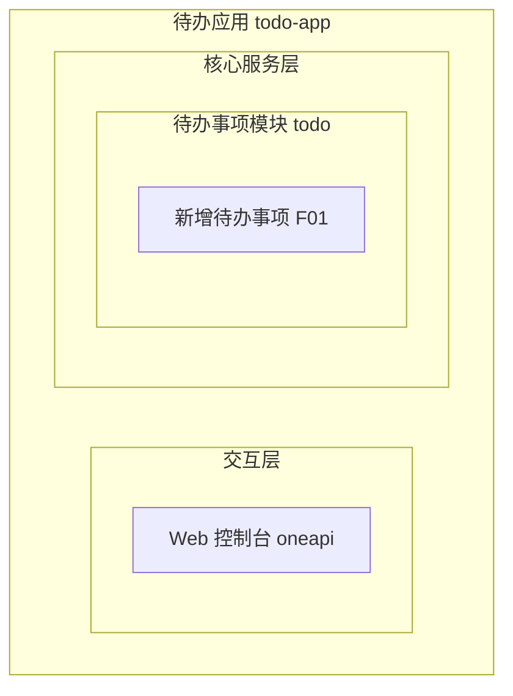
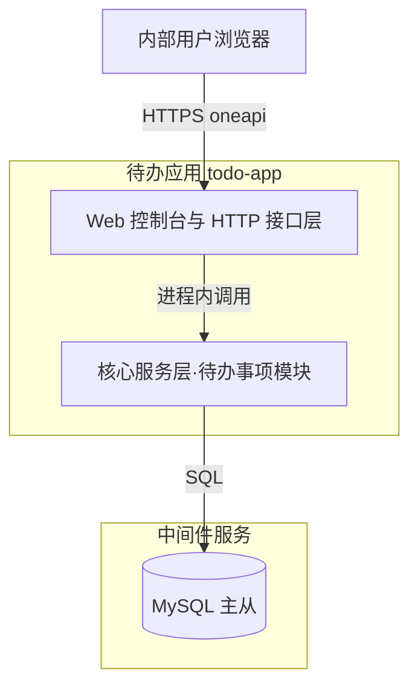
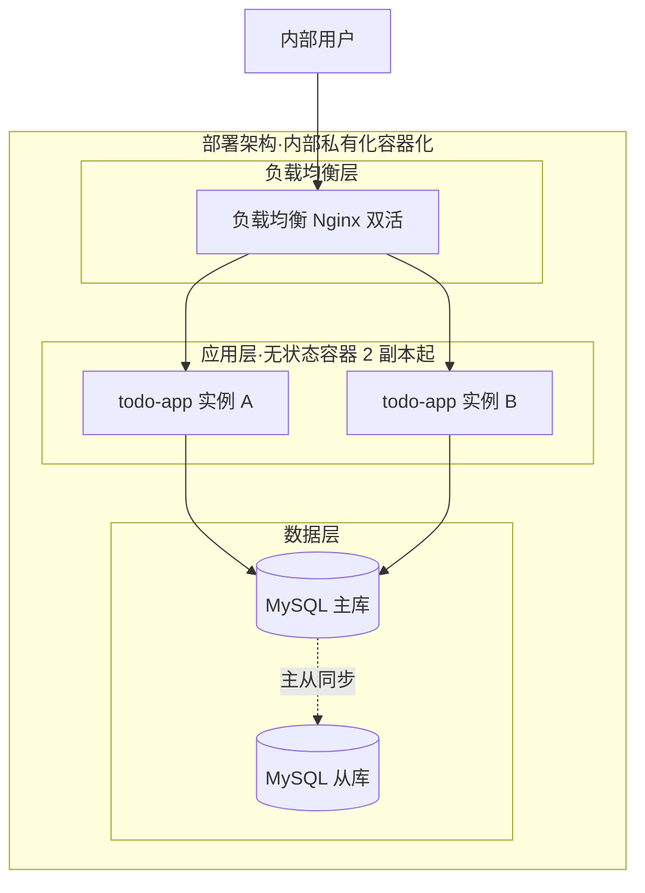
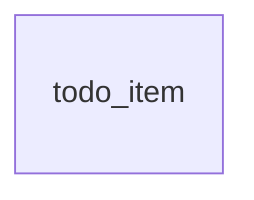
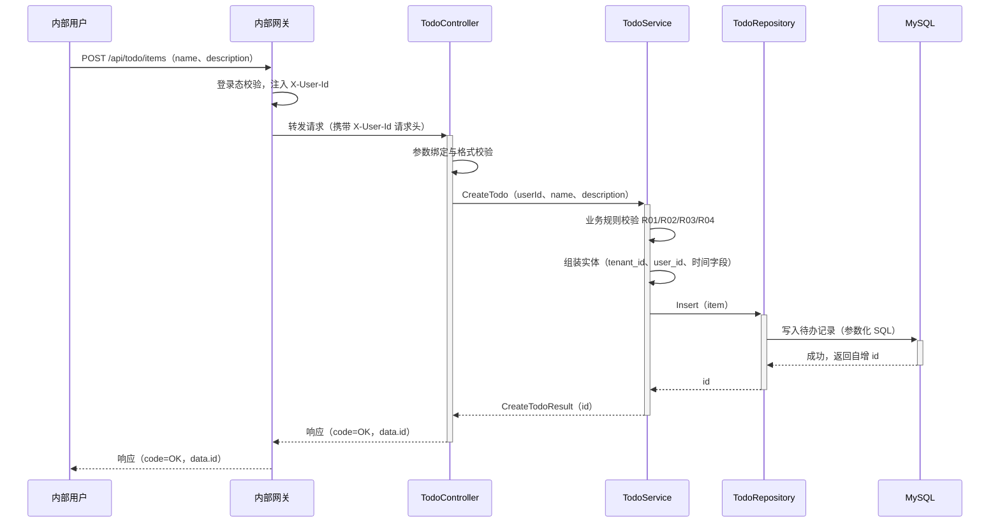

> **文档元信息**
>
> | 项目 | 内容 |
> |------|------|
> | 文档版本 | v1.0 |
> | 作者 | AiWork 系分流水线（自动生成） |
> | 创建日期 | 2026-10-27 |
> | 需求来源 | 任务需求描述（目标：帮助用户记录日常待办事项；核心功能：新增待办事项；任务信息：事项名称和描述；目标用户：内部用户；最小闭环：仅创建） |
> | 评审状态 | 待评审 |

# 待办事项记录（新增待办）系分设计
## 1. 需求与范围

### 1.1 背景与目标

内部用户在日常工作中需要随手记录待办事项，避免遗漏。本期建设一个面向内部用户的待办事项记录能力，目标是完成最小闭环：用户提交"事项名称 + 描述"，系统可靠地保存为一条待办记录，并返回该待办的唯一标识。

### 1.2 核心功能

- 新增待办事项：内部用户提交事项名称（必填）与描述（选填），系统校验后持久化保存，并返回待办标识。

### 1.3 约束与非功能要求

- 目标用户：内部用户，经内部统一认证体系登录（假设 A02）。
- 范围约束：最小闭环仅创建，不含查询/修改/完成/删除。
- 可用性：服务多副本部署，目标可用性 99.9%（假设，内部工具标准）。
- 性能：创建接口单次落库，目标 P99 ≤ 200ms（假设）。
- 数据可靠性：落库成功才向用户返回成功，杜绝"假成功"。

### 1.4 排除范围

- 待办的查询、列表、修改、完成、删除（后续迭代）
- 提醒/通知、日历集成、多人协作/分享
- 外部系统 OpenAPI 能力
- 移动端适配
- 多租户运营（表结构按 DB 规范预留 tenant_id，本期按单租户运行）

### 需求功能清单与优先级

| 编号 | 功能点 | 优先级 | PRD 原始描述/章节 | 备注 |
|------|--------|--------|-------------------|------|
| F01 | 新增待办事项 | P0 | 目标：帮助用户记录日常待办事项；核心功能：新增待办事项；任务信息：事项名称和描述；最小闭环：仅创建 | 本期唯一功能点 |

### 假设与待确认项

| 编号 | 假设/待确认内容 | 当前假设 | 确认状态 |
|------|-----------------|----------|----------|
| A01 | 事项描述是否必填 | 选填：名称必填、描述可空（日常记录场景中描述常为补充信息） | 待确认 |
| A02 | 内部用户身份获取方式 | 内部统一网关完成认证并注入用户标识请求头（X-User-Id），应用不自建账户体系 | 待确认 |
| A03 | 是否需要租户隔离 | 按 DB 设计规范预留 tenant_id 字段，默认 '0' 单租户运行 | 待确认 |
| A04 | 字段长度上限 | 名称 ≤128 字符、描述 ≤1024 字符 | 待确认 |
| A05 | 实现技术栈 | 沿用仓库现有 Go 语言技术栈（Gin + MySQL） | 待确认 |
## 2. 架构与模块

### 2.1 应用架构与技术栈选型

**应用架构方案对比：**

| 方案 | 说明 | 优势 | 劣势 |
|------|------|------|------|
| A. 单体分层应用 | 单应用内 Controller-Service-Repository 三层 | 改动最小、部署简单、无分布式复杂度 | 功能持续膨胀后需拆分（当前体量无此风险） |
| B. 微服务拆分 | 网关服务与待办服务独立部署 | 独立扩展 | 单功能点拆分过度，运维成本高 |
| C. Serverless | 函数计算 + 托管存储 | 免运维 | 内部私有化环境不适合，依赖平台设施 |

**推荐 A**：单一功能点、内部用户小体量，单体分层风险最低、符合最小闭环目标。

**技术栈方案对比：**

| 方案 | 说明 | 优势 | 劣势 |
|------|------|------|------|
| A. Go 标准库 net/http | 零三方依赖 | 无依赖引入 | 路由/参数绑定/中间件需自建 |
| B. Go + Gin | 轻量 Web 框架 | 路由、参数绑定校验、中间件生态成熟 | 引入一个框架依赖 |
| C. Java Spring Boot | 企业级框架 | 生态完善 | 与仓库 Go 现状不符，引入新语言栈成本高 |

**推荐 B**：仓库现状为 Go 工程（sort.go、review_test.go），沿用 Go 语言风险最低；Gin 为 Go 内部服务主流选择，参数绑定与统一中间件开箱即用。

存储选型：MySQL（InnoDB），详见 5.2.4 模块技术选型。

### 2.2 功能架构



- 交互层说明：内部用户通过 Web 控制台（oneapi 通道）访问新增待办入口。
- 核心服务层说明：待办事项模块负责待办的创建、业务规则校验与持久化，内部按 Controller-Service-Repository 三层组织。
- 扩展/集成层说明：本项不适用，原因：本期无外部系统集成需求。

**模块清单**

| 模块 | 职责 | 依赖 |
|------|------|------|
| 待办事项模块（todo） | 待办事项的创建、业务规则校验与持久化 | MySQL（数据存储） |

### 2.3 应用集成架构



**集成关系说明：**

| 调用方 | 被调用方 | 协议 | 接口类型 | 说明 |
|--------|----------|------|----------|------|
| 内部用户浏览器 | 待办应用 Web 控制台 | HTTPS | oneapi REST | 新增待办事项入口（W01） |
| 待办应用核心服务层 | MySQL | SQL（数据库驱动） | 内部 SQL | 待办记录持久化（参数化写入） |

外部依赖服务：本项不适用，原因：本期不集成任何外部系统 API。

### 2.4 部署架构



**部署说明：**
- **负载均衡层**：内部 SLB/Nginx 双活，健康检查自动摘除故障实例。
- **应用层**：容器化部署，无状态，≥2 副本，支持按流量水平扩容。
- **数据层**：MySQL 主从，主库故障自动切换；假设：内部已具备标准 MySQL 运维设施。
- 假设：内部应用按私有化默认容器化部署，无公有云同城双机房诉求。
## 3. 数据模型与存储

### 实体清单

| 实体名称 | 实体说明 | 所属模块 | 与其他实体的关系 |
|----------|----------|----------|-----------------|
| 待办事项（todo_item） | 用户记录的单条待办，含事项名称与描述 | 待办事项模块 | 独立实体，本期无关联实体 |

### 实体关系图



**模型说明：**
- 本期仅一个业务实体，无实体间关系；内部用户身份不单独建模（用户主数据归属内部统一账户体系，本系统仅存储 user_id 标识，属适度冗余）。
- 租户隔离：按 DB 设计规范默认预留 tenant_id 字段，当前单租户固定 '0'（假设 A03）。
- 缓存/MQ：本项不适用，原因：纯创建低频写场景，无缓存与异步消息需求。
- 实体命名遵循 DB 规范：表名小写、下划线组成、不使用复数、遵循"业务名称_表作用"（todo 业务 + item 条目）。
## 4. 接口设计

### 4.1 oneapi（Web 控制台接口）

| 编号 | 接口名称 | 方法 | 路径 | 模块 |
|------|----------|------|------|------|
| W01 | 新增待办事项 | POST | /api/todo/items | 待办事项模块 |

### 4.2 OpenAPI（对外接口）

本项不适用，原因：内部应用，无外部系统调用诉求。

### 4.3 内部接口（Service 层）

| 编号 | 接口名称 | 类 | 方法签名 |
|------|----------|------|----------|
| S01 | 创建待办 | TodoService | CreateTodo(ctx context.Context, req CreateTodoRequest) (CreateTodoResult, error) |
| D01 | 插入待办记录 | TodoRepository | Insert(ctx context.Context, item *TodoItem) (int64, error) |

### 4.4 集成接口（Integration 层）

本项不适用，原因：无外部系统集成。
## 5. 功能模块设计

### 5.1 全局约定

- 错误码格式：{MODULE}_{SEQ}，本期模块号 TODO；通用系统异常码 TODO_999。
- 通用出参结构：{code, msg, data}；code 为 "OK" 表示成功，其余为错误码。
- 模块映射表：

| 模块 | 模块号 | 主表 | 接口前缀 |
|------|--------|------|----------|
| 待办事项模块 | TODO | todo_item | /api/todo |
### 5.2 待办事项模块（todo）

#### 5.2.1 表结构设计

##### 5.2.1.1 待办事项表 todo_item

（命名遵循 DB 规范：表名 todo_item = 业务名称 todo + 表作用 item，小写下划线、非复数；字段追加于主键之后；禁止 timestamp/float/enum 类型）

| 字段名 | 数据类型 | 约束 | 默认值 | 说明 |
|--------|----------|------|--------|------|
| id | bigint unsigned | PK，自增 | - | 系统自增主键（整型单列主键） |
| tenant_id | varchar(16) | NOT NULL | '0' | 租户标识（DB 规范默认预留；当前单租户固定 '0'） |
| user_id | varchar(64) | NOT NULL | - | 创建人用户标识（内部用户，水平权限隔离维度） |
| name | varchar(128) | NOT NULL | - | 事项名称 |
| description | varchar(1024) | NOT NULL | '' | 事项描述（选填，空存空串） |
| gmt_create | datetime | NOT NULL | CURRENT_TIMESTAMP | 创建时间（代码逻辑维护，默认值兜底） |
| gmt_modified | datetime | NOT NULL | CURRENT_TIMESTAMP | 修改时间（代码逻辑维护，默认值兜底） |

表级约定：
- 引擎/字符集：库表默认 InnoDB 与 utf8mb4，不显式指定存储引擎与字段字符集（DB 规范强制）。
- 事务隔离级别：ReadCommitted（DB 规范强制）。

**索引：**
- PK：pk_todo_item（id）
- 唯一索引：无，原因：允许同名待办重复创建（同一用户可创建多条同名待办，属合理业务行为）。
- 普通索引：本期不建，原因：最小闭环仅创建，无查询路径；待列表查询需求落地时，按左前缀与筛选性原则补充（以 user_id 等高筛选性列开头的联合索引）。

##### 5.2.1.2 枚举与常量定义

本模块无枚举/常量定义，原因：最小闭环仅创建，未引入 status/type 等有限取值字段（"未完成/已完成"状态属后续"完成待办"需求，落地时再引入）。

#### 5.2.2 接口详细设计

##### W01 新增待办事项

- **URI**: POST /api/todo/items
- **描述**: 内部用户新增一条待办事项（名称+描述），系统校验后持久化，并返回待办标识
- **入参**:

| 参数名称 | 类型 | 是否必填 | 描述 |
|----------|------|----------|------|
| X-User-Id（请求头） | string | 是 | 内部统一网关认证后注入的创建人标识，终端不可自定义 |
| name | string | 是 | 事项名称；去除首尾空白后长度 1~128 字符 |
| description | string | 否 | 事项描述；最长 1024 字符，缺省空串 |

- **出参**:

| 参数名称 | 类型 | 描述 |
|----------|------|------|
| code | string | 结果码，"OK" 表示成功，其余为错误码 |
| msg | string | 提示信息 |
| data.id | int64 | 新建待办的主键标识 |

- **错误码**:

| 错误码 | 说明 |
|--------|------|
| TODO_001 | 参数校验失败（名称为空/超长、描述超长） |
| TODO_002 | 用户身份缺失或非法 |
| TODO_999 | 系统内部异常（如数据库不可用） |

- **业务规则**: 见 5.2.3.1 业务规则表 R01~R04

- **请求示例**:
```json
{
  "name": "整理周报",
  "description": "汇总本周迭代进展，周五下班前完成"
}
```

- **响应示例**:
```json
{
  "code": "OK",
  "msg": "SUCCESS",
  "data": { "id": 10001 }
}
```

##### S01 创建待办（内部接口 · TodoService.CreateTodo）

- **方法签名**: CreateTodo(ctx context.Context, req CreateTodoRequest) (CreateTodoResult, error)
- **入参**:

| 参数名称 | 类型 | 是否必填 | 描述 |
|----------|------|----------|------|
| req.userId | string | 是 | 创建人标识（取自网关注入的 X-User-Id） |
| req.name | string | 是 | 事项名称（已去首尾空白） |
| req.description | string | 否 | 事项描述，缺省空串 |

- **出参**:

| 参数名称 | 类型 | 描述 |
|----------|------|------|
| result.id | int64 | 新建待办主键标识 |

- **错误码**: TODO_001（规则校验失败）、TODO_999（落库失败），透传给接口层
- **职责**: 业务规则校验（R01/R02/R03/R04）、实体组装（补 tenant_id='0'、user_id、时间字段）、调用 Repository 落库

##### D01 插入待办记录（内部接口 · TodoRepository.Insert）

- **方法签名**: Insert(ctx context.Context, item *TodoItem) (int64, error)
- **入参**: TodoItem 实体（字段同 5.2.1.1 表结构）
- **出参**: 自增主键 id（int64）
- **错误**: 数据库错误包装后上抛，由 Service 映射为 TODO_999
- **约束**: 一律使用参数化 SQL，禁止字符串拼接（防 SQL 注入）

#### 5.2.3 子功能详细设计

##### 5.2.3.1 新增待办事项（F01）

**处理时序图**



**业务规则：**

| 规则编号 | 规则描述 | 校验时机 | 不满足时的处理 |
|----------|----------|----------|--------------|
| R01 | 事项名称必填：去除首尾空白后长度 1~128 字符 | 创建时（Controller 前置 + Service 复核） | 返回 TODO_001，提示"事项名称不能为空且不超过128字符" |
| R02 | 事项描述选填：最长 1024 字符 | 创建时 | 返回 TODO_001，提示"描述不超过1024字符" |
| R03 | 创建人身份必须存在且合法（X-User-Id 非空） | 创建时（网关认证 + 应用层兜底双重校验） | 返回 TODO_002，提示"用户未登录或身份非法" |
| R04 | 待办归属人 user_id 一律取网关注入身份，不信任前端传入 | 创建时 | 返回 TODO_002（防越权代建） |

**异常场景：**

| 异常场景 | 处理方式 |
|----------|----------|
| 名称/描述为空或超长 | Controller 层参数校验拦截，返回 TODO_001，不触达 DB |
| 用户身份缺失（绕过网关直连或请求头丢失） | 应用层兜底校验失败，返回 TODO_002 |
| 数据库连接失败/写入超时 | Repository 返回错误，Service 映射为 TODO_999；单条插入失败即整体失败，无补偿需求 |
| 用户重复提交（双击/网络重试） | 无唯一约束，产生两条记录，属可接受业务行为；不做幂等（见并发控制） |
| 事务说明 | 单表单条插入，天然原子；无跨表事务编排需求，无需回滚策略设计 |

**并发控制：**
- 并发场景：多用户/同一用户并发创建待办。
- 控制策略：无并发风险，原因：纯新增写入、自增主键由 DB 分配、无唯一约束与共享可变资源；InnoDB 行级锁与自增 id 机制天然隔离并发插入，无需应用层加锁或幂等设计。

**状态机设计：** 本项不适用，原因：实体无状态字段，仅创建、无状态流转。

#### 5.2.4 模块技术选型

**存储方案对比：**

| 方案 | 优势 | 劣势 |
|------|------|------|
| MySQL（InnoDB） | 事务/主从/备份/监控生态成熟，多副本应用可共享持久层 | 需独立部署与运维 |
| SQLite | 零运维、嵌入式 | 并发写入弱，多副本无法共享数据 |
| 文件/JSON 存储 | 实现最简 | 无事务保障，多副本数据不一致 |

**推荐 MySQL**：无状态多副本应用需共享持久层；假设内部已具备标准 MySQL 运维设施（主从、备份、监控）。

#### 5.2.5 模块自检

- 完备性对账：F01 新增待办 ↔ W01/S01/D01 接口（5.2.2）+ 子功能设计（5.2.3.1）+ todo_item 表（5.2.1.1），链路齐备。
- 过度设计检查：未引入 status 状态字段、未建二级索引、未加缓存/MQ/唯一键、未做幂等与分布式锁，与"最小闭环仅创建"匹配；tenant_id 为 DB 规范默认预留（已记为假设 A03）。

**跨模块调用链：** 本项不适用，原因：本期仅一个业务模块，无跨模块调用。
## 6. 非功能性需求设计

### 6.1 高可用性
- 应用层：todo-app 无状态，≥2 副本容器化部署，负载均衡双活转发，单实例故障自动摘除。
- 数据层：MySQL 主从架构，主库故障自动切换（假设：内部已具备标准 MySQL 运维设施）。
- 降级策略：创建链路唯一依赖为 MySQL，DB 不可用时快速失败返回 TODO_999，不做本地排队或异步补偿重试，避免重复写入与"假成功"；无其他第三方依赖，无可降级点。

### 6.2 可扩展性
- 水平扩展：应用无状态，可按流量直接扩容副本数。
- 数据扩展：按内部用户日常记录量预估，单表数据量远低于 500w 阈值；超阈值时按 DB 规范评估以 user_id 为分表键的水平拆分。
- 功能扩展：后续查询/完成/删除需求以新增接口、新增字段（如 status）方式演进；新增列按规范追加在已有字段之后并设默认值。

### 6.3 稳定性/可靠性
- 限流：网关层对 /api/todo/items 配置单用户限流（假设 10 QPS）与全局阈值，防突发刷接口。
- 性能：单条参数化插入、无复杂事务，目标 P99 ≤ 200ms。
- 可靠性：参数校验前置在应用层完成，无效请求不触达 DB；落库成功才返回成功，杜绝假成功。

### 6.4 安全性设计

#### 6.4.1 账户系统方案
复用内部统一认证体系：登录态由内部网关统一校验；应用不自实现登录/注册/找回密码。

#### 6.4.2 授权&访问控制
##### 6.4.2.1 是否实现水平权限检查
本期仅创建、无读取场景：创建时 user_id 强制取网关注入身份（R04），不信任前端传入，杜绝越权代建；待办查询接口上线时补充资源归属校验（owner 与当前用户一致性）。
##### 6.4.2.2 是否实现垂直权限检查
不涉及：内部应用单一功能，所有合法登录用户均可创建待办，无角色与管理面区分。
##### 6.4.2.3 是否检查登录态
全局统一：网关登录态拦截 + 应用层校验 X-User-Id 存在性（双保险），未认证请求返回 TODO_002。

#### 6.4.3 数据防护方案
##### 6.4.3.1 是否对敏感数据加密存储
不适用，原因：待办名称/描述为一般级别的个人工作记录，无身份证/银行卡等强敏感字段，按内部数据分级标准不加密存储。
##### 6.4.3.2 是否对敏感数据展示进行脱敏
本期无展示场景（创建接口仅返回 id）；日志中不打印 description 全文（仅记录长度或截断摘要），防止个人记录内容扩散到日志系统。

### 6.5 监控/统计/日志/告警
- 监控点：W01 接口 QPS、成功率（按错误码维度）、耗时 P50/P99；DB 插入耗时与错误数、连接池使用率。
- 日志：结构化日志记录 trace 标识、user_id、todo id、耗时；不含描述全文。
- 告警：错误率 >1% 持续 5 分钟、P99 >500ms、DB 不可用时即时告警。
## 7. 变更三板斧

### 7.1 可监控
- 服务埋点：W01 接口调用次数、处理结果（成功数/各错误码计数）、处理耗时（P50/P99）。
- DB 埋点：INSERT 耗时、失败次数、连接池使用率。
- 日志：每次创建记录 trace 标识、user_id、todo id、耗时，便于问题定位与审计（不含描述全文，见 6.4.3.2）。
- 告警阈值见 6.5。

### 7.2 可灰度
方案对比：

| 方案 | 说明 | 优劣 |
|------|------|------|
| 直接全量 | 上线即对所有内部用户开放 | 最快；风险暴露面大 |
| 用户尾号灰度 | 按用户标识尾号分批放量 | 需网关/应用支持分流规则，成本中等 |
| 白名单试点 | 先对试点用户组开放，观察后全量 | 成本最低、验证充分 |

推荐：白名单试点（配置化白名单），观察 1 个工作日后全量。理由：内部用户小体量，白名单的实现与回退都最简单。

### 7.3 可应急
- 开关控制：保留配置开关（todo_create_enabled），关闭后 W01 直接返回"功能维护中"（HTTP 503），不触达 DB，实现秒级止血。
- 回滚兜底：全新功能 + 全新表，直接回滚应用发布包即可；旧版本代码不访问 todo_item 表，表保留不影响运行。
- 上下游兼容：上游仅 Web 入口按钮，随前端同版本回滚；无下游系统依赖，回滚无级联影响。
## 8. 方案自检（19 项 Checklist）

| # | 检查项 | 结论 | 说明 |
|---|--------|------|------|
| 1 | 模块划分合理性 | 通过 | 单模块单一职责（待办创建）；无循环依赖；无功能点占比超 50% 的模块（模块内仅 F01 一个功能点） |
| 2 | 依赖关系合理性 | 通过 | 唯一下游为 MySQL；DB 异常时快速失败返回 TODO_999，应用自身可用性不受影响 |
| 3 | 单点问题（部署层面） | 通过 | 负载均衡双活、应用 ≥2 副本、MySQL 主从自动切换，无单点 |
| 4 | 表模型设计范式 | 通过 | todo_item 满足 1NF/2NF/3NF：字段原子、非主属性均直接依赖主键、无传递依赖 |
| 5 | 隐私安全 | 通过 | 无强敏感字段；日志不打印描述全文；已设计网关认证、身份兜底校验与防越权代建（R04） |
| 6 | 兼容性检查（接口） | 不适用 | 全新接口，无旧调用方 |
| 7 | 兼容性检查（表） | 不适用 | 全新表，无存量访问方 |
| 8 | 数据迁移检查 | 不适用 | 新增表，无字典数据与初始化数据需求 |
| 9 | 一致性检查（功能点） | 通过 | F01 → 5.2.2 W01/S01/D01 接口设计 + 5.2.3.1 子功能设计，链路齐备 |
| 10 | 一致性检查（表） | 通过 | Step 3 实体 todo_item → 5.2.1.1 完整表结构（含索引与表级约定） |
| 11 | 一致性检查（接口） | 通过 | Step 4 的 W01/S01/D01 → 5.2.2 均有详细定义（入参/出参/错误码/示例） |
| 12 | 一致性检查（枚举） | 不适用 | 实体无枚举字段（已在 5.2.1.2 说明原因） |
| 13 | 状态机完整性 | 不适用 | 实体无状态字段，仅创建、无流转（已在 5.2.3.1 说明原因） |
| 14 | 并发风险检查 | 通过 | 方案对比：无锁（纯新增+自增主键+无唯一约束） vs 乐观锁 vs 分布式锁；推荐无锁，理由：无共享可变资源，DB 自增机制天然隔离并发插入 |
| 15 | 单点问题（定时任务层面） | 不适用 | 本期无定时任务 |
| 16 | 非功能性设计可行性 | 通过 | 多副本/主从/网关限流/参数化 SQL/metrics 埋点均为内部标准设施常规手段，可落地 |
| 17 | 三板斧-可监控可行性 | 通过 | 标准 metrics + 结构化日志，实现成本低 |
| 18 | 三板斧-可灰度可行性 | 通过 | 白名单试点方案（对比全量/尾号灰度），配置化实现，成本最低（7.2） |
| 19 | 三板斧-可应急可行性 | 通过 | 配置开关秒级止血 + 发布包回滚；全新功能+全新表，回滚无上下游兼容负担（7.3） |

**自检结论**：19 项中 13 项通过、6 项不适用（均附原因说明）、0 项不通过，无需修复项。
