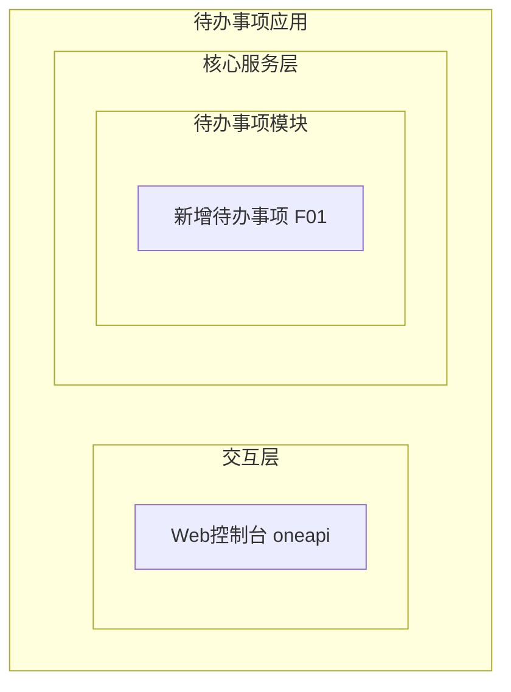
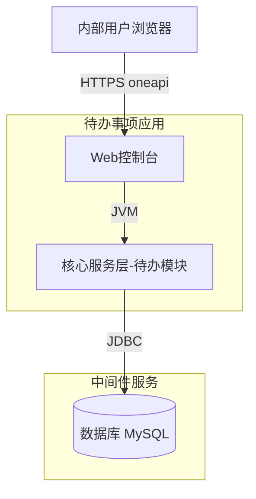
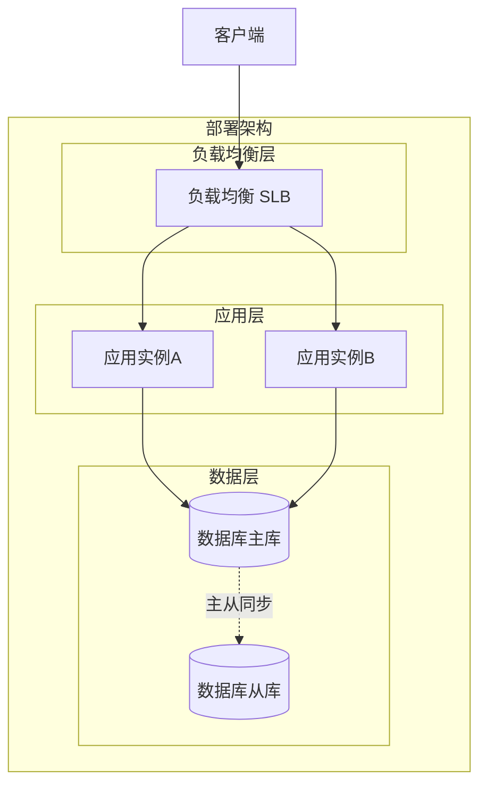
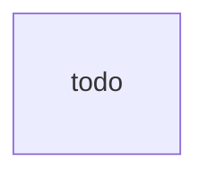
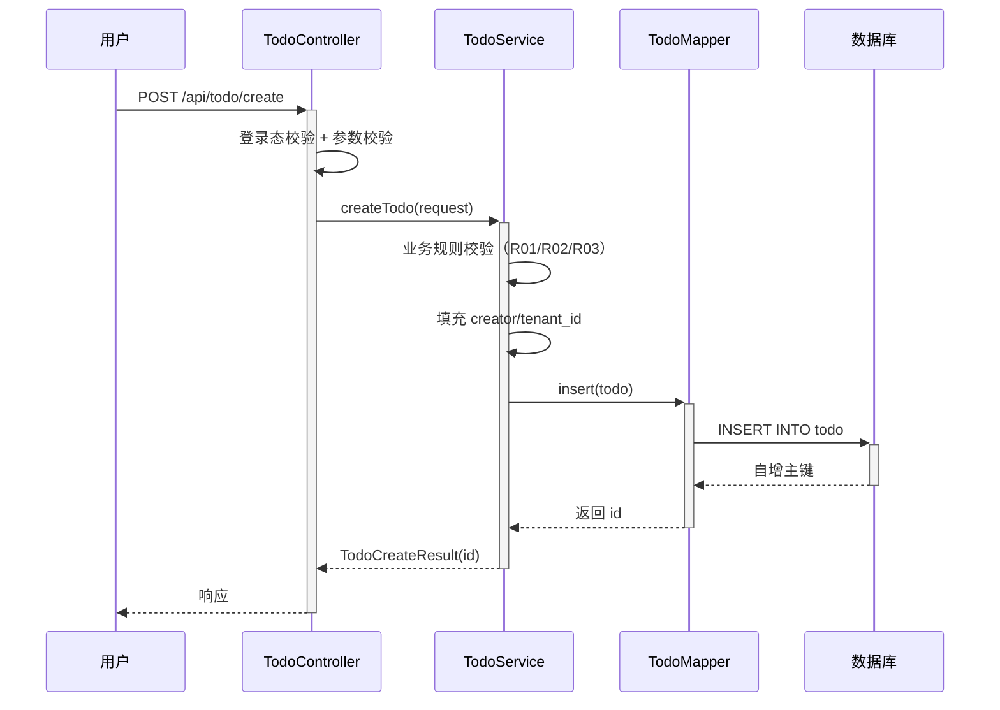

> **文档元信息**
>
> | 项目 | 内容 |
> |------|------|
> | 文档版本 | v1.0 |
> | 作者 | AiWork |
> | 创建日期 | 2026-10-28 |
> | 需求来源 | 任务：帮助用户记录日常待办事项（核心功能：新增待办事项） |
> | 评审状态 | 待评审 |

# 待办事项（新增）系分设计

## 1. 需求与范围

### 背景与目标
帮助内部用户记录日常待办事项。本期实现最小闭环：**新增待办事项**。用户提交事项名称（必填）与描述（选填）后持久化保存，形成可追溯的待办记录，为后续待办管理（查询、完成、删除等）奠定数据基础。

### 核心功能
- 新增待办事项：录入事项名称与描述，保存为一条待办记录。

### 约束与非功能要求
- 仅内部用户使用，需登录态校验。
- 数据按用户隔离，不同用户互不可见。
- 创建接口需具备基本可用性与可监控、可灰度、可应急能力。

### 排除范围
- 待办事项的编辑、删除、查询列表、完成/状态流转、提醒通知均不在本期。
- 用户登录注册流程不在本期（复用既有内部登录态）。
- 多租户管理后台不在本期（默认单租户）。

### 需求功能清单与优先级

| 编号 | 功能点 | 优先级 | PRD 原始描述 | 备注 |
|------|--------|--------|--------------|------|
| F01 | 新增待办事项 | P0 | 核心功能：新增待办事项；任务信息：事项名称和描述 | 最小闭环：仅创建 |

### 假设与待确认项

| 编号 | 假设/待确认内容 | 当前假设 | 确认状态 |
|------|-----------------|----------|----------|
| A01 | 无既有架构文档 | 仓库无 SSOT.md / docs，按通用单体分层架构全新设计 | 待确认 |
| A02 | 内部用户身份来源 | 来自登录上下文（SSO/IAM），本期不自实现登录 | 待确认 |
| A03 | 租户模型 | 单租户内部部署，tenant_id 预留空值 | 待确认 |
| A04 | 描述是否必填 | description 允许空串，限长 1000 | 待确认 |
| A05 | 是否需要状态字段 | 本期不引入 status，仅创建无流转需求 | 待确认 |

## 2. 架构与模块

### 功能架构

- 交互层说明：内部用户通过 Web 控制台 oneapi 访问。
- 核心服务层说明：待办事项模块负责接收创建请求、校验、持久化。
- 扩展/集成层说明：本期无扩展/集成层。

**模块清单**

| 模块 | 职责 | 依赖 |
|------|------|------|
| 待办事项模块（todo） | 接收待办创建请求，参数校验，持久化待办记录 | 数据库 |

### 应用集成架构


**集成关系说明：**

| 调用方 | 被调用方 | 协议 | 接口类型 | 说明 |
|--------|----------|------|----------|------|
| 内部用户浏览器 | 应用 Web 控制台 | HTTPS | oneapi REST | 调用新增待办接口 |
| 应用核心服务层 | 数据库 | JDBC | SQL | 插入待办记录 |

### 部署架构


**部署说明：**
- **负载均衡层**：SLB 入口，流量分发至多实例。
- **应用层**：无状态应用多副本容器化部署，支持滚动发布。
- **数据层**：MySQL 主从架构，主写从读（本期仅写主库）。

## 3. 数据模型与存储

### 实体清单

| 实体名称 | 实体说明 | 所属模块 | 与其他实体的关系 |
|----------|----------|----------|-----------------|
| todo（待办事项） | 用户记录的一条日常待办 | 待办事项模块 | 无关联实体 |

### 实体关系图

单实体，无关系连线。字段详细定义在第 5 章完成。

**模型说明：**
- 本期仅一个待办实体，无实体间关系。
- 缓存/MQ：本项不适用，原因：本期仅单表写入，无缓存或消息队列需求。

## 4. 接口设计

### 4.1 oneapi（Web 控制台接口）

| 编号 | 接口名称 | 方法 | 路径 | 模块 |
|------|----------|------|------|------|
| W01 | 新增待办事项 | POST | /api/todo/create | 待办事项模块 |

### 4.2 OpenAPI（对外接口）
本项不适用，原因：目标用户为内部用户，无对外接口需求。

### 4.3 内部接口（Service 层）

| 编号 | 接口名称 | 类 | 方法签名 |
|------|----------|------|----------|
| S01 | 创建待办 | TodoService | TodoCreateResult createTodo(TodoCreateRequest request) |

### 4.4 集成接口（Integration 层）
本项不适用，原因：无外部系统集成。

## 5. 功能模块设计

### 全局约定
- **错误码格式**：`{MODULE}_{SEQ}`，MODULE 大写，SEQ 三位数字。本模块 `MODULE = TODO`。
- **通用出参结构**：

| 参数名称 | 类型 | 描述 |
|----------|------|------|
| result | String | 结果 code，OK 表示成功 |
| msg | String | 提示信息 |
| data | Object | 业务数据 |

- **模块错误码映射**：

| 模块 | 前缀 |
|------|------|
| 待办事项模块 | TODO_ |

### 5.1 待办事项模块

#### 5.1.1 表结构设计

##### 5.1.1.1 todo（待办事项表）

| 字段名 | 数据类型 | 约束 | 默认值 | 说明 |
|--------|----------|------|--------|------|
| id | bigint | PK, 自增 | - | 系统自增主键 |
| title | varchar(100) | NOT NULL | - | 事项名称 |
| description | varchar(1000) | NOT NULL | '' | 事项描述，允许空串 |
| creator | varchar(64) | NOT NULL | '' | 创建人（登录用户标识） |
| tenant_id | varchar(32) | NOT NULL | '' | 租户标识，默认单租户空值 |
| gmt_create | datetime | NOT NULL | CURRENT_TIMESTAMP | 创建时间 |
| gmt_modified | datetime | NOT NULL | CURRENT_TIMESTAMP | 修改时间 |

**索引：**
- IDX: `idx_todo_tenant_creator` (tenant_id, creator) —— 按租户+创建人查询待办列表（本期查询暂未实现，索引为后续列表场景预留）。
- UK: 无业务唯一约束（待办允许同名重复创建）。

> 注：遵循 references/db.md 规范——整形单列主键、表名/字段名小写下划线、datetime（非 timestamp）、varchar 非 PK、索引列 NOT NULL 带 default、新增表含 id/gmt_create/gmt_modified。

##### 5.1.1.2 枚举与常量定义
本模块无枚举/常量定义。

#### 5.1.2 接口详细设计

##### W01 新增待办事项（F01）

- **URI**: POST `/api/todo/create`
- **描述**: 内部用户录入事项名称与描述，保存为一条待办记录。
- **入参**:

| 参数名称 | 类型 | 是否必填 | 描述 |
|----------|------|----------|------|
| title | String | 是 | 事项名称，长度 1~100 |
| description | String | 否 | 事项描述，长度 0~1000 |

- **出参**:

| 参数名称 | 类型 | 描述 |
|----------|------|------|
| result | String | 结果 code |
| msg | String | 提示信息 |
| data | Object | 业务数据 |
| data.id | Long | 新建待办 ID |

- **错误码**:

| 错误码 | 说明 |
|--------|------|
| TODO_001 | 事项名称为空或空白 |
| TODO_002 | 事项名称或描述长度超限 |
| TODO_003 | 待办创建失败（系统异常） |

- **业务规则**: 校验事项名称非空且长度合规、描述长度合规；creator 与 tenant_id 取登录上下文，不允许前端传入。

- **请求示例**:
```json
{
  "title": "整理周报",
  "description": "汇总本周交付与下周计划"
}
```

- **响应示例**:
```json
{
  "result": "OK",
  "msg": "SUCCESS",
  "data": {
    "id": 1001
  }
}
```

#### 5.1.3 子功能详细设计

##### 5.1.3.1 新增待办事项（F01）

- 处理时序图


**业务规则：**

| 规则编号 | 规则描述 | 校验时机 | 不满足时的处理 |
|----------|----------|----------|--------------|
| R01 | title 非空且非纯空白 | 创建时 | 返回 TODO_001，提示"事项名称不能为空" |
| R02 | title 长度 ≤ 100 | 创建时 | 返回 TODO_002，提示"事项名称长度超限" |
| R03 | description 长度 ≤ 1000 | 创建时 | 返回 TODO_002，提示"事项描述长度超限" |
| R04 | creator、tenant_id 取登录上下文，禁前端传入 | 创建时（填充前） | 缺失登录态由全局拦截器拒绝；不满足则不写入 |

**异常场景：**

| 异常场景 | 处理方式 |
|----------|----------|
| 数据库写入异常（连接/约束/超时） | 捕获异常，返回 TODO_003，记录日志与告警 |
| 登录态缺失 | 全局拦截器拦截，返回未登录错误（非本接口处理） |
| 入参 JSON 解析失败 | 框架层返回参数格式错误 |

**并发控制（涉及数据写入）：**
- 并发场景：多用户或同用户并发提交新增待办。
- 控制策略：无并发风险，原因：纯 INSERT 操作、自增主键、不同记录互不冲突；无唯一约束竞争。无需乐观锁/分布式锁/幂等键。

**状态机设计：**
本模块无状态字段，本项不适用，原因：本期仅创建，不引入 status 字段与状态流转。

**技术选型方案对比（并发控制）：**

| 方案 | 优点 | 缺点 |
|------|------|------|
| A. 自增主键直接插入 | 简单、无锁、高吞吐 | — |
| B. 分布式锁 + 幂等键 | 防重复提交 | 本期无防重需求，过度设计 |

推荐 A：待办创建无唯一性约束，重复提交即产生多条记录符合业务语义；直接插入最优。

#### 5.1.4 模块自检

**完备性对账：**

| 检查维度 | 状态 | 说明 |
|----------|------|------|
| F01 功能点 | 已覆盖 | W01/S01 + 时序 + 规则 + 异常 |
| 表结构 | 已定义 | todo 表 7 字段 + 索引 |
| 接口 | 已定义 | W01 入参/出参/错误码/示例 |
| 业务规则 | 已定义 | R01~R04 |
| 异常场景 | 已定义 | DB 异常/登录态/解析失败 |
| 并发控制 | 已定义 | 无风险 + 方案对比 |

**过度设计检查：** 未引入 status 状态机、未引入 MQ/缓存、未引入外部依赖、未引入分布式锁/幂等键，符合"最小闭环：仅创建"。`idx_todo_tenant_creator` 为后续列表查询预留，属合理前瞻，未展开列表逻辑。

## 6. 非功能性需求设计

### 6.1 高可用性
服务多副本部署 + SLB；数据库主从。单实例故障由负载均衡剔除，不影响整体可用。无第三方依赖需降级。

### 6.2 可扩展性
应用层无状态，可横向扩缩容；数据层未来可按 tenant_id / creator 维度分表扩展。

### 6.3 稳定性/可靠性
创建接口做严格参数校验与异常捕获；DB 写入失败返回明确错误码 TODO_003 并告警，避免静默失败。

### 6.4 安全性设计

#### 6.4.1 账户系统方案
复用内部登录态（SSO/IAM），本期不自实现登录注册。假设：内部用户身份由登录上下文提供。

#### 6.4.2 授权&访问控制

##### 6.4.2.1 是否实现水平权限检查
是。待办按 `creator` 隔离：创建时写入当前登录用户 creator；后续查询场景（本期暂无）按 creator 过滤，确保用户只能访问自己的待办。

##### 6.4.2.2 是否实现垂直权限检查
不适用，原因：内部用户均具备"新增待办"权限，无需细分角色。

##### 6.4.2.3 是否检查登录态
是。全局统一拦截器校验登录态，未登录请求拦截于接口之外。

#### 6.4.3 数据防护方案

##### 6.4.3.1 是否对敏感数据加密存储
不适用，原因：title/description 为普通业务文本，不涉及身份证/银行卡等敏感信息。

##### 6.4.3.2 是否对敏感数据展示进行脱敏
日志打印对 creator 做脱敏处理；title/description 不涉及敏感信息，无需脱敏。

### 6.5 监控/统计/日志/告警
埋点：`createTodo` 调用次数、成功/失败计数、处理耗时（P99）；DB 写入失败告警。

### 6.6 限流降级
本项不适用，原因：内部用户量小、低流量场景，暂无限流降级需求。

## 7. 变更三板斧

### 7.1 可监控
`createTodo` 接口埋点：调用次数、成功/失败计数、处理耗时 P99；数据库写入异常触发告警。监控粒度到接口级。

### 7.2 可灰度
方案对比：

| 方案 | 优点 | 缺点 |
|------|------|------|
| A. 按 tenant_id 尾号灰度 | 粒度可控 | 单租户场景无意义 |
| B. 功能开关（feature_todo_create）灰度 | 简单、开关即时生效 | 粒度为全量开关 |

推荐 B：内部单租户部署，按租户灰度无意义；功能开关即可满足灰度与回切需求。采用功能开关方案。

### 7.3 可应急
保留功能开关 `feature_todo_create`：关闭后接口直接返回"功能暂不可用"，快速止血。纯新增表、无旧逻辑兼容风险，无需回滚表结构；如需彻底回退，下线接口路由即可，无上下游依赖。

## 8. 方案检查（Step 9 checklist）

| 检查项 | 结果 | 说明 |
|------|------|------|
| 模块划分合理性 | 通过 | 单一职责、单一模块、无循环依赖 |
| 依赖关系合理性 | 通过 | 仅依赖 DB，无下游异常风险 |
| 单点问题（部署） | 通过 | 多副本 + SLB + 主从，无单点 |
| 表模型设计范式 | 通过 | 满足 3NF，单表无冗余 |
| 隐私安全检查 | 通过 | 无敏感字段，creator 日志脱敏 |
| 兼容性检查（接口） | 通过 | 全新接口，无旧调用方 |
| 兼容性检查（表） | 通过 | 全新表，无变更兼容问题 |
| 数据迁移检查 | 通过 | 新增表无迁移、无初始化数据需求 |
| 一致性检查（功能点） | 通过 | F01 在 5.1 完整设计 |
| 一致性检查（表） | 通过 | todo 实体在 5.1.1 完整定义 |
| 一致性检查（接口） | 通过 | W01/S01 在 5.1.2 详细定义 |
| 一致性检查（枚举） | 不适用 | 无枚举字段 |
| 状态机完整性 | 不适用 | 无状态字段 |
| 并发风险检查 | 通过 | 纯插入无并发风险，方案 A 推荐 |
| 单点问题（定时任务） | 不适用 | 无定时任务 |
| 非功能性设计可行性 | 通过 | 多副本+开关可落地 |
| 三板斧（可监控） | 通过 | 接口级埋点可行 |
| 三板斧（可灰度） | 通过 | 功能开关推荐方案可行 |
| 三板斧（可应急） | 通过 | 开关回切，无回滚依赖 |

检查结论：19 项全部通过或不适用，无修复项。
