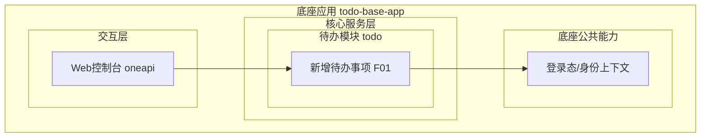
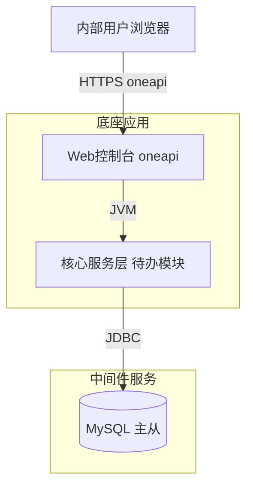
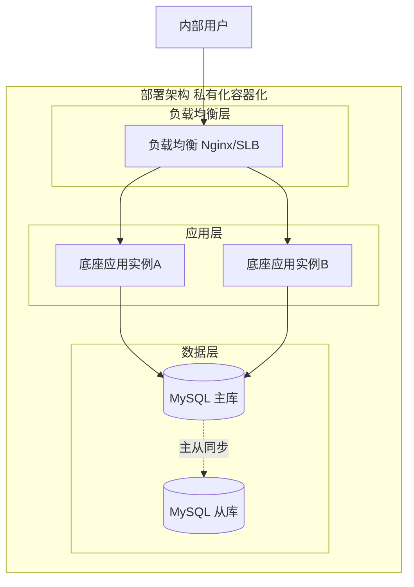
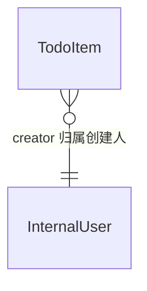
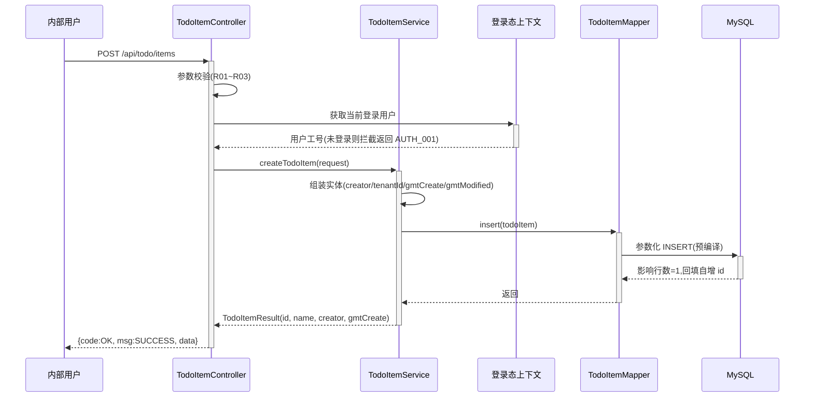

> **文档元信息**
>
> | 项目 | 内容 |
> |------|------|
> | 文档版本 | v1.0 |
> | 作者 | AIWork Agent(系分生成流水线) |
> | 创建日期 | 2026-11-27 |
> | 需求来源 | 任务需求描述:底座变更——帮助用户记录日常待办事项(核心功能:新增待办事项;任务信息:事项名称和描述;目标用户:内部用户;最小闭环:仅创建) |
> | 评审状态 | 待评审 |

# 待办事项——新增待办 系分设计

## 1. 需求与范围

### 1.1 背景与目标

- 背景:底座需要为内部用户提供日常事务记录能力。当前底座仓库尚无业务功能(空底座),本次以"待办事项"作为首个业务能力横向接入。
- 目标:帮助内部用户记录日常待办事项,本次交付**最小闭环——仅"新增待办事项"**:用户提交事项名称与描述即可完成一次记录。
- 价值:形成"记录"入口,为后续查询、完成、提醒等迭代打底(表结构与模块边界按可扩展设计,但不在本次实现)。

### 1.2 核心功能

1. 新增待办事项:内部用户在 Web 控制台提交"事项名称"(必填)与"事项描述"(选填),系统校验通过后落库,返回创建结果(含系统生成的待办 ID 与创建时间)。
2. 创建者归属:创建人身份由服务端从登录态获取,不信任前端传入。

### 1.3 约束与非功能要求

- 目标用户:内部用户,必须持有有效登录态(底座统一认证)方可调用。
- 数据规范:遵循底座数据库设计规范(单列自增整型主键、datetime 时间字段、utf8mb4、禁 enum/timestamp/float、索引前缀 pk_/uk_/idx_)。
- 错误码规范:{MODULE}_{SEQ}(如 TODO_001)。
- 出参规范:统一 {code, msg, data} 结构。
- 数据规模预期:内部用户量级小,单表写入频率低,无分库分表诉求。

### 1.4 排除范围(明确不做)

- 待办事项的查询/列表/详情接口。
- 待办的修改、删除、完成/勾选、状态流转。
- 提醒、通知、到期时间、优先级、标签、排序。
- 批量导入/导出、多人协同、分享。
- OpenAPI 对外开放。

### 1.5 需求功能清单与优先级

| 编号 | 功能点 | 优先级 | PRD 原始描述/章节 | 备注 |
|------|--------|--------|-------------------|------|
| F01 | 新增待办事项 | P0 | "核心功能:新增待办事项。任务信息:事项名称和描述。最小闭环:仅创建" | 含入参校验、登录态获取创建人、落库、返回创建结果 |

### 1.6 假设与待确认项

| 编号 | 假设/待确认内容 | 当前假设 | 确认状态 |
|------|-----------------|----------|----------|
| A01 | 事项名称/描述的必填性与长度限制 | name 必填,trim 后 1~64 字符;description 选填,≤500 字符;超限拒绝而非截断 | 待确认 |
| A02 | 内部用户身份来源 | 底座统一登录态(会话/SSO),服务端解析当前用户工号作为创建人;无有效登录态拒绝请求 | 待确认 |
| A03 | 技术栈 | Java 17 + Spring Boot 3.x + MyBatis-Plus + MySQL 8(仓库无既有工程约束,按底座 Java 惯例) | 待确认 |
| A04 | 部署形态 | 单体应用容器化多副本部署,MySQL 主从 | 待确认 |
| A05 | 重复提交处理 | 服务端不做幂等键,前端做防重复点击;重复提交产生多条独立记录 | 待确认 |

## 2. 架构与模块

### 2.0 应用形态选型对比

| 方案 | 说明 | 优点 | 缺点 | 结论 |
|------|------|------|------|------|
| A. 底座单体新增待办模块(推荐) | 在底座应用内新增 todo 模块,分层 Controller-Service-Mapper | 改动最小、部署运维不变、复用底座登录态/公共组件;符合最小闭环定位 | 业务能力与底座同进程,后续膨胀需拆分 | ✅ 采用 |
| B. 独立微服务(todo-service) | 独立应用+独立库 | 边界清晰 | 单功能多服务,部署/链路/成本与内部小功能不匹配 | ❌ |
| C. Serverless/函数计算 | 事件驱动函数落库 | 无常驻成本 | 与底座规范、内部运维体系不匹配,登录态复用复杂 | ❌ |

采用方案 A,决策理由:符合"改动最小、风险最低、符合现有架构惯例"的自主决策优先级。

### 2.1 功能架构



- 交互层说明:Web 控制台(oneapi)承载内部用户提交待办的唯一入口。
- 核心服务层说明:待办模块(todo)职责单一——接收新增待办请求,完成参数校验、创建人注入、落库;本次仅含"新增待办事项 F01"一个功能点。
- 扩展/集成层说明:本项不适用,原因:无外部系统集成诉求(最小闭环仅创建)。

**模块清单**

| 模块 | 职责 | 依赖 |
|------|------|------|
| 待办模块(todo) | 待办事项的新增落库、参数校验、错误码定义 | 底座公共能力(登录态上下文)、数据存储(MySQL) |
| 底座公共能力(既有) | 登录态校验与当前用户身份解析 | - |

依赖方向:交互层 → 待办模块 → 底座公共能力/数据层,无循环依赖。

### 2.2 应用集成架构



**集成关系说明:**

| 调用方 | 被调用方 | 协议 | 接口类型 | 说明 |
|--------|----------|------|----------|------|
| 内部用户浏览器 | 底座应用 Web控制台 | HTTPS | oneapi REST | 新增待办入口,携带登录态 Cookie/Token |
| 底座应用核心服务层 | MySQL | JDBC | SQL | todo_item 单表插入(参数化预编译) |

### 2.3 部署架构



**部署说明:**

- **负载均衡层**:Nginx/SLB 双机热备,HTTPS 卸载。
- **应用层**:容器化部署≥2 副本,滚动发布,无单点;应用无本地状态,可横向扩容。
- **数据层**:MySQL 主从,写主读从;新增待办为写操作,走主库。

## 3. 数据模型与存储

### 3.1 实体清单

| 实体名称 | 实体说明 | 所属模块 | 与其他实体的关系 |
|----------|----------|----------|-----------------|
| 待办事项(TodoItem) | 一条由内部用户创建的日常待办记录,承载事项名称与描述 | 待办模块(todo) | 多对一逻辑关联"内部用户"(底座账户体系,外部实体,本域仅以 creator 字段引用,不建外键) |

### 3.2 实体关系图



**模型说明:**

- 本域仅一个实体 TodoItem;内部用户为底座账户体系实体,不属于本变更建模范围,通过 creator 字段(工号/账号)逻辑关联,遵循规范"禁止使用外键"。
- 缓存/MQ:本项不适用,原因:仅创建场景,无读多写少的缓存诉求,无异步消息场景。
- 租户隔离:默认采用 tenant_id 字段隔离,当前内部单租户,取默认值。
- 命名遵循底座数据库规范:表名小写下划线、同模块统一前缀 todo_、布尔字段 is_ 前缀、主键自增单列。

## 4. 接口设计

### 4.1 oneapi(Web 控制台接口)

| 编号 | 接口名称 | 方法 | 路径 | 模块 |
|------|----------|------|------|------|
| W01 | 新增待办事项 | POST | /api/todo/items | 待办模块(todo) |

### 4.2 OpenAPI(对外接口)

本项不适用,原因:目标用户为内部用户,最小闭环仅创建,无对外开放诉求。

### 4.3 内部接口(Service 层)

| 编号 | 接口名称 | 类 | 方法签名 |
|------|----------|------|----------|
| S01 | 新增待办事项 | TodoItemService | TodoItemResult createTodoItem(CreateTodoItemRequest request) |

### 4.4 集成接口(Integration 层)

本项不适用,原因:无外部系统集成点(最小闭环仅创建,数据仅落本域库)。

## 5. 功能模块设计

依赖拓扑:待办模块依赖底座公共能力(登录态上下文)与 MySQL,无被依赖方,按拓扑顺序设计如下。

### 5.1 待办模块(todo)

#### 5.1.1 表结构设计

##### 5.1.1.1 todo_item(待办事项表)

| 字段名 | 数据类型 | 约束 | 默认值 | 说明 |
|--------|----------|------|--------|------|
| id | bigint | PK, 自增 | - | 系统自增主键 |
| tenant_id | bigint | NOT NULL | 0 | 租户ID,默认单租户 |
| name | varchar(64) | NOT NULL | - | 事项名称,业务层保证 trim 后 1~64 字符 |
| description | varchar(500) | NOT NULL | '' | 事项描述,选填,≤500 字符 |
| creator | varchar(64) | NOT NULL | - | 创建人工号/账号,服务端从登录态注入 |
| modifier | varchar(64) | NOT NULL | '' | 最后修改人,创建时与 creator 相同 |
| is_deleted | bigint | NOT NULL | 0 | 逻辑删除标记,0 未删除;预留字段,本次无删除语义 |
| gmt_create | datetime | NOT NULL | CURRENT_TIMESTAMP | 创建时间,应用层维护 |
| gmt_modified | datetime | NOT NULL | CURRENT_TIMESTAMP | 修改时间,应用层维护 |

**索引:**

- PK: `pk_todo_item` (id,自增单列主键)
- 业务索引:本项不适用,原因:最小闭环无查询需求;查询类功能上线前补充 `idx_todo_item_creator_gmt (creator, gmt_create)`(记录为扩展点)。

设计说明:遵循底座数据库规范——整型单列自增主键;未使用外键/enum/timestamp/float;时间用 datetime;字段全小写下划线;同模块表前缀 todo_;字符集库表统一 utf8mb4(不逐字段指定);引擎 InnoDB、隔离级别 ReadCommitted(连接池统一配置,不指定表存储引擎)。满足第三范式,所有非主键字段直接依赖主键,无传递冗余。

##### 5.1.1.2 枚举与常量定义

本模块无枚举/常量定义,原因:todo_item 无状态/类型等有限取值字段(完成状态等流转能力不在本次闭环范围)。

#### 5.1.2 接口详细设计

##### W01 新增待办事项

- **URI**: POST /api/todo/items
- **描述**: 内部用户提交事项名称与描述,创建一条待办记录,返回系统生成的待办 ID 与创建时间。
- **入参**(application/json,请求体):

| 参数名称 | 类型 | 是否必填 | 描述 |
|----------|------|----------|------|
| name | String | 是 | 事项名称,trim 后长度 1~64 字符 |
| description | String | 否 | 事项描述,长度 ≤500 字符,缺省按空串处理 |

说明:创建人(creator)、租户(tenant_id)、创建时间均由服务端从登录态与系统时钟获取,接口不接收,防止越权伪造。

- **出参**(通用结构 data 节点):

| 参数名称 | 类型 | 描述 |
|----------|------|------|
| code | String | 结果 code,成功为 OK |
| msg | String | 提示信息,成功为 SUCCESS |
| data | Object | 业务数据 |
| data.id | Long | 系统生成的待办事项 ID |
| data.name | String | 事项名称(服务端 trim 后回显) |
| data.creator | String | 创建人工号 |
| data.gmtCreate | String | 创建时间,yyyy-MM-dd HH:mm:ss |

- **错误码**:

| 错误码 | 说明 |
|--------|------|
| TODO_001 | 事项名称不能为空 |
| TODO_002 | 事项名称超过 64 字符 |
| TODO_003 | 事项描述超过 500 字符 |
| AUTH_001 | 登录态失效/未登录(底座通用错误码) |
| SYS_999 | 系统内部异常(底座通用兜底错误码) |

- **业务规则**: 见 5.1.3 业务规则表 R01~R04。

- **请求示例**:
```json
{
  "name": "周三前完成评审材料",
  "description": "补充性能测试数据后提交"
}
```

- **响应示例**:
```json
{
  "code": "OK",
  "msg": "SUCCESS",
  "data": {
    "id": 10001,
    "name": "周三前完成评审材料",
    "creator": "zhangsan",
    "gmtCreate": "2026-11-27 10:30:00"
  }
}
```

#### 5.1.3 子功能详细设计

##### 5.1.3.1 新增待办事项(F01)

- 处理时序图



**业务规则:**

| 规则编号 | 规则描述 | 校验时机 | 不满足时的处理 |
|----------|----------|----------|--------------|
| R01 | 事项名称必填,trim 后非空 | 服务端参数校验(创建时) | 返回 TODO_001,提示"事项名称不能为空" |
| R02 | 事项名称 trim 后 ≤64 字符 | 服务端参数校验(创建时) | 返回 TODO_002,提示"事项名称超过 64 字符" |
| R03 | 事项描述选填,≤500 字符 | 服务端参数校验(创建时) | 返回 TODO_003,提示"事项描述超过 500 字符" |
| R04 | 创建人取当前登录用户,创建时间取服务端时间;入库前组装,不接受前端传入 | 落库前 | 无有效登录态由全局拦截器返回 AUTH_001,请求不进入业务逻辑 |

**异常场景:**

| 异常场景 | 处理方式 |
|----------|----------|
| 请求体缺失/非 JSON | 底座统一异常处理返回参数错误提示,不进入业务校验 |
| 登录态失效 | 全局拦截器返回 AUTH_001,不落库 |
| DB 插入失败(连接异常/锁超时) | 语句级自动回滚,记录 WARN 日志与埋点,返回 SYS_999,用户可重试 |
| 字段超长被 DB 拒绝(绕过前端直调) | 服务端校验前置拦截(TODO_002/TODO_003),DB 层 varchar 长度兜底 |
| 同一用户高频重复提交 | 前端按钮防重(提交后置灰);服务端不设幂等键,重复提交产生多条独立记录(假设 A05,记录为扩展点) |

事务说明:单表单条 INSERT,语句级原子性即可,无需显式多表事务与回滚编排。

**并发控制:**

- 并发场景:多用户/多会话并发插入互不冲突(自增主键分配由 DB 保证);同一用户双击重复提交是最现实的并发风险。
- 控制策略:单条 INSERT 无并发冲突,无需乐观锁/分布式锁;前端防重复点击 + 提交后跳转反馈;不做幂等键(最小闭环,避免过度设计,记录为扩展点)。

**状态机设计:**

本项不适用,原因:todo_item 本次无状态字段(不引入 status,避免孤岛状态);后续迭代引入"完成/关闭"状态时补充状态机设计。

**技术选型方案对比(持久层):**

| 方案 | 说明 | 优点 | 缺点 | 结论 |
|------|------|------|------|------|
| A. MyBatis-Plus(推荐) | 注解/条件构造器操作单表 | 底座 Java 体系惯例、单表 CRUD 零 XML、自动填充 gmt 字段 | 引入 starter 依赖 | ✅ 采用 |
| B. Spring Data JPA | 注解实体直接映射 | 开发快 | 底座惯例偏 MyBatis 系,复杂 SQL 可控性弱 | ❌ |
| C. 原生 MyBatis(XML) | 手写 XML SQL | 完全可控 | 单表场景模板代码多 | ❌ |

#### 5.1.4 模块自检

**完备性对账:**

| 来源 | 内容 | 是否覆盖 |
|------|------|----------|
| F01 | 新增待办事项(名称+描述,仅创建) | ✅ W01/S01/todo_item 表 + 5.1.3 详细设计 |

**过度设计检查:**

- 未引入状态机/缓存/MQ/幂等键/业务索引——均为最小闭环非必需项,已在相应小节说明"不适用+原因/扩展点"。
- 预留字段仅 tenant_id 与 is_deleted,为底座表规范默认项,成本极低,不构成功能过度设计。

跨模块调用链:本项不适用,原因:仅单一业务模块,无跨模块调用。

## 6. 非功能性需求设计

### 6.1 高可用性

- 应用无状态,容器化多副本(≥2)部署,任一副本故障由负载均衡摘除,不依赖单点。
- 本功能无第三方外部依赖;唯一下游为 MySQL:主库异常时写入口返回 SYS_999 供用户重试,应用进程不因下游故障挂死;主从切换由底座数据库高可用方案保障。
- 登录态服务异常:属于底座公共能力故障域,全局拦截器快速失败返回 AUTH_001,不影响应用其他功能。

### 6.2 可扩展性

- 应用层无状态,可直接横向扩缩容(加副本)。
- 表结构为后续迭代预留空间:查询上线前补 `idx_todo_item_creator_gmt (creator, gmt_create)`;完成/关闭功能上线时增加 status 字段(新表阶段 ALTER 成本低);需要开放外部系统时新增 /openapi 路由层接口,复用 Service。
- 存储选型插件化:当前体量不需要对象存储/缓存;若后续引入附件等能力,通过底座扩展层对接 OSS/MinIO 可切换实现,不影响本模块。

### 6.3 稳定性/可靠性

- 边界输入:空串/纯空格名称(TODO_001)、超长字段(TODO_002/TODO_003)、非 JSON 请求体——全部服务端前置校验,拒绝而非截断,保证落库数据一致。
- 服务端校验不依赖前端,绕过前端直调同样被拦截。
- 创建结果以 DB 自增 id 回填为准,应用层不自行生成业务 ID,避免并发 id 冲突。

### 6.4 安全性设计

#### 6.4.1 账户系统方案

- 复用底座统一登录态(内部用户 SSO/会话),本模块不自实现注册/登录/找密;身份解析通过底座登录态上下文完成。

#### 6.4.2 授权&访问控制

##### 6.4.2.1 是否实现水平权限检查

- /api/todo/items 为纯写入接口,创建人由服务端登录态注入,不接受前端传入,不存在"以他人身份创建"的水平越权面;无资源读取类接口,无按 ID 访问他人数据的路径。

##### 6.4.2.2 是否实现垂直权限检查

- 内部用户统一角色即可创建自己的待办,无管理端特权操作,不涉及角色分级;若后续引入管理视角,再补充角色权限检查。

##### 6.4.2.3 是否检查登录态

- /api/todo/items 纳入底座全局登录态拦截器统一校验,未登录返回 AUTH_001;不配置白名单。

#### 6.4.3 数据防护方案

##### 6.4.3.1 是否对敏感数据加密存储

- 本项不适用,原因:事项名称/描述为普通业务文本,不含身份证、账密、银行卡等敏感信息,无需加密存储。

##### 6.4.3.2 是否对敏感数据展示进行脱敏

- 本项不适用,原因:无敏感字段;creator 为内部工号,仅本人在创建响应中回显;日志打印时不输出 description 全文(避免冗长日志),输出截断摘要。

### 6.5 性能

- 写入路径单条 INSERT,内部用户低频操作,单表数据量远低于分表阈值(500w 行/10G),无缓存诉求;缓存击穿/雪崩防护本项不适用(无缓存)。
- 限流降级:底座网关统一限流兜底即可,业务层不单独限流。

### 6.6 监控/统计/日志/告警

- 监控埋点:接口维度 QPS/RT(P99)/错误率,按错误码(TODO_001~003、AUTH_001、SYS_999)细分。
- 告警:SYS_999(DB 写失败)占比阈值告警;接口 RT 突增告警。
- 日志:入参校验失败记录 WARN(含脱敏摘要);DB 异常记录 WARN 含 traceId;不打印冗长正文。

## 7. 变更三板斧

### 7.1 可监控

- 服务埋点:todo_item_create 接口埋点,记录调用来源、处理结果(成功/各错误码)、处理耗时;DB 写入失败单独计数并携带 traceId。
- 发布观察:发布后对比发布前后该接口 QPS/RT/错误率曲线;新接口基线从零开始,以错误率<1% 为健康线(校验类错误码除外)。

### 7.2 可灰度

方案对比:

| 方案 | 说明 | 优点 | 缺点 | 结论 |
|------|------|------|------|------|
| A. 纯新增接口直接全量+功能开关兜底(推荐) | /api/todo/items 为全新接口,无存量调用方,随版本发布即生效;配置 todo.create.enabled 开关 | 零灰度成本;风险本身极低(新接口不影响旧功能) | 无法小流量验证新接口 | ✅ 采用 |
| B. 按租户尾号灰度引流 | 仅白名单租户可见入口 | 可控放量 | 单一内部功能、无存量影响,灰度链路成本>收益 | ❌ 备选 |

采用方案 A:纯新增能力无存量兼容负担;保留方案 B 作为后续重大迭代(如开放 OpenAPI)时的灰度手段。

### 7.3 可应急

- **功能开关**:todo.create.enabled 静态配置开关(CR P0-4 修订:最小闭环不引入配置中心),关闭后 /api/todo/items 返回"功能维护中"提示,重启级止血(多副本滚动,分钟级生效),不影响应用其他功能——优先于回滚;接入配置中心后升级为秒级动态止血(扩展点)。
- **发布回滚兜底**:本变更为纯新增(新接口+新表),回滚发布包不涉及旧逻辑切换,无上下游兼容性问题;回滚后新表数据保留(已上线表禁止删除),重新发布后数据仍可见于后续迭代。
- **数据应急**:写入失败(主库异常)属底座数据库故障域,按平台数据库应急预案切换;业务表无需数据订正脚本(仅追加写入,无状态变更)。

## 附录 A:方案自检结果(19 项 Checklist)

| # | 检查项 | 结果 | 说明 |
|---|--------|------|------|
| 1 | 模块划分合理性 | 通过 | 单一模块 todo,职责单一;依赖单向,无循环依赖;仅 1 个功能点,无"单模块占比>50%"失衡问题 |
| 2 | 依赖关系合理性 | 通过 | 唯一下游 MySQL;下游异常时快速失败返回 SYS_999 供重试,应用不挂死 |
| 3 | 单点问题检查(部署层面) | 通过 | LB 双机、应用≥2 副本、MySQL 主从,无单点 |
| 4 | 表模型设计范式检查 | 通过 | 满足第三范式;无冗余字段,无需为性能反范式化(单表低频写入) |
| 5 | 隐私安全检查 | 通过 | 无敏感字段;已声明日志不输出描述全文、工号仅本人回显 |
| 6 | 兼容性检查(接口) | 通过 | 纯新增接口,无存量调用方,天然兼容 |
| 7 | 兼容性检查(表) | 通过 | 纯新增表,不触碰存量表 |
| 8 | 数据迁移检查 | 通过 | 新表无初始化数据需求,无迁移策略;回滚时表与数据保留 |
| 9 | 一致性检查(功能点) | 通过 | F01 在 5.1.3.1 有对应详细设计 |
| 10 | 一致性检查(表) | 通过 | 实体 TodoItem 在 5.1.1.1 有完整表结构定义 |
| 11 | 一致性检查(接口) | 通过 | W01 在 5.1.2 有详细定义;S01 与 W01 一一对应,行为由 5.1.2/5.1.3 承载 |
| 12 | 一致性检查(枚举) | 通过 | 表无有限取值字段,5.1.1.2 声明无枚举,两侧一致 |
| 13 | 状态机完整性检查 | 不适用 | 无状态字段,无状态机(不引入 status,避免孤岛状态) |
| 14 | 并发风险检查 | 通过 | 单条 INSERT 原子无锁冲突;重复提交以前端防重应对,幂等键列为扩展点(避免过度设计) |
| 15 | 单点问题检查(定时任务层面) | 不适用 | 无定时任务 |
| 16 | 非功能性设计可行性检查 | 通过 | 多副本/主从/网关限流/统一拦截器均为底座既有常规能力,可落地 |
| 17 | 变更三板斧可行性(可监控) | 通过 | 标准接口埋点+错误码细分,底座监控平台可直接承接 |
| 18 | 变更三板斧可行性(可灰度) | 通过 | 已给出 A/B 方案对比并推荐 A(纯新增无存量影响,开关兜底) |
| 19 | 变更三板斧可行性(可应急) | 通过(CR P0-4 修订) | 开关为重启级止血(多副本滚动),回滚为纯新增无兼容性负担;动态止血列为配置中心扩展点 |
