> **文档元信息**
>
> | 项目 | 内容 |
> |------|------|
> | 文档版本 | v1.0 |
> | 作者 | AiWork |
> | 创建日期 | 2026-11-13 |
> | 需求来源 | `docs/prd/设备故障智能工单助手-PRD.md`（V1.1）+ 需求描述第 2/4 章 |
> | 评审状态 | 待评审 |

# 设备故障智能工单助手 系分设计

## 0. 复杂度路由

| 路由结论 | 命中条件/判定依据 | 执行范围 | 决策记录位置 |
|----------|-----------------|----------|--------------|
| 完整流程 | ①状态流转变化：4 状态、3 条正向流转与分派自环；②跨模块调用与数据共享：前端 5 页面/弹窗 ↔ 后端 3 模块共享两张表；③数据初始化与不可逆数据变更：建表 + 6 条演示工单 + 21 条记录，删库后重建 | Step 0–9 | `docs/temp/.draft/20261113072220-a7f/decisions.md` Step 0 |

> 说明：本期为本机单实例演示应用，无外部系统集成、无登录鉴权；路由仍按完整流程执行，因状态流转与初始化数据命中完整流程触发条件。

## 1. 需求与范围

### 1.1 背景与目标

设备出现异常时，现场人员依靠口头、电话或聊天工具报修，维修过程与结果缺少统一记录，导致故障历史无法追溯、处理进度不可见。本期构建一个可在本机直接启动的"设备故障智能工单助手"管理后台，用一条工单记录串起报修、分派、处理、完成与关闭。

设计目标（对应 PRD 1.1）：

1. 现场人员可在 1 分钟内完成一条故障工单录入，系统自动生成唯一工单编号。
2. 工单可被分派给指定维修人员，并在列表中直观看到当前状态与维修人员。
3. 维修人员可记录处理过程与处理方案，工单按固定规则流转，不允许跳步或回退。
4. 通过统计卡片与故障等级分布，掌握待处理、处理中、已完成、已关闭数量与等级构成。
5. Vue 3 / Vite / Element Plus / FastAPI / SQLite 全套技术栈在本机零外部依赖启动，用于培训与 Demo。

### 1.2 核心功能

| 编号 | 功能 | 页面/接口 | 优先级 |
|---|---|---|---|
| F01 | 工单列表与筛选：工单编号、设备名称、故障等级、当前状态、维修人员、创建时间，按状态与故障等级"与"关系筛选，分页 | 工单列表页 / `GET /api/work-orders` | P0 |
| F02 | 新建工单：弹窗录入设备名称、设备编号、故障现象、故障等级、报修人，生成唯一工单编号 | 新建工单弹窗 / `POST /api/work-orders` | P0 |
| F03 | 工单详情与记录展示：基本信息、状态流转记录、维修处理记录（均倒序） | 工单详情页 / `GET /api/work-orders/{id}` | P0 |
| F04 | 分派、开始处理、完成、关闭：4 状态 3 条正向流转，分派可合并"立即开始处理" | 详情页与分派弹窗 / `PATCH /api/work-orders/{id}/status` | P0 |
| F05 | 工单统计：4 张状态卡片 + 高/中/低等级分布 + 合计 | 工单统计页 / `GET /api/work-orders/statistics` | P1 |
| F06 | 本机运行与说明：建表、6 条演示数据初始化、启动命令、CORS、README | `README.md`、启动初始化任务 | P1 |

### 1.3 约束与非功能要求

**技术栈约束**（PRD 3.1，需求第 2 章，不可替换）：

| 分层 | 选型 | 设计含义 |
|---|---|---|
| 前端框架 | Vue 3 | 页面组件、状态与交互逻辑 |
| 前端工程化 | Vite | 开发服务器 5173、热更新、生产构建 |
| 前端组件库 | Element Plus | 表格、表单、按钮、弹窗、菜单、标签、开关、分页 |
| 后端框架 | FastAPI | REST API、请求校验、自动接口文档 `/docs` |
| 数据库 | SQLite | 单文件 `backend/demo.db`，无独立数据库服务 |
| 接口风格 | JSON REST API | 请求/响应 `application/json`，时间 `yyyy-MM-dd HH:mm:ss` |

**工程约束**（PRD 3.2、3.3）：

1. 前端不得直接访问数据库，所有读写经 FastAPI 接口。
2. 状态流转校验必须位于后端 `services` 层；前端只做按钮可见性/可用性控制，不信任前端传入状态。
3. 演示数据由后端启动初始化写入，前端不硬编码业务数据。
4. 前端 5173 访问后端 8000 为跨域，后端 CORS 仅允许前端来源，方法含 `GET/POST/PATCH`，允许 JSON 请求头。
5. `/api/work-orders/statistics` 必须先于 `/api/work-orders/{id}` 注册或 `{id}` 声明为整型，避免静态路径被当作 id 解析。
6. 目录结构遵循 `frontend/src/{api,views,components,router}` 与 `backend/app/{main.py,models,schemas,routers,services}`。

**非功能要求**（PRD 6.1）：

| 编号 | 要求 |
|---|---|
| NFR-01 | 工单量 ≤ 1000 条、本机单用户时，列表与详情接口响应 < 500ms，页面操作反馈 < 1s |
| NFR-02 | Chrome/Edge 最近两个大版本；最小分辨率 1280×720 无横向滚动 |
| NFR-03 | 错误提示为中文，指明原因与处理建议；空数据有明确空态 |
| NFR-04 | 服务重启数据不丢失；删除 `.db` 后可重建表并写入演示数据 |
| NFR-05 | 仅本机访问，不做登录鉴权；CORS 仅允许前端来源；写操作经后端校验 |
| NFR-06 | 前后端分层与目录结构一致；状态流转规则集中在 `services` 层 |
| NFR-07 | `/docs` 可访问，含 5 个接口的请求/响应示例与错误码 |
| NFR-08 | README 含环境要求、安装、启动命令、访问地址；干净环境一次跑通 |
| NFR-09 | 服务端本机时区生成时间，统一 `yyyy-MM-dd HH:mm:ss`，前端不做时区换算 |
| NFR-10 | 全链路 UTF-8，中文不乱码 |

### 1.4 排除范围

| 编号 | 不做内容 | 原因 |
|---|---|---|
| O-1 | 用户登录、密码、角色权限 | PRD Q-01 已确认本期不实现 |
| O-2 | 设备台账、维修人员主数据维护 | 需求仅要求填写设备名称/编号，人员为固定选项 |
| O-3 | 消息通知、超时提醒 | 需求未提出 |
| O-4 | 附件上传 | 需求未提出 |
| O-5 | 报表导出、多机型统计 | 需求未提出 |
| O-6 | 生产部署、HTTPS、多用户并发压测、高可用/集群 | 交付目标为本机演示 |
| O-7 | 工单删除、关闭后重新打开、处理中回退待处理 | PRD 4.6 明确状态不可回退，关闭为终态（Q-05） |

### 1.5 需求功能清单与优先级

| 编号 | 功能点 | 优先级 | PRD 原始描述/章节 | 备注 |
|---|---|---|---|---|
| F01 | 工单列表与筛选 | P0 | PRD 4.1；需求 4.3-1；`GET /api/work-orders` | 含分页（PRD S-02）、空态、总数文案 |
| F02 | 新建工单 | P0 | PRD 4.2；需求 4.3-2；`POST /api/work-orders` | 编号规则 PRD 5.2；创建后跳转详情 |
| F03 | 工单详情与记录展示 | P0 | PRD 4.3；需求 4.3-3；`GET /api/work-orders/{id}` | 记录倒序、404 处理 |
| F04 | 分派 / 开始处理 / 完成 / 关闭 | P0 | PRD 4.3、4.4、4.6；需求 4.3-3、4.4；`PATCH /api/work-orders/{id}/status` | 含分派合并开始处理、处理说明、处理方案、终态只读 |
| F05 | 工单统计 | P1 | PRD 4.5；需求 4.3-4（原文标注可选）；`GET /api/work-orders/statistics` | 4 张卡片（Q-03 已确认）、等级分布、合计 |
| F06 | 本机运行与演示数据初始化 | P1 | PRD 3.3、3.4、5.3；需求 2.2、2.3 | 建表、6 条演示工单与记录、README、CORS |

需求覆盖核对：需求第 2 章（技术栈、目录、运行）由 F06 与 1.3 约束承接；需求 4.1/4.2 业务闭环由 F01–F04 承接；需求 4.3 四个页面要求由 F01–F05 承接；需求 4.4 五个接口由 F01–F05 承接；需求 4.5 数据字段由第 3 章与第 4 章承接；需求 4.6 验收演示由 1.6 与各接口业务规则承接。

### 1.6 验收标准索引

本期验收以 PRD 6.2 的 AC-01–AC-28 为准，设计侧映射如下：

| 验收分组 | PRD 验收项 | 设计落点 |
|---|---|---|
| 列表与筛选 | AC-01–AC-06 | F01（接口 W01、页面列表页） |
| 新建与校验 | AC-07–AC-10、AC-25 | F02（W02、编号生成 S01） |
| 详情与流转 | AC-11–AC-15、AC-24 | F03/F04（W03、W04、状态机） |
| 分派 | AC-16–AC-18 | F04（W04 分派场景） |
| 统计 | AC-19–AC-21 | F05（W05） |
| 运行与接口文档 | AC-22、AC-23、AC-26–AC-28 | F06（初始化任务 I01、部署与运行设计） |

### 1.7 假设与待确认项

| 编号 | 假设/待确认内容 | 当前假设 | 确认状态 |
|---|---|---|---|
| A01 | 演示环境无登录，操作人固定为页头身份"张伟"，接口可通过 `operator` 覆盖 | 按 PRD A-01 / Q-01 已确认实现；记录表 `operator` 取请求值，缺省"张伟" | 已确认（Q-01） |
| A02 | 维修人员为固定 4 人名单（李强、王敏、赵磊、陈晨），不建人员表 | 后端常量维护，前端下拉透传姓名 | 待确认（Q-02，不阻塞） |
| A03 | 演示数据为 2026-11-11 至 2026-11-13 的 6 条工单及配套记录 | 严格按 PRD 5.3 生成，统计口径 1/2/1/2、等级 2/2/2 | 待确认（PRD A-03） |
| A04 | 新建工单故障等级不预选；处理说明选填；处理方案完成时必填 | 按 PRD A-04、A-05、Q-06 默认规则实现 | 待确认（Q-06，不阻塞） |
| A05 | 工单编号按自然日重置 4 位流水，取当日最大流水 +1，冲突重试一次 | 按 PRD 5.2 / Q-04 默认规则实现 | 待确认（Q-04，不阻塞） |
| A06 | 关闭为终态，不支持重新打开 | 按 PRD Q-05 默认规则实现，`已关闭` 拒绝任何更新 | 待确认（Q-05，不阻塞） |
| A07 | 统计页保留 4 张状态卡片 | 按 PRD Q-03 已确认实现 | 已确认（Q-03） |
| A08 | SQLite 为单文件、单进程访问，无多实例并发写 | 本机单实例运行；写操作按"当前库中状态"条件更新，避免覆盖 | 假设（PRD 3.4、O-6） |
| A09 | 时间字段以 `yyyy-MM-dd HH:mm:ss` 文本存储，取服务端本机时间 | 与 PRD 3.4、NFR-09 一致；不存时区偏移 | 假设（PRD 3.4） |
| A10 | 设备名称/编号不做唯一约束，同一设备可存在多条未关闭工单 | 按 PRD 4.2 说明"不做设备维度去重" | 假设（PRD 4.2） |

### 待确认项

1. Q-02（维修人员名单来源）、Q-04（流水是否按日重置）、Q-05（是否支持重新打开）、Q-06（处理说明是否必填）均按 PRD 当前默认规则设计；如后续变更，将影响 W04 业务规则、编号生成内部接口 S01 与前端表单校验，不影响接口路径与字段。
2. 本期不引入登录与权限（Q-01 已确认），因此安全设计仅覆盖本机访问、CORS 白名单、输入校验与操作留痕，不覆盖身份认证与水平/垂直越权。

## 2. 架构与模块

### 2.1 架构形态与分层

本期为**本机单实例、前后端分离的两进程应用**：前端 `web-console`（Vue 3 + Vite + Element Plus）通过 JSON REST 调用后端 `work-order-app`（FastAPI），后端独占访问 SQLite 单文件 `demo.db`。不存在微服务拆分、消息中间件、缓存与外部系统集成。

- 前端分层：交互层（5 个页面/弹窗）→ 前端支撑层（API 客户端、路由与菜单、公共格式化与标签色）。
- 后端分层：路由层（Controller）→ 业务层（Service，状态流转校验唯一入口）→ 仓储层（Repository，封装 SQLite 访问）→ 数据层（`work_orders`、`work_order_logs`）。
- 运行支撑：应用启动时完成建表与演示数据种子（幂等），并注册 CORS、统一异常处理与请求日志。

### 2.2 功能架构

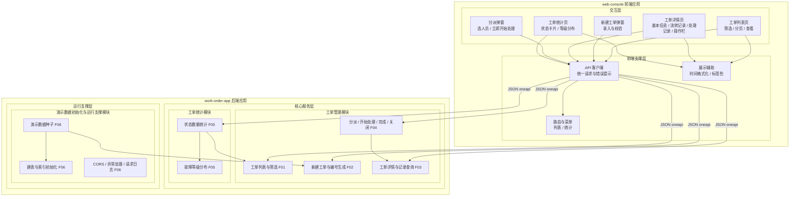

- **交互层说明**：仅承担录入、展示、按钮可用性与前端校验，不实现状态流转判定；所有数据来自后端接口。
- **核心服务层说明**：工单管理模块是唯一写入方，负责编号生成、状态机校验、记录追加与事务；工单统计模块只读聚合，复用工单管理模块的查询能力，不直接写库。
- **运行支撑层说明**：启动期完成表结构创建与演示数据初始化；运行期提供 CORS、统一异常映射与请求日志。该层不参与业务请求链路。

**模块清单**

| 模块 | 职责（一句话） | 包含的功能点 | 依赖的模块 |
|---|---|---|---|
| 工单管理模块（`work-order-app`） | 维护工单全生命周期：列表查询、创建与编号生成、详情与记录查询、分派与状态流转校验 | F01、F02、F03、F04 | 无（仅依赖 SQLite 数据层） |
| 工单统计模块（`work-order-app`） | 按全量工单聚合状态数量与故障等级分布 | F05 | 工单管理模块（复用其仓储只读查询：按状态计数、按等级计数、总数） |
| 演示数据初始化与运行支撑模块（`work-order-app`） | 启动时建表并幂等写入演示数据，提供 CORS、统一异常与请求日志 | F06 | 工单管理模块（复用其表结构定义与仓储写入/计数） |

依赖方向：`工单统计模块 → 工单管理模块`、`演示数据初始化与运行支撑模块 → 工单管理模块`，工单管理模块不反向依赖任何业务模块，**无循环依赖**。

### 2.3 应用集成架构

本期无外部业务系统、无第三方 API、无消息/缓存中间件。集成点仅为本机三跳：浏览器 → 前端开发服务器 → 后端 API → SQLite 文件。

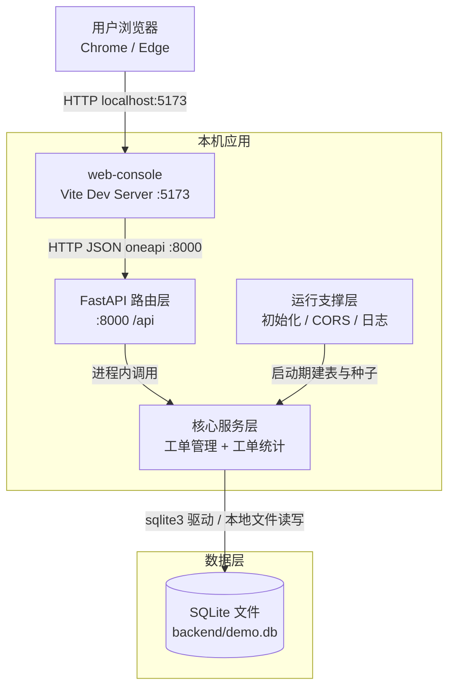

**集成关系说明**

| 调用方 | 被调用方 | 协议 | 接口类型 | 说明 |
|---|---|---|---|---|
| 用户浏览器 | web-console（Vite :5173） | HTTP | 页面资源 | 加载 Vue 单页应用 |
| web-console | work-order-app（FastAPI :8000） | HTTP + JSON | oneapi REST | 5 个业务接口，跨域需 CORS 允许 `http://localhost:5173` |
| work-order-app 核心服务层 | SQLite `demo.db` | 本地文件（sqlite3 驱动） | SQL | 单连接/短连接读写；无外键、无存储过程 |
| 运行支撑层 | 核心服务层 | 进程内方法调用 | 内部接口 | 启动时建表与演示数据种子，幂等 |
| 外部业务系统 | — | — | — | **本项不适用**：需求与 PRD 均未涉及外部系统对接，本期不设计 OpenAPI 与外部集成层 |

### 2.4 部署架构

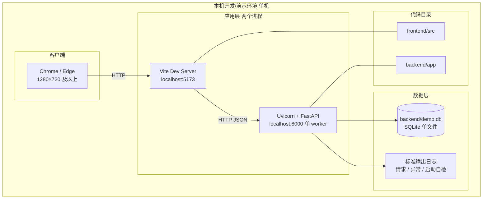

**部署说明**

- **客户端层**：单一浏览器，无 CDN、无反向代理。
- **应用层**：`npm run dev` 启动 Vite（5173），`uvicorn app.main:app --reload --port 8000` 启动 FastAPI（8000，单 worker）。端口可按环境调整，README 必须写明最终地址。
- **数据层**：SQLite 单文件 `backend/demo.db`；首次启动自动建表，表为空时写入 6 条演示工单及配套记录；删除文件后重启可恢复。
- **单点说明**：FastAPI 单进程与 SQLite 单文件均为单点，属于本机演示交付形态（PRD O-6 明确不做生产部署与高可用），**本期不设计负载均衡与多副本**；风险控制为"数据文件可备份/可重建 + 启动自检日志"，不引入集群能力。
- **无定时任务、无后台批处理**：不涉及任务单点与并发调度问题。

## 3. 数据模型与存储

### 3.1 实体清单

| 实体名称 | 实体说明 | 所属模块 | 与其他实体的关系 |
|---|---|---|---|
| 工单 WorkOrder（`work_orders`） | 一条设备故障报修记录，承载设备信息、故障现象、等级、当前状态、报修人、维修人员、处理方案与时间戳；核心业务标识为 `order_no` | 工单管理模块 | 与工单记录一对多（1 条工单对应 N 条记录） |
| 工单记录 WorkOrderLog（`work_order_logs`） | 工单的追加型流水，包含状态流转记录（`status`）与维修处理记录（`handling`），记录变更前后状态、涉及人员、操作人与内容；核心业务标识为 `work_order_id` + `created_at` 的归属关系 | 工单管理模块 | 与工单多对一（N 条记录归属 1 条工单） |

**非实体说明**

| 对象 | 处理方式 | 原因 |
|---|---|---|
| 维修人员名单（李强、王敏、赵磊、陈晨） | 后端常量，不建表 | PRD Q-02 当前处理方式；需求未要求人员主数据维护 |
| 统计结果（状态数量、等级分布） | 实时聚合，不落表、不缓存 | 数据量 ≤ 1000，聚合成本低；避免统计与工单数据不一致 |
| 演示数据种子 | 启动期初始化逻辑，不建独立实体 | 内容为 6 条工单与配套记录，直接写入上述两张表 |
| 操作人/演示身份 | 请求参数与记录字段，不建用户实体 | PRD Q-01 已确认本期不引入登录与用户体系 |

### 3.2 实体关系图

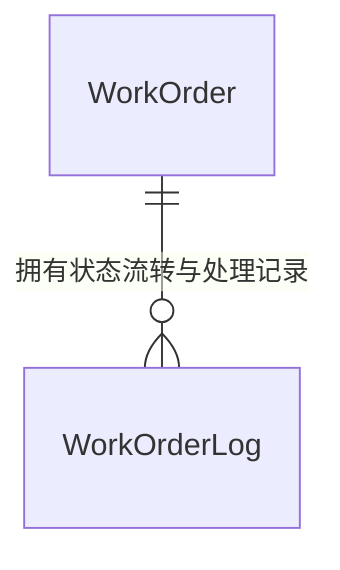

### 3.3 模型说明

1. **一对多与聚合边界**：工单为聚合根，工单记录只能通过工单产生，不单独对外提供读写接口；记录不做更新与删除，保证处理历史不可篡改（PRD 4.3 BR-12、BR-15、BR-16）。
2. **状态唯一权威**：`work_orders.status` 是当前状态唯一权威来源；`work_order_logs.from_status/to_status` 仅为流转轨迹快照，任何状态判断均以工单主表为准（PRD BR-18）。
3. **人员快照**：`work_order_logs.assignee` 记录本次变更涉及的维修人员快照，使换人历史可追溯（PRD BR-23）；`work_orders.assignee` 为当前维修人员。
4. **记录类型互斥**：`log_type` 取 `status`（状态流转）或 `handling`（处理记录）；`handling` 类型不写前后状态，`status` 类型必须有前后状态（创建记录除外，`from_status` 为空）。
5. **不设物理外键**：遵循项目数据库规范（禁止外键），关联完整性由服务层与同一事务写入保证。
6. **无租户字段**：本机单用户演示、无登录体系（PRD Q-01、NFR-05），不存在数据隔离诉求，不引入 `tenant_id`。
7. **无缓存与 MQ**：本期为单机演示，读写直连 SQLite；引入缓存/MQ 无性能或可用性依据，属于过度设计。
8. **命名与规范差异（已在决策文件登记）**：表名沿用 PRD 5.1 的 `work_orders`、`work_order_logs`（复数形式）；时间字段沿用 PRD 的 `created_at`、`updated_at`（未使用规范的 `gmt_create`、`gmt_modified`），以保持与 PRD 字段契约一致；索引名按 `uk_`/`idx_` 前缀规范命名。

## 4. 功能模块与接口设计

### 4.0 模块—接口映射

本期接口分为三类：oneapi（供前端页面调用，前缀 `/api`）、内部接口（后端应用内 Service 层方法，供其他模块或本模块接口复用）、任务接口（应用启动期触发）。无对外 OpenAPI，无外部集成接口。

| 接口编号 | 接口名称 | 类型 | 方法/触发方式 | 路径/方法签名 | 所属模块 | 对应功能点 |
|---|---|---|---|---|---|---|
| W01 | 查询工单列表 | oneapi | GET | `/api/work-orders`（query：`status`、`fault_level`、`page`、`page_size`） | 工单管理模块 | F01 |
| W02 | 创建工单 | oneapi | POST | `/api/work-orders`（body：设备与故障字段） | 工单管理模块 | F02 |
| W03 | 查询工单详情 | oneapi | GET | `/api/work-orders/{id}`（path：整型 `id`） | 工单管理模块 | F03 |
| W04 | 更新工单状态/人员/处理信息 | oneapi | PATCH | `/api/work-orders/{id}/status`（body：`status`、`assignee`、`solution`、`note`、`operator`） | 工单管理模块 | F04（复用 W03 刷新详情） |
| W05 | 查询工单统计 | oneapi | GET | `/api/work-orders/statistics` | 工单统计模块 | F05 |
| S01 | 工单编号生成 | 内部接口 | 方法调用 | `work-order-app.WorkOrderService.generateOrderNo(businessDate)` | 工单管理模块 | F02 |
| S02 | 工单状态流转校验与执行 | 内部接口 | 方法调用 | `work-order-app.WorkOrderService.applyTransition(orderId, command)` | 工单管理模块 | F04 |
| S03 | 统计聚合查询 | 内部接口 | 方法调用 | `work-order-app.StatisticsService.aggregate()` | 工单统计模块 | F05 |
| I01 | 启动初始化：建表与演示数据种子 | 任务接口 | 应用启动事件 | `work-order-app.DemoDataInitializer.initialize()` | 演示数据初始化与运行支撑模块 | F06 |

**OpenAPI 说明**：本项不适用。需求与 PRD 均未涉及对外系统对接，本期不暴露 `/openapi`。

**集成接口说明**：本项不适用。无外部系统或依赖服务，无 RPC/HTTP 外部契约需要设计。

**映射完整性核对**：F01→W01；F02→W02、S01；F03→W03；F04→W04、S02（并复用 W03 刷新）；F05→W05、S03；F06→I01。每个功能点至少映射 1 个接口，无遗漏。

### 4.1 全局约定与模块设计顺序

#### 4.1.1 全局接口约定

| 约定项 | 内容 | 依据/理由 |
|---|---|---|
| 基础路径 | `/api`，请求与响应 `application/json; charset=utf-8` | PRD 4.7 |
| 成功响应结构 | 直接返回业务对象，不额外包 `result/msg/data` 外壳：列表 `{total, page, page_size, items}`；详情为工单对象 + `logs`；统计 `{total, by_status, by_fault_level}`；创建 201 返回完整工单对象；PATCH 200 返回更新后的工单对象（不含 `logs`，前端随后以 W03 刷新） | 项目无既有返回体约定；PRD 4.7 已给出响应示例，沿用可避免前端二次拆包；PATCH 返回体 PRD 未规定，取"更新后工单对象"便于前端即时刷新状态标签 |
| 错误响应结构 | 400/404/500：`{"detail": {"code": "<错误码>", "message": "<中文说明>"}}`；422：FastAPI 默认 `{"detail": [{"loc": [...], "msg": "...", "type": "..."}]}` | PRD 4.7 固定契约；422 沿用框架结构以保留字段级定位能力 |
| 错误码格式 | 采用 PRD 已定义的大写下划线码：`VALIDATION_ERROR`、`ORDER_NOT_FOUND`、`ORDER_NO_CONFLICT`、`INVALID_TRANSITION`、`ASSIGNEE_REQUIRED`、`SOLUTION_REQUIRED`、`ORDER_CLOSED`，补充 `INTERNAL_ERROR`（未预期异常兜底）。422 响应体不含自定义 `code` 字段，`VALIDATION_ERROR` 为语义码，仅用于日志与前端提示映射 | 错误码需与前端提示映射保持一致，PRD 已定义，不另造格式；与 PRD 4.7 的 422 框架结构并存，避免同一响应出现两套结构 |
| 时间格式 | `yyyy-MM-dd HH:mm:ss`，服务端本机时区生成，不存时区偏移，前端不做换算 | PRD 3.4、NFR-09 |
| 分页 | `page` 默认 1、最小 1；`page_size` 默认 10、范围 1–100；偏移量 `(page-1) × page_size`；响应回传 `page`、`page_size`、`total` | PRD S-02、4.7 |
| 列表排序 | 固定 `created_at DESC, id DESC`，不提供排序参数 | PRD BR-01；需求未要求自定义排序 |
| 模糊搜索 | 不支持；筛选仅按 `status`、`fault_level` 精确匹配，"与"关系 | 需求 4.3-1 仅要求状态与等级筛选，避免过度设计 |
| 写操作时间戳 | 创建时 `created_at = updated_at = 当前时间`；每次写入工单（分派/开始/完成/关闭）刷新 `updated_at` | PRD 5.1、BR-15 |
| 事务 | 每个写接口一个事务：工单主表更新与记录追加同事务提交，任一失败整体回滚 | PRD 5.2 第 3 条要求编号生成与写入同事务 |
| 并发控制 | 写操作使用"带当前状态条件的更新"（`WHERE id = ? AND status = <读取时状态>`），受影响行数为 0 即判定状态已变化并拒绝；SQLite 写事务串行化作为兜底 | PRD BR-18、A08；单机单用户仍防止重复提交与页面过期状态覆盖 |
| 幂等 | 不引入幂等键；创建接口的重复提交由前端提交期禁用按钮拦截，后端不提供去重 | 需求未定义幂等键，且同一设备允许重复报修（A10），服务端无法区分"重复提交"与"同设备再次报修"；引入幂等键会改变接口契约，收益不足 |
| 字符集 | UTF-8，中文枚举值直接存库与返回 | PRD 5.1 数据约束 1、NFR-10 |
| 空值语义 | `assignee`、`solution` 用 NULL 表示未填写；返回时统一输出 `null`，前端展示"—" | PRD 5.1 数据约束 2、BR-05 |

#### 4.1.2 预构建映射表

**模块 → 功能点**

| 模块 | 功能点 |
|---|---|
| 工单管理模块 | F01、F02、F03、F04 |
| 工单统计模块 | F05 |
| 演示数据初始化与运行支撑模块 | F06 |

**模块 → 实体**

| 模块 | 实体 | 说明 |
|---|---|---|
| 工单管理模块 | 工单 WorkOrder、工单记录 WorkOrderLog | 唯一读写方，负责两张表的完整字段与索引设计 |
| 工单统计模块 | 无独立实体 | 只读聚合工单主表，不新建表 |
| 演示数据初始化与运行支撑模块 | 工单 WorkOrder、工单记录 WorkOrderLog（初始化写入） | 复用主表结构，不新增实体；新增初始化逻辑与运行配置 |

**模块 → 接口**

| 模块 | 接口编号 |
|---|---|
| 工单管理模块 | W01、W02、W03、W04、S01、S02 |
| 工单统计模块 | W05、S03 |
| 演示数据初始化与运行支撑模块 | I01 |

#### 4.1.3 模块设计顺序与进度

依赖拓扑：工单管理模块定义表结构、仓储与状态机，是被依赖方；统计模块与运行支撑模块均依赖其表与仓储，故顺序为：

| 顺序 | 模块 | 依赖前置 | 设计状态 |
|---|---|---|---|
| 1 | 工单管理模块 | 无 | 已完成 |
| 2 | 工单统计模块 | 工单管理模块（表结构、按状态/等级计数仓储方法） | 已完成 |
| 3 | 演示数据初始化与运行支撑模块 | 工单管理模块（表结构、仓储写入与计数） | 已完成 |

### 4.2 工单管理模块

**模块职责**：维护工单全生命周期——列表查询、创建与编号生成、详情与记录查询、分派与状态流转校验，是两张业务表的唯一写入方。  
**覆盖功能点**：F01、F02、F03、F04  
**依赖模块/接口**：无（仅依赖 SQLite 数据层；向工单统计模块与运行支撑模块提供按状态/等级计数、总数统计、按日最大编号查询与记录写入能力）

#### 4.2.1 表结构设计

##### 4.2.1.1 工单主表 `work_orders`

| 字段名 | 数据类型 | 约束 | 默认值 | 说明 |
|---|---|---|---|---|
| id | INTEGER | PK，自增，NOT NULL | — | 系统自增主键，接口路径中的 `id` |
| order_no | TEXT(16) | NOT NULL，唯一 | — | 工单编号，`WO` + `yyyyMMdd` + 4 位当日流水，如 `WO202611130001` |
| device_name | TEXT(50) | NOT NULL | — | 设备名称，1–50 字 |
| device_code | TEXT(32) | NOT NULL | — | 设备编号，1–32 字，允许字母、数字、`-`、`_` |
| fault_description | TEXT(500) | NOT NULL | — | 故障现象，1–500 字，保留换行 |
| fault_level | TEXT(2) | NOT NULL | — | 故障等级：高 / 中 / 低 |
| status | TEXT(4) | NOT NULL | `待处理` | 当前状态：待处理 / 处理中 / 已完成 / 已关闭 |
| reporter | TEXT(20) | NOT NULL | — | 报修人，1–20 字 |
| assignee | TEXT(20) | NULL | NULL | 当前维修人员；NULL 表示未分派 |
| solution | TEXT(500) | NULL | NULL | 处理方案，完成时写入；NULL 表示未填写 |
| created_at | TEXT(19) | NOT NULL | — | 创建时间，`yyyy-MM-dd HH:mm:ss`，服务端本机时间 |
| updated_at | TEXT(19) | NOT NULL | — | 最后更新时间，每次写操作刷新 |

**数据约束说明**：`status`、`fault_level` 直接存中文枚举值（PRD 5.1 数据约束 1）；`assignee`、`solution` 的 NULL 与空字符串均视为未填写，服务端统一落 NULL（PRD 5.1 数据约束 2）；无删除标记，本期不删除工单；无物理外键（项目数据库规范）。

**索引：**

- PK：`pk_work_orders`（`id`，SQLite `INTEGER PRIMARY KEY` 隐含主键索引）
- UK：`uk_work_order_order_no`（`order_no`）——保证编号唯一并支撑编号冲突兜底
- IDX：`idx_work_order_status`（`status`）——支撑状态筛选与按状态计数
- IDX：`idx_work_order_level`（`fault_level`）——支撑等级筛选与按等级计数
- IDX：`idx_work_order_created`（`created_at`）——支撑默认排序

##### 4.2.1.2 工单记录表 `work_order_logs`

| 字段名 | 数据类型 | 约束 | 默认值 | 说明 |
|---|---|---|---|---|
| id | INTEGER | PK，自增，NOT NULL | — | 系统自增主键 |
| work_order_id | INTEGER | NOT NULL | — | 关联 `work_orders.id`，逻辑关联，不建外键 |
| log_type | TEXT(8) | NOT NULL | — | 记录类型：`status` 状态流转 / `handling` 处理记录 |
| from_status | TEXT(4) | NULL | NULL | 变更前状态；创建记录为 NULL，`handling` 类型为 NULL |
| to_status | TEXT(4) | NULL | NULL | 变更后状态；`handling` 类型为 NULL |
| assignee | TEXT(20) | NULL | NULL | 本次变更涉及的维修人员快照（记录换人历史） |
| operator | TEXT(20) | NOT NULL | — | 操作人姓名，缺省演示身份"张伟" |
| content | TEXT(500) | NULL | NULL | 记录内容：状态变更说明或处理说明 |
| created_at | TEXT(19) | NOT NULL | — | 记录时间，`yyyy-MM-dd HH:mm:ss`，与该次工单 `updated_at` 一致 |

**索引：**

- PK：`pk_work_order_logs`（`id`，SQLite `INTEGER PRIMARY KEY` 隐含主键索引）
- IDX：`idx_wo_log_order_created`（`work_order_id`, `created_at`）——支撑按工单查询记录并按时间倒序

**表设计说明**：记录表为追加型流水，不提供更新与删除，因此只保留 `created_at`，不设 `updated_at`（与规范的 `gmt_create/gmt_modified` 模板差异已在决策文件登记，理由为记录不可变更）。`work_order_id` 与 `created_at` 组合索引按左前缀可用 `work_order_id` 单条件查询，满足详情页读取。

##### 4.2.1.3 枚举与常量定义

| 枚举名称 | 取值 | 含义 | 关联字段 |
|---|---|---|---|
| WorkOrderStatus | 待处理 | 工单已创建，尚未开始维修；维修人员可能为空或已指定 | `work_orders.status`；`work_order_logs.from_status` / `to_status` |
| WorkOrderStatus | 处理中 | 维修人员已受理并处理故障 | 同上 |
| WorkOrderStatus | 已完成 | 故障已处理完成，处理方案已填写 | 同上 |
| WorkOrderStatus | 已关闭 | 工单结束，页面只读，终态 | 同上 |
| FaultLevel | 高 | 高紧急程度，红色标签 | `work_orders.fault_level` |
| FaultLevel | 中 | 中紧急程度，橙色标签 | `work_orders.fault_level` |
| FaultLevel | 低 | 低紧急程度，灰色标签 | `work_orders.fault_level` |
| LogType | status | 状态流转记录，必须有 `to_status`，`from_status` 创建时为空 | `work_order_logs.log_type` |
| LogType | handling | 维修处理记录，`from_status`/`to_status` 为空 | `work_order_logs.log_type` |
| ErrorCode | VALIDATION_ERROR | 字段格式/取值校验失败（422） | 错误响应 `detail.code` |
| ErrorCode | ORDER_NOT_FOUND | 工单不存在（404） | 错误响应 `detail.code` |
| ErrorCode | ORDER_NO_CONFLICT | 编号生成冲突且重试后仍失败（500） | 错误响应 `detail.code` |
| ErrorCode | INVALID_TRANSITION | 非法状态流转（跳步、回退、重复提交）（400） | 错误响应 `detail.code` |
| ErrorCode | ASSIGNEE_REQUIRED | 进入处理中但维修人员为空（400） | 错误响应 `detail.code` |
| ErrorCode | SOLUTION_REQUIRED | 进入已完成但处理方案为空（400） | 错误响应 `detail.code` |
| ErrorCode | ORDER_CLOSED | 工单已关闭仍提交更新（400） | 错误响应 `detail.code` |
| ErrorCode | INTERNAL_ERROR | 未预期异常兜底（500） | 错误响应 `detail.code` |

**常量定义：**

| 常量名称 | 取值 | 用途 |
|---|---|---|
| DEMO_ASSIGNEES | 李强、王敏、赵磊、陈晨 | 分派下拉选项与 `assignee` 取值校验（A02） |
| DEFAULT_OPERATOR | 张伟 | `operator` 缺省值（A01） |
| ORDER_NO_PREFIX | `WO` | 工单编号前缀 |
| ORDER_NO_DATE_FORMAT | `yyyyMMdd` | 编号中的创建日期段 |
| ORDER_NO_SEQ_LENGTH | 4 | 当日流水位数，`0001` 起 |
| ORDER_NO_RETRY_TIMES | 1 | 唯一约束冲突后的重试次数 |
| MAX_PAGE_SIZE | 100 | 分页上限 |
| DEFAULT_PAGE_SIZE | 10 | 分页默认值 |

#### 4.2.2 仓储层设计

| 归属应用 | 仓储类 | 方法名 | 关联实体/表 | 操作类型 | 核心查询/更新条件 | 入参 | 返回值 | 说明 |
|---|---|---|---|---|---|---|---|---|
| work-order-app | WorkOrderRepository | `insertOrder` | work_orders | 新增 | 无（插入新行） | 工单实体（含 `order_no`、时间戳） | 新增行 `id` | 创建工单主记录 |
| work-order-app | WorkOrderRepository | `updateOrderIfStatus` | work_orders | 更新 | `id = :id AND status = :expectedStatus` | `id`、`expectedStatus`、待更新字段（`status`/`assignee`/`solution`/`updated_at`） | 受影响行数 | 带状态条件更新，行数为 0 表示状态已被改变 |
| work-order-app | WorkOrderRepository | `findById` | work_orders | 查询 | `id = :id` | `id` | 工单实体或空 | 详情与流转前读取当前状态 |
| work-order-app | WorkOrderRepository | `findPage` | work_orders | 查询 | 可选 `status = :status`、`fault_level = :level`；排序 `created_at DESC, id DESC`；`LIMIT :limit OFFSET :offset` | `status`、`faultLevel`、`offset`、`limit` | 工单列表 | 列表页数据；不返回 `fault_description`、`solution` 与 `logs`（按需在查询层裁列） |
| work-order-app | WorkOrderRepository | `countByFilter` | work_orders | 查询 | 与 `findPage` 相同的可选筛选条件 | `status`、`faultLevel` | 整数总数 | 列表总数，保证与 `items` 同一口径 |
| work-order-app | WorkOrderRepository | `findLogsByOrderId` | work_order_logs | 查询 | `work_order_id = :orderId`，排序 `created_at DESC, id DESC` | `orderId` | 记录列表 | 详情页状态流转与处理记录 |
| work-order-app | WorkOrderRepository | `insertLog` | work_order_logs | 新增 | 无 | 记录实体 | 新增行 `id` | 状态流转与处理记录追加 |
| work-order-app | WorkOrderRepository | `maxOrderNoByPrefix` | work_orders | 查询 | `order_no LIKE :prefix || '%'`，取最大 `order_no` | 编号前缀（`WO` + 日期） | 最大编号或空 | 供 S01 计算当日下一流水 |
| work-order-app | WorkOrderRepository | `countAll` | work_orders | 查询 | 无 | 无 | 整数总数 | 统计数据 `total`；供统计模块 S03 复用 |
| work-order-app | WorkOrderRepository | `countGroupByStatus` | work_orders | 查询 | 按 `status` 分组计数 | 无 | 状态→数量映射（4 个键，无数据补 0） | 供统计模块 S03 复用 |
| work-order-app | WorkOrderRepository | `countGroupByFaultLevel` | work_orders | 查询 | 按 `fault_level` 分组计数 | 无 | 等级→数量映射（3 个键，无数据补 0） | 供统计模块 S03 复用 |
| work-order-app | WorkOrderRepository | `existsSeedData` | work_orders | 查询 | `SELECT 1 ... LIMIT 1` | 无 | 布尔值 | 供运行支撑模块 I01 判断是否需要写入演示数据 |

**仓储一致性要求**：所有 SQL 使用参数绑定，不拼接用户输入；写方法由调用方开启事务，仓储不自行提交；`findPage` 与 `countByFilter` 必须共用同一筛选条件构造逻辑，避免总数与列表不一致。

#### 4.2.3 接口设计

| 接口编号 | 接口名称 | 类型 | 方法/触发方式 | 路径/方法签名 | 对应功能点 |
|---|---|---|---|---|---|
| W01 | 查询工单列表 | oneapi | GET | `/api/work-orders` | F01 |
| W02 | 创建工单 | oneapi | POST | `/api/work-orders` | F02 |
| W03 | 查询工单详情 | oneapi | GET | `/api/work-orders/{id}` | F03 |
| W04 | 更新工单状态/人员/处理信息 | oneapi | PATCH | `/api/work-orders/{id}/status` | F04 |
| S01 | 工单编号生成 | 内部接口 | 方法调用 | `WorkOrderService.generateOrderNo(businessDate)` | F02 |
| S02 | 工单状态流转校验与执行 | 内部接口 | 方法调用 | `WorkOrderService.applyTransition(orderId, command)` | F04 |

##### 4.2.3.1 W01 查询工单列表（F01）

- **URI**：GET `/api/work-orders`
- **接口类型**：oneapi
- **描述**：按状态、故障等级筛选并以创建时间倒序分页返回工单列表，用于列表页展示与筛选。
- **入参**：

| 参数名称 | 类型 | 是否必填 | 描述 |
|---|---|---|---|
| status | string（query） | 否 | 待处理 / 处理中 / 已完成 / 已关闭；缺省或空串表示全部 |
| fault_level | string（query） | 否 | 高 / 中 / 低；缺省或空串表示全部 |
| page | integer（query） | 否 | 页码，默认 1，最小 1 |
| page_size | integer（query） | 否 | 每页条数，默认 10，范围 1–100 |

- **出参**：

| 参数名称 | 类型 | 描述 |
|---|---|---|
| total | integer | 符合筛选条件的工单总数 |
| page | integer | 当前页码 |
| page_size | integer | 每页条数 |
| items | array | 工单列表，按 `created_at DESC, id DESC` 排序 |
| items[].id | integer | 工单主键 |
| items[].order_no | string | 工单编号 |
| items[].device_name | string | 设备名称 |
| items[].device_code | string | 设备编号 |
| items[].fault_level | string | 故障等级 |
| items[].status | string | 当前状态 |
| items[].reporter | string | 报修人 |
| items[].assignee | string / null | 维修人员，未分派为 null |
| items[].created_at | string | 创建时间 `yyyy-MM-dd HH:mm:ss` |
| items[].updated_at | string | 最后更新时间 |

- **错误码**：

| 错误码 | 说明 |
|---|---|
| VALIDATION_ERROR（422） | `status`/`fault_level` 非枚举值、`page` < 1、`page_size` 越界、`page` 非整数 |
| INTERNAL_ERROR（500） | 数据库不可用或未预期异常 |

- **业务规则**：

| 规则编号 | 规则描述 | 校验时机 | 不满足时的处理 |
|---|---|---|---|
| R-W01-01 | `status` 若传值必须属于 WorkOrderStatus 四值；空串按未传处理 | 参数校验 | 返回 422 `VALIDATION_ERROR`，`msg` 指明字段 |
| R-W01-02 | `fault_level` 若传值必须属于 FaultLevel 三值 | 参数校验 | 返回 422 `VALIDATION_ERROR` |
| R-W01-03 | `page` 最小 1，`page_size` 范围 1–100 | 参数校验 | 返回 422 `VALIDATION_ERROR` |
| R-W01-04 | 两个筛选条件为"与"关系 | 查询构造 | 仅返回同时满足的工单（BR-02） |
| R-W01-05 | 固定按 `created_at DESC, id DESC` 排序 | 查询构造 | 忽略任何排序意图，保证分页稳定 |
| R-W01-06 | `total` 与 `items` 使用同一筛选条件 | 查询构造 | 二者口径不一致视为缺陷 |
| R-W01-07 | 无匹配数据返回 200、`total=0`、`items` 为空数组 | 查询结果 | 前端显示"暂无数据"并隐藏分页（BR-04） |
| R-W01-08 | 列表项不返回 `fault_description`、`solution`、`logs` | 出参裁剪 | 减少传输量，详情字段由 W03 提供 |
| R-W01-09 | `assignee` 为空时输出 null，不输出空字符串或 `"None"` | 序列化 | 前端统一显示"—"（BR-05） |

- **处理时序图**：

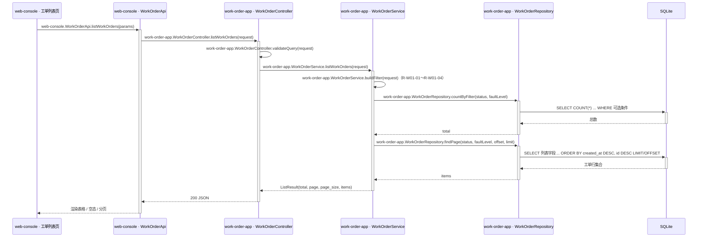

- **异常场景**：

| 异常场景 | 处理方式 |
|---|---|
| 状态或等级传入非法值 | 返回 422 `VALIDATION_ERROR`，前端定位下拉并提示 |
| 页码超出总页数 | 返回 200 且 `items` 为空，前端按空态展示并保留筛选条件 |
| 数据库文件被删除或不可读 | 返回 500 `INTERNAL_ERROR`，前端提示"服务暂不可用，请检查后端服务" |
| 服务未启动 | 前端请求失败，提示连接失败，保留筛选条件（AC-23） |

- **事务与并发控制（如适用）**：
  - 事务/回滚策略：只读查询，不开显式事务。
  - 并发场景与控制策略：读多写少，无并发风险；同一毫秒创建的多条工单用 `id DESC` 保证分页稳定。

- **请求示例**：

```json
{
  "status": "处理中",
  "fault_level": "高",
  "page": 1,
  "page_size": 10
}
```

- **响应示例**：

```json
{
  "total": 2,
  "page": 1,
  "page_size": 10,
  "items": [
    {
      "id": 5,
      "order_no": "WO202611130001",
      "device_name": "冷却水泵 P-11",
      "device_code": "EQ-P-11",
      "fault_level": "高",
      "status": "处理中",
      "reporter": "张伟",
      "assignee": "李强",
      "created_at": "2026-11-13 08:40:00",
      "updated_at": "2026-11-13 09:05:00"
    }
  ]
}
```

##### 4.2.3.2 W02 创建工单（F02）

- **URI**：POST `/api/work-orders`
- **接口类型**：oneapi
- **描述**：校验必填与长度，生成当日唯一工单编号，写入一条状态为"待处理"的工单及一条创建记录，返回 201 与完整工单对象。
- **入参**：

| 参数名称 | 类型 | 是否必填 | 描述 |
|---|---|---|---|
| device_name | string | 是 | 设备名称，去除首尾空格后 1–50 字 |
| device_code | string | 是 | 设备编号，1–32 字，允许字母、数字、`-`、`_` |
| fault_description | string | 是 | 故障现象，1–500 字，允许换行 |
| fault_level | string | 是 | 高 / 中 / 低 |
| reporter | string | 是 | 报修人，去除首尾空格后 1–20 字 |
| operator | string | 否 | 操作人，缺省"张伟"；不落主表，仅写入创建记录 |

- **出参**：

| 参数名称 | 类型 | 描述 |
|---|---|---|
| id | integer | 工单主键 |
| order_no | string | 生成的工单编号 |
| device_name | string | 设备名称（已去首尾空格） |
| device_code | string | 设备编号 |
| fault_description | string | 故障现象 |
| fault_level | string | 故障等级 |
| status | string | 固定为 `待处理` |
| reporter | string | 报修人 |
| assignee | null | 创建时未分派 |
| solution | null | 创建时无处理方案 |
| created_at | string | 创建时间 |
| updated_at | string | 与 `created_at` 相同 |

- **错误码**：

| 错误码 | 说明 |
|---|---|
| VALIDATION_ERROR（422） | 必填缺失、去空格后为空、长度超限、设备编号字符不合法、`fault_level` 非枚举 |
| ORDER_NO_CONFLICT（500） | 编号唯一约束冲突且重试 1 次后仍失败 |
| INTERNAL_ERROR（500） | 写库失败或未预期异常（事务已回滚） |

- **业务规则**：

| 规则编号 | 规则描述 | 校验时机 | 不满足时的处理 |
|---|---|---|---|
| R-W02-01 | 5 个必填字段缺失或去首尾空格后为空即拒绝 | 参数校验 | 422 `VALIDATION_ERROR`，字段级定位（BR-07） |
| R-W02-02 | 长度：`device_name` ≤ 50、`device_code` ≤ 32、`fault_description` ≤ 500、`reporter` ≤ 20、`operator` ≤ 20 | 参数校验 | 422 `VALIDATION_ERROR`（BR-08 前端同时限制输入） |
| R-W02-03 | `device_code` 仅允许字母、数字、`-`、`_` | 参数校验 | 422 `VALIDATION_ERROR` |
| R-W02-04 | `fault_level` 必须为高/中/低；服务端不提供默认等级 | 参数校验 | 422 `VALIDATION_ERROR`（A04 前端不预选） |
| R-W02-05 | `status` 固定写 `待处理`，`assignee`、`solution` 写 NULL，忽略前端传入 | 写入前 | 以服务端赋值为准（BR-09） |
| R-W02-06 | 编号由 S01 生成：`WO` + 服务端当日 `yyyyMMdd` + 4 位流水，流水取当日最大 +1，从 `0001` 起 | 写入前 | 冲突时重试 1 次；仍失败返回 500 `ORDER_NO_CONFLICT`（PRD 5.2） |
| R-W02-07 | 工单与创建记录同事务写入；创建记录 `log_type=status`、`from_status=NULL`、`to_status=待处理`、`content="创建工单"` | 写入时 | 任一写入失败整体回滚，不产生无记录工单 |
| R-W02-08 | 初始化数据已存在的判断不影响创建接口；同一设备允许重复创建 | 写入前 | 不做设备维度去重（A10） |
| R-W02-09 | 返回 201，`Location` 指向 `/api/work-orders/{id}` | 响应 | 前端以响应体 `id` 跳转详情 |

- **处理时序图**：

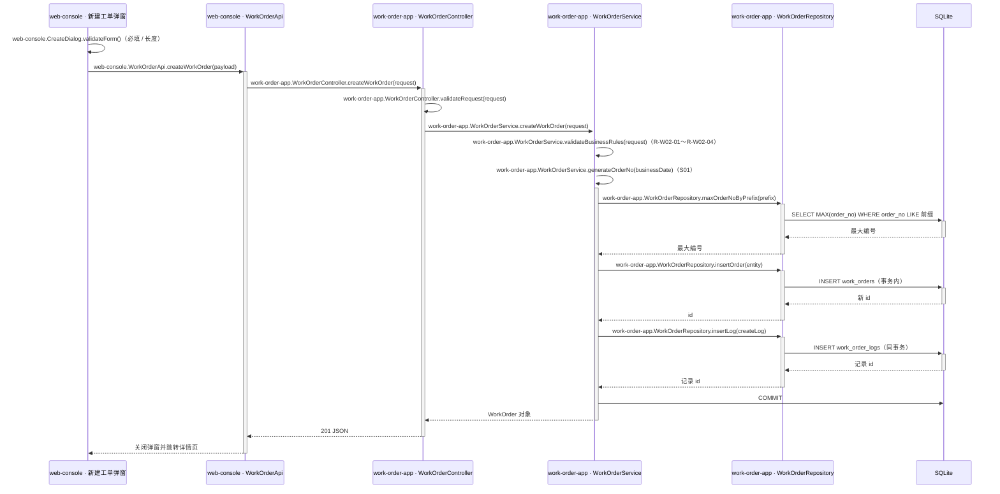

- **异常场景**：

| 异常场景 | 处理方式 |
|---|---|
| 必填缺失或超长 | 422 `VALIDATION_ERROR`，弹窗保持打开并高亮字段（BR-11） |
| 编号唯一冲突（并发/历史数据异常） | 重新生成并重试 1 次；仍冲突返回 500 `ORDER_NO_CONFLICT`，不写入任何数据 |
| 记录写入失败 | 事务回滚，工单不落库，返回 500 `INTERNAL_ERROR` |
| 数据库只读或磁盘满 | 返回 500 `INTERNAL_ERROR`，前端提示检查磁盘与文件权限 |
| 重复点击提交 | 前端提交期禁用按钮（BR-10）；后端无幂等键（见 4.1.1 决策） |

- **事务与并发控制（如适用）**：
  - 事务/回滚策略：`BEGIN IMMEDIATE` 开启写事务，先算号再插工单、插创建记录，全部成功 `COMMIT`；任一失败 `ROLLBACK`。`order_no` 唯一约束兜底。
  - 并发场景与控制策略：单进程内并发创建由 SQLite 写事务串行化 + 唯一约束保证；不在内存维护流水号，避免重启丢失；冲突重试 1 次。

- **请求示例**：

```json
{
  "device_name": "压缩机 C-01",
  "device_code": "EQ-C-01",
  "fault_description": "运行中振动明显增大，伴随周期性异响。",
  "fault_level": "高",
  "reporter": "张伟",
  "operator": "张伟"
}
```

- **响应示例**：

```json
{
  "id": 7,
  "order_no": "WO202611130003",
  "device_name": "压缩机 C-01",
  "device_code": "EQ-C-01",
  "fault_description": "运行中振动明显增大，伴随周期性异响。",
  "fault_level": "高",
  "status": "待处理",
  "reporter": "张伟",
  "assignee": null,
  "solution": null,
  "created_at": "2026-11-13 09:30:00",
  "updated_at": "2026-11-13 09:30:00"
}
```

##### 4.2.3.3 W03 查询工单详情（F03）

- **URI**：GET `/api/work-orders/{id}`
- **接口类型**：oneapi
- **描述**：返回单条工单完整信息及全部记录（状态流转 + 处理记录），记录按时间倒序，供详情页与操作后刷新使用。
- **入参**：

| 参数名称 | 类型 | 是否必填 | 描述 |
|---|---|---|---|
| id | integer（path） | 是 | 工单主键，必须为正整数 |

- **出参**：

| 参数名称 | 类型 | 描述 |
|---|---|---|
| id | integer | 工单主键 |
| order_no | string | 工单编号 |
| device_name | string | 设备名称 |
| device_code | string | 设备编号 |
| fault_description | string | 故障现象 |
| fault_level | string | 故障等级 |
| status | string | 当前状态 |
| reporter | string | 报修人 |
| assignee | string / null | 当前维修人员 |
| solution | string / null | 处理方案 |
| created_at | string | 创建时间 |
| updated_at | string | 最后更新时间 |
| logs | array | 记录列表，`created_at DESC, id DESC` |
| logs[].id | integer | 记录主键 |
| logs[].log_type | string | `status` / `handling` |
| logs[].from_status | string / null | 变更前状态 |
| logs[].to_status | string / null | 变更后状态 |
| logs[].assignee | string / null | 本次变更的维修人员快照 |
| logs[].operator | string | 操作人 |
| logs[].content | string / null | 变更说明或处理说明 |
| logs[].created_at | string | 记录时间 |

- **错误码**：

| 错误码 | 说明 |
|---|---|
| ORDER_NOT_FOUND（404） | 指定 `id` 不存在 |
| VALIDATION_ERROR（422） | `id` 非整数（如 `/statistics` 被误解析为 id 时的兜底表现） |
| INTERNAL_ERROR（500） | 数据库不可用或未预期异常 |

- **业务规则**：

| 规则编号 | 规则描述 | 校验时机 | 不满足时的处理 |
|---|---|---|---|
| R-W03-01 | `id` 必须为正整数，路由声明为整型且 `statistics` 静态路由优先注册 | 路由匹配 | 非整数返回 422；静态路径不被当作 id（PRD 4.7 实现约束） |
| R-W03-02 | 工单不存在返回 404 `ORDER_NOT_FOUND` | 查询后 | 前端展示"工单不存在"并给返回列表入口（BR-19） |
| R-W03-03 | 记录按 `created_at DESC, id DESC` 排序，最新在上 | 查询构造 | 前端直接渲染，不再排序（BR-12） |
| R-W03-04 | 无记录时 `logs` 返回空数组，不返回 null | 序列化 | 前端展示"暂无处理记录"（BR-12） |
| R-W03-05 | 返回当前状态与 `solution`，供前端计算可用操作与只读态 | 序列化 | 前端按钮可见性仅作展示控制，最终以 W04 校验为准 |
| R-W03-06 | 不返回已删除/软删标记（本期无删除） | 序列化 | — |

- **处理时序图**：

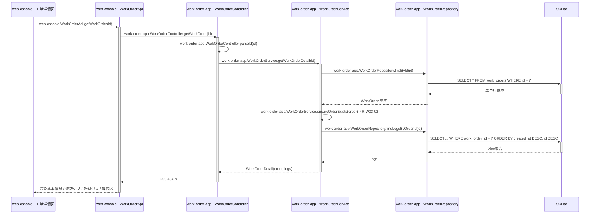

- **异常场景**：

| 异常场景 | 处理方式 |
|---|---|
| 工单不存在 | 404 `ORDER_NOT_FOUND`，前端提示并可返回列表 |
| 记录数据中 `content` 为空 | 正常返回 null，前端展示为空内容行，不报错 |
| 数据库不可用 | 500 `INTERNAL_ERROR`，前端错误提示与重试入口 |
| 操作后立即刷新读到旧数据 | 写接口返回更新后对象，前端先更新状态标签再异步刷新详情；不做缓存 |

- **事务与并发控制（如适用）**：
  - 事务/回滚策略：只读，无事务。
  - 并发场景与控制策略：读取期间的写入由 SQLite 快照隔离保证，单次查询看到一致数据；不引入乐观锁字段。

- **请求示例**：

```json
{
  "id": 4
}
```

- **响应示例**：

```json
{
  "id": 4,
  "order_no": "WO202611120002",
  "device_name": "压缩机 C-01",
  "device_code": "EQ-C-01",
  "fault_description": "运行中振动明显增大，伴随周期性异响。",
  "fault_level": "高",
  "status": "处理中",
  "reporter": "张伟",
  "assignee": "王敏",
  "solution": null,
  "created_at": "2026-11-12 16:25:00",
  "updated_at": "2026-11-13 08:40:00",
  "logs": [
    {
      "id": 12,
      "log_type": "status",
      "from_status": "待处理",
      "to_status": "处理中",
      "assignee": "王敏",
      "operator": "王敏",
      "content": "分派并开始处理，维修人员：王敏",
      "created_at": "2026-11-13 08:40:00"
    },
    {
      "id": 11,
      "log_type": "handling",
      "from_status": null,
      "to_status": null,
      "assignee": "王敏",
      "operator": "王敏",
      "content": "已到达现场，初步判断为地脚螺栓松动。",
      "created_at": "2026-11-13 08:52:00"
    }
  ]
}
```

##### 4.2.3.4 W04 更新工单状态/人员/处理信息（F04）

- **URI**：PATCH `/api/work-orders/{id}/status`
- **接口类型**：oneapi
- **描述**：以一次请求完成分派、开始处理、追加处理说明、完成、关闭中的一种或组合；服务端按当前库中状态校验流转，写入状态流转记录与处理记录，返回更新后的工单对象。
- **入参**：

| 参数名称 | 类型 | 是否必填 | 描述 |
|---|---|---|---|
| id | integer（path） | 是 | 工单主键，正整数 |
| status | string（body） | 否 | 目标状态：处理中 / 已完成 / 已关闭；不允许传"待处理" |
| assignee | string（body） | 否 | 维修人员姓名，1–20 字，须在 DEMO_ASSIGNEES 内 |
| solution | string（body） | 否 | 处理方案，1–500 字；仅允许随 `status=已完成` 提交 |
| note | string（body） | 否 | 处理说明，1–500 字；仅允许在"处理中"状态提交 |
| operator | string（body） | 否 | 操作人，1–20 字，缺省"张伟" |

至少提交 `status`、`assignee`、`solution`、`note` 中的一项；仅提交 `operator` 视为空更新。

- **出参**：

| 参数名称 | 类型 | 描述 |
|---|---|---|
| id | integer | 工单主键 |
| order_no | string | 工单编号 |
| device_name | string | 设备名称 |
| device_code | string | 设备编号 |
| fault_description | string | 故障现象 |
| fault_level | string | 故障等级 |
| status | string | 更新后状态 |
| reporter | string | 报修人 |
| assignee | string / null | 更新后维修人员 |
| solution | string / null | 处理方案 |
| created_at | string | 创建时间 |
| updated_at | string | 本次更新时间 |

- **错误码**：

| 错误码 | 说明 |
|---|---|
| INVALID_TRANSITION（400） | 跳步、回退、目标状态等于当前状态、在不允许的状态提交 `note`、仅提交 `operator` |
| ASSIGNEE_REQUIRED（400） | 进入"处理中"但工单无维修人员且请求未提供 |
| SOLUTION_REQUIRED（400） | 进入"已完成"但处理方案为空 |
| ORDER_CLOSED（400） | 工单已关闭仍提交任何更新 |
| ORDER_NOT_FOUND（404） | 工单不存在 |
| VALIDATION_ERROR（422） | 字段超长、`assignee` 不在名单、`solution` 与目标状态不匹配、`status` 非法值、空对象 |
| INTERNAL_ERROR（500） | 写库失败（事务已回滚） |

- **业务规则**：

| 规则编号 | 规则描述 | 校验时机 | 不满足时的处理 |
|---|---|---|---|
| R-W04-01 | 读取当前工单；不存在返回 404 | 读取后 | 404 `ORDER_NOT_FOUND` |
| R-W04-02 | 当前状态为"已关闭"时拒绝任何字段更新，不写记录 | 流转前 | 400 `ORDER_CLOSED`（BR-17、BR-24） |
| R-W04-03 | 目标 `status` 仅允许 处理中 / 已完成 / 已关闭；传入"待处理"或未知值 | 参数校验 | 422 `VALIDATION_ERROR`（未知值）或 400 `INVALID_TRANSITION`（待处理） |
| R-W04-04 | 合法流转仅三条：待处理→处理中、处理中→已完成、已完成→已关闭；其余组合拒绝 | 流转前 | 400 `INVALID_TRANSITION`（BR-13、BR-18、AC-24） |
| R-W04-05 | 目标状态等于当前状态视为重复提交，拒绝；但"仅分派"（不传 `status`）允许更新人员 | 流转前 | 400 `INVALID_TRANSITION` |
| R-W04-06 | 进入"处理中"时，维修人员取请求 `assignee`，缺省取库中已有值；仍为空则拒绝 | 写入前 | 400 `ASSIGNEE_REQUIRED`（BR-13） |
| R-W04-07 | 进入"已完成"必须提供非空 `solution`（去空格后 1–500 字） | 写入前 | 400 `SOLUTION_REQUIRED`（BR-14） |
| R-W04-08 | `solution` 仅允许随 `status=已完成` 提交，其他情况携带即拒绝 | 参数校验 | 422 `VALIDATION_ERROR`，避免静默丢弃 |
| R-W04-09 | `note` 仅允许在当前状态为"处理中"时提交（Q-06 选填），写入 `log_type=handling` 记录，不改状态 | 写入前 | 400 `INVALID_TRANSITION` |
| R-W04-10 | 仅分派（传 `assignee`、不传 `status`）允许在"待处理"与"处理中"执行；写 `log_type=status`、`from_status=to_status=当前状态`、`content` 体现"分派工单，维修人员：X"或换人前后人员 | 流转时 | 其他状态走 R-W04-04 拒绝（BR-21、BR-23） |
| R-W04-11 | 组合语义：一次请求可同时"分派 + 开始处理"（`assignee` + `status=处理中`，BR-20）、"处理说明 + 完成"（`note` + `status=已完成` + `solution`）；先追加 `handling` 记录，再写状态流转记录 | 写入顺序 | 顺序错误视为缺陷，保证详情页记录时间语义一致 |
| R-W04-12 | 记录 `assignee` 快照取变更后的维修人员；`operator` 取请求值或"张伟"；记录时间与工单 `updated_at` 同一时间戳 | 写入时 | 缺失快照视为缺陷（BR-15、BR-16） |
| R-W04-13 | 工单主表更新与全部记录追加在同一事务；任一失败整体回滚 | 写入时 | 回滚并返回 500 `INTERNAL_ERROR` |
| R-W04-14 | 更新使用"带当前状态条件"的 UPDATE，受影响行数为 0 时重新读取：若已关闭返回 `ORDER_CLOSED`，否则返回 `INVALID_TRANSITION` 并提示刷新 | 更新时 | 400，不写任何记录（BR-18） |
| R-W04-15 | 关闭成功后前端进入只读，不提供任何写入口；服务端终态校验为最终防线 | 关闭后 | 后续写请求 400 `ORDER_CLOSED`（BR-16） |

- **处理时序图**：

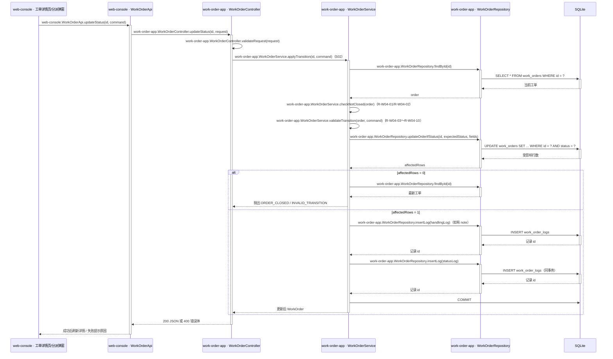

- **异常场景**：

| 异常场景 | 处理方式 |
|---|---|
| 待处理工单直接关闭 | 400 `INVALID_TRANSITION`（AC-24） |
| 已完成工单回退处理中 | 400 `INVALID_TRANSITION`，状态不变 |
| 已关闭工单再次更新 | 400 `ORDER_CLOSED`，不写记录（AC-14） |
| 分派时未选维修人员 | 前端拦截；绕过前端时后端按 R-W04-06 返回 `ASSIGNEE_REQUIRED` |
| 完成时未填处理方案 | 400 `SOLUTION_REQUIRED`，状态保持处理中 |
| 页面停留过久后提交 | 条件更新失败，返回 `INVALID_TRANSITION`，提示"当前状态已变化，请刷新"（BR-18） |
| 处理中提交 `note` 为空串 | 422 `VALIDATION_ERROR`（长度 1–500） |
| 写记录失败 | 事务回滚，工单状态不变，返回 500 |

- **事务与并发控制（如适用）**：
  - 事务/回滚策略：`BEGIN IMMEDIATE` → 条件 UPDATE → 追加记录（1 或 2 条）→ `COMMIT`；任一步失败 `ROLLBACK`，保证状态与记录强一致。
  - 并发场景与控制策略：乐观并发——以读取时状态作为 UPDATE 条件，受影响行数为 0 即拒绝并提示刷新；SQLite 写事务串行化兜底；不使用 `version` 字段（单机演示、写频率低，条件更新已足够，避免无依据的字段扩展）。

- **请求示例（分派并开始处理）**：

```json
{
  "assignee": "李强",
  "status": "处理中",
  "operator": "张伟"
}
```

- **响应示例**：

```json
{
  "id": 5,
  "order_no": "WO202611130001",
  "device_name": "冷却水泵 P-11",
  "device_code": "EQ-P-11",
  "fault_description": "运行中振动明显增大，伴随周期性异响。",
  "fault_level": "高",
  "status": "处理中",
  "reporter": "张伟",
  "assignee": "李强",
  "solution": null,
  "created_at": "2026-11-13 08:40:00",
  "updated_at": "2026-11-13 09:05:00"
}
```

##### 4.2.3.5 S01 工单编号生成（F02）

- **接口类型**：内部接口（Service 方法）
- **方法签名**：`work-order-app.WorkOrderService.generateOrderNo(businessDate)`
- **描述**：按服务端业务日期生成 `WO + yyyyMMdd + 4 位流水` 的工单编号，供 W02 调用。
- **入参**：

| 参数名称 | 类型 | 是否必填 | 描述 |
|---|---|---|---|
| businessDate | date | 是 | 服务端当前日期，决定 `yyyyMMdd` 段与流水归属日 |

- **出参**：

| 参数名称 | 类型 | 描述 |
|---|---|---|
| orderNo | string | 生成的工单编号，如 `WO202611130003` |

- **错误码**：

| 错误码 | 说明 |
|---|---|
| ORDER_NO_CONFLICT | 当日流水超过 9999 或唯一冲突重试后仍失败（由调用方 W02 转换为 500） |

- **业务规则**：

| 规则编号 | 规则描述 | 校验时机 | 不满足时的处理 |
|---|---|---|---|
| R-S01-01 | 前缀为 `WO` + 业务日期 `yyyyMMdd` | 生成时 | — |
| R-S01-02 | 查询当日最大编号，取后 4 位 + 1，左补 0 至 4 位 | 生成时 | 无当日记录则从 `0001` 开始 |
| R-S01-03 | 流水不跨天延续；跨天从 `0001` 重新开始 | 生成时 | — |
| R-S01-04 | 生成结果由 `uk_work_order_order_no` 兜底；冲突时重新生成并重试 1 次 | 写入失败后 | 仍失败返回冲突错误 |
| R-S01-05 | 流水超过 9999 时不扩容位数，返回冲突错误 | 生成时 | 由 W02 返回 500 `ORDER_NO_CONFLICT` |
| R-S01-06 | 编号生成与工单写入同一事务，不提前占用编号 | 写入时 | 事务回滚则编号不落库 |

- **处理时序图**：

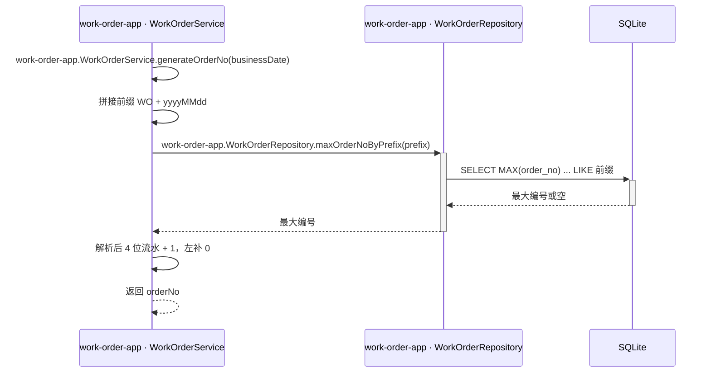

- **异常场景**：

| 异常场景 | 处理方式 |
|---|---|
| 当日无任何工单 | 返回 `0001` |
| 历史编号格式异常（非 4 位数字后缀） | 跳过异常行取最大合法流水，仍冲突则重试 |
| 流水超过 9999 | 抛出冲突错误，W02 返回 500 `ORDER_NO_CONFLICT` |

- **事务与并发控制（如适用）**：
  - 事务/回滚策略：不自开事务，由 W02 的写事务包裹；回滚后编号不被占用。
  - 并发场景与控制策略：同一事务内"查最大 + 插入"，SQLite 写事务串行化；多进程场景由唯一约束兜底 + 重试 1 次。

##### 4.2.3.6 S02 工单状态流转校验与执行（F04）

- **接口类型**：内部接口（Service 方法）
- **方法签名**：`work-order-app.WorkOrderService.applyTransition(orderId, command)`
- **描述**：W04 的唯一业务实现，承担终态校验、合法流转判定、人员与方案校验、条件更新、记录追加与事务提交；其他模块不得直接改写工单状态。
- **入参**：

| 参数名称 | 类型 | 是否必填 | 描述 |
|---|---|---|---|
| orderId | integer | 是 | 工单主键 |
| command | TransitionCommand | 是 | 含 `status`、`assignee`、`solution`、`note`、`operator` 的变更指令 |

- **出参**：

| 参数名称 | 类型 | 描述 |
|---|---|---|
| order | WorkOrder | 更新后的工单对象 |

- **错误码**：

| 错误码 | 说明 |
|---|---|
| ORDER_NOT_FOUND | 工单不存在 |
| ORDER_CLOSED | 已关闭工单被更新 |
| INVALID_TRANSITION | 非法流转、重复提交、非法 note 场景 |
| ASSIGNEE_REQUIRED | 进入处理中缺少维修人员 |
| SOLUTION_REQUIRED | 进入已完成缺少处理方案 |

- **业务规则**：

| 规则编号 | 规则描述 | 校验时机 | 不满足时的处理 |
|---|---|---|---|
| R-S02-01 | 校验顺序固定：存在性 → 终态 → 参数与流转合法性 → 人员/方案 → 条件更新 → 记录写入 | 每次调用 | 任一步失败即中断，返回对应错误码，不写记录 |
| R-S02-02 | 流转表为唯一判定依据，禁止在 Controller 或前端复制判定逻辑 | 设计约束 | 违反视为缺陷（NFR-06） |
| R-S02-03 | 记录内容模板固定：分派并开始处理 / 开始处理 / 分派工单 / 换人 / 完成工单 / 关闭工单 / 处理说明 | 写入时 | 使用统一模板，便于详情页展示与审计 |
| R-S02-04 | 状态与记录在同一事务提交；并发失败不产生"状态变了但没有记录" | 写入时 | 回滚 |

- **处理时序图**：

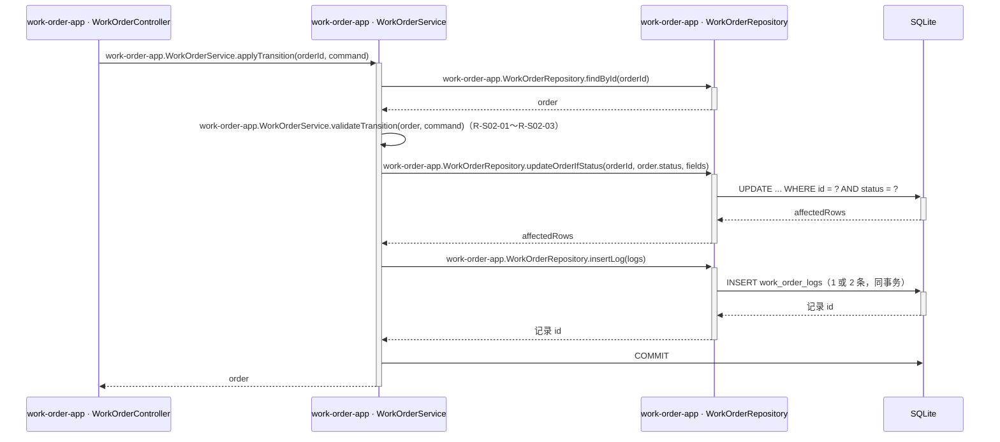

- **异常场景**：

| 异常场景 | 处理方式 |
|---|---|
| 校验失败 | 抛出对应业务错误，事务未开启或已回滚，工单与记录均不变 |
| 条件更新失败 | 重读工单后返回 `ORDER_CLOSED` 或 `INVALID_TRANSITION` |
| 记录写入失败 | 回滚主表更新，返回 500 |

- **事务与并发控制（如适用）**：
  - 事务/回滚策略：方法内统一开启 `BEGIN IMMEDIATE` 并在成功时提交、异常时回滚；调用方不重复提交。
  - 并发场景与控制策略：条件更新 + 写事务串行化；不引入分布式锁（单机单实例，无跨进程并发）。

#### 4.2.4 状态机设计

`work_orders.status` 为有限状态字段，状态机如下（分派但未开始处理为状态自环，不产生第五种状态）：

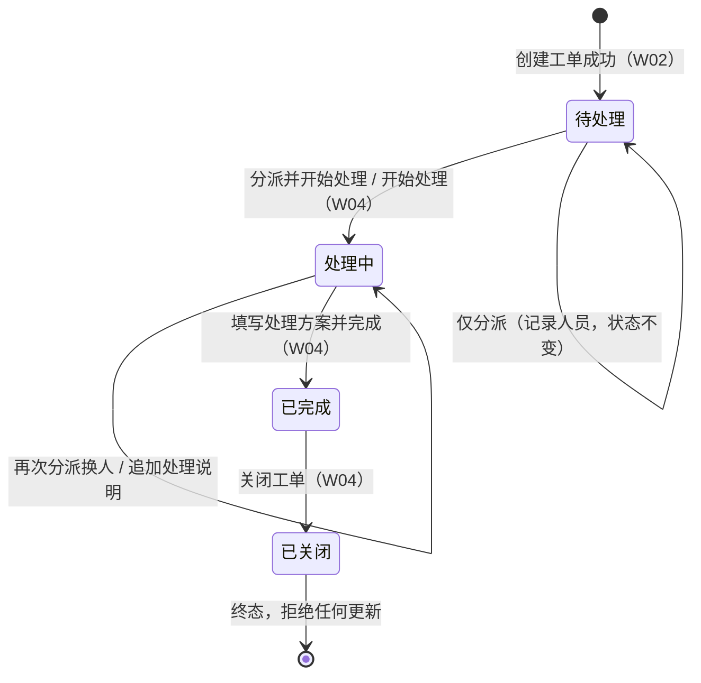

**状态流转规则：**

| 当前状态 | 目标状态 | 流转条件 | 前置校验 | 触发动作 |
|---|---|---|---|---|
| （无） | 待处理 | 创建工单成功 | 5 个必填字段合法、编号生成成功 | 写工单 + 创建记录（W02 / S01） |
| 待处理 | 处理中 | 提交"分派并开始处理"或"开始处理" | 维修人员非空（请求或库中已有） | 条件更新状态、写 `status` 记录、刷新 `updated_at` |
| 待处理 | 待处理 | 仅分派（不传目标状态） | 维修人员在名单内、工单未关闭 | 更新 `assignee`、写人员变更记录、状态不变 |
| 处理中 | 处理中 | 再次分派换人 / 追加处理说明 | 工单未关闭；`note` ≤500 字 | 更新 `assignee` 或追加 `handling` 记录，状态不变 |
| 处理中 | 已完成 | 填写处理方案并完成 | 处理方案非空 1–500 字 | 条件更新状态、写处理方案、追加 `handling`（如有）与 `status` 记录 |
| 已完成 | 已关闭 | 点击关闭工单 | 工单未关闭 | 条件更新状态、追加 `status` 记录，页面转只读 |
| 已关闭 | —（拒绝） | 任何更新请求 | 当前状态 = 已关闭 | 返回 400 `ORDER_CLOSED`，不写记录 |

**状态可达性核对**：4 个状态均从创建可达；每个非终态均有出边；`已关闭` 无出边（终态）；不存在孤岛状态；自环仅用于"仅分派/追加说明"，不改变状态值。

#### 4.2.5 模块自检结果

**功能点—接口对账表**

| F 编号 | 功能点名称 | 对应接口章节 | 时序图 | 业务规则表 | 异常场景 | 并发控制 | 状态 |
|---|---|---|---|---|---|---|---|
| F01 | 工单列表与筛选 | 4.2.3.1（W01） | 有 | 有（R-W01-01～09） | 有 | 无需（只读） | ✅通过 |
| F02 | 新建工单 | 4.2.3.2（W02）、4.2.3.5（S01） | 有 | 有（R-W02-01～09、R-S01-01～06） | 有 | 有（唯一约束 + 重试 + 写事务） | ✅通过 |
| F03 | 工单详情与记录展示 | 4.2.3.3（W03） | 有 | 有（R-W03-01～06） | 有 | 无需（只读） | ✅通过 |
| F04 | 分派/开始处理/完成/关闭 | 4.2.3.4（W04）、4.2.3.6（S02） | 有 | 有（R-W04-01～15、R-S02-01～04） | 有 | 有（条件更新 + 写事务） | ✅通过 |

**表结构对账**

| Step 3 实体 | 表结构定义 | 字段完整性 | 索引 | 状态 |
|---|---|---|---|---|
| 工单 WorkOrder | 4.2.1.1 `work_orders` | 12 字段全部定义（PRD 5.1 全覆盖） | 1 UK + 3 IDX | ✅通过 |
| 工单记录 WorkOrderLog | 4.2.1.2 `work_order_logs` | 9 字段全部定义 | 1 复合 IDX | ✅通过 |

**接口对账**

| 接口编号 | 详细定义 | 入参/出参表 | 错误码 | 示例 | 状态 |
|---|---|---|---|---|---|
| W01 | 4.2.3.1 | 有 | 有 | 有 | ✅通过 |
| W02 | 4.2.3.2 | 有 | 有 | 有 | ✅通过 |
| W03 | 4.2.3.3 | 有 | 有 | 有 | ✅通过 |
| W04 | 4.2.3.4 | 有 | 有 | 有 | ✅通过 |
| S01 | 4.2.3.5 | 有 | 有 | 处理时序覆盖 | ✅通过 |
| S02 | 4.2.3.6 | 有 | 有 | 处理时序覆盖 | ✅通过 |

**仓储层对账**

| 表/操作 | 仓储方法 | 调用接口 | 状态 |
|---|---|---|---|
| work_orders 新增 | `insertOrder` | W02 | ✅通过 |
| work_orders 条件更新 | `updateOrderIfStatus` | W04 | ✅通过 |
| work_orders 按 id 查询 | `findById` | W03、W04 | ✅通过 |
| work_orders 分页查询 | `findPage` | W01 | ✅通过 |
| work_orders 条件计数 | `countByFilter` | W01 | ✅通过 |
| work_order_logs 按工单查询 | `findLogsByOrderId` | W03 | ✅通过 |
| work_order_logs 追加 | `insertLog` | W02、W04 | ✅通过 |
| work_orders 最大编号查询 | `maxOrderNoByPrefix` | S01、W02 | ✅通过 |
| work_orders 全量计数/分组计数 | `countAll`、`countGroupByStatus`、`countGroupByFaultLevel` | 统计模块 S03（W05） | ✅通过（依赖模块补充，见 4.3.2） |
| work_orders 种子存在判断 | `existsSeedData` | 运行支撑模块 I01（4.4.2） | ✅通过（依赖模块补充） |

**时序图归属对账**：4.2.3 下 5 张时序图的 Controller、Service、Repository 调用均以"`work-order-app.类名.方法名`"标注；前端参与者以"`web-console.类名.方法名`"标注；数据库节点使用 SQL 描述。逐条核对无缺失归属的调用。

**状态机对账**

| 含状态字段的实体 | 状态字段 | 状态机图 | 流转规则表 | 可追溯接口 | 状态 |
|---|---|---|---|---|---|
| 工单 WorkOrder | `status` | 4.2.4 | 有（7 行） | W02、W04 | ✅通过 |
| 工单记录 WorkOrderLog | 无状态字段（`from_status`/`to_status` 为快照） | 不适用 | 不适用 | — | ✅不适用 |

**过度设计检查**

| 检查项 | 结论 |
|---|---|
| 是否引入需求未要求的功能/扩展点 | 否。无导出、通知、附件、人员管理、设备台账 |
| 是否存在不必要的抽象层或中间件 | 否。仅保留 Controller–Service–Repository 三层；无缓存、无 MQ、无事件总线 |
| 索引是否按需 | 是。仅覆盖筛选、排序、编号唯一与记录查询，共 4 组索引，无冗余索引 |
| 是否引入无依据的字段 | 否。无 `version`、`tenant_id`、软删标记等未要求字段；并发用条件更新解决 |
| 预留设计 | 仅保留 `operator` 参数以支持后续登录体系接入（PRD A-01 已说明），不建用户表 |

### 4.3 工单统计模块

**模块职责**：按全量工单实时聚合 4 种状态数量、3 种故障等级分布与总数，供统计页与演示验收使用。  
**覆盖功能点**：F05  
**依赖模块/接口**：工单管理模块（复用 `WorkOrderRepository.countAll`、`countGroupByStatus`、`countGroupByFaultLevel`，见 4.2.2）

#### 4.3.1 表结构设计

**本模块无独立表结构。** 原因：统计结果为工单主表的实时聚合，不落统计表、不做定时快照；数据量 ≤ 1000 条（NFR-01），聚合成本可接受，引入统计表会带来一致性与额外写入负担。读取字段与索引复用 4.2.1.1 `work_orders`（`status`、`fault_level` 上已有索引）。

##### 4.3.1.1 枚举与常量定义

本模块不新增枚举，复用 4.2.1.3 的 `WorkOrderStatus`、`FaultLevel`；新增统计口径常量：

| 常量名称 | 取值 | 用途 |
|---|---|---|
| STATUS_KEYS | 待处理、处理中、已完成、已关闭 | `by_status` 必须包含的 4 个键，缺失补 0 |
| FAULT_LEVEL_KEYS | 高、中、低 | `by_fault_level` 必须包含的 3 个键，缺失补 0 |
| STAT_CLOCK | 服务端请求时刻 | 统计口径时间点，不做时间范围过滤 |

#### 4.3.2 仓储层设计

本模块**不新增仓储类**，复用工单管理模块已定义的只读方法；为保证依赖闭合，下列方法已在 4.2.2 中补充定义：

| 归属应用 | 仓储类 | 方法名 | 关联实体/表 | 操作类型 | 核心查询/更新条件 | 入参 | 返回值 | 说明 |
|---|---|---|---|---|---|---|---|---|
| work-order-app | WorkOrderRepository | `countAll` | work_orders | 查询 | 无 | 无 | 整数 | 统计 `total` |
| work-order-app | WorkOrderRepository | `countGroupByStatus` | work_orders | 查询 | `GROUP BY status` | 无 | 状态→数量映射 | 统计卡片 |
| work-order-app | WorkOrderRepository | `countGroupByFaultLevel` | work_orders | 查询 | `GROUP BY fault_level` | 无 | 等级→数量映射 | 等级分布 |

约束：三次查询必须在同一读事务（同一快照）内执行，避免并发写入导致 `total` 与分组之和不一致。

#### 4.3.3 接口设计

| 接口编号 | 接口名称 | 类型 | 方法/触发方式 | 路径/方法签名 | 对应功能点 |
|---|---|---|---|---|---|
| W05 | 查询工单统计 | oneapi | GET | `/api/work-orders/statistics` | F05 |
| S03 | 统计聚合查询 | 内部接口 | 方法调用 | `StatisticsService.aggregate()` | F05 |

##### 4.3.3.1 W05 查询工单统计（F05）

- **URI**：GET `/api/work-orders/statistics`
- **接口类型**：oneapi
- **描述**：返回全量工单总数、按状态数量与按故障等级分布，用于统计页 4 张卡片、等级条形图与合计。
- **入参**：

| 参数名称 | 类型 | 是否必填 | 描述 |
|---|---|---|---|
| 无 | — | — | 不接受筛选、分页或时间范围参数；传入的额外查询参数一律忽略 |

- **出参**：

| 参数名称 | 类型 | 描述 |
|---|---|---|
| total | integer | 全量工单总数 |
| by_status | object | 状态→数量映射，固定含 待处理/处理中/已完成/已关闭 4 个键 |
| by_status.待处理 | integer | 待处理数量，无数据为 0 |
| by_status.处理中 | integer | 处理中数量，无数据为 0 |
| by_status.已完成 | integer | 已完成数量，无数据为 0 |
| by_status.已关闭 | integer | 已关闭数量，无数据为 0 |
| by_fault_level | object | 等级→数量映射，固定含 高/中/低 3 个键 |
| by_fault_level.高 | integer | 高等级数量，无数据为 0 |
| by_fault_level.中 | integer | 中等级数量，无数据为 0 |
| by_fault_level.低 | integer | 低等级数量，无数据为 0 |

- **错误码**：

| 错误码 | 说明 |
|---|---|
| INTERNAL_ERROR（500） | 数据库不可用或聚合查询异常 |

- **业务规则**：

| 规则编号 | 规则描述 | 校验时机 | 不满足时的处理 |
|---|---|---|---|
| R-W05-01 | 统计口径为库中全部工单，不区分列表筛选、不做时间范围过滤（BR-25） | 查询构造 | 忽略任何筛选参数 |
| R-W05-02 | `by_status` 固定输出 4 个键，`by_fault_level` 固定输出 3 个键，无数据补 0，不省略键（BR-26） | 序列化 | 缺失键补 0，前端卡片始终渲染 4 张 |
| R-W05-03 | `total` = 各状态数量之和 = 各等级数量之和；不一致视为缺陷 | 聚合后 | 以同一读快照保证一致，必要时重试一次 |
| R-W05-04 | 路由必须先于 `/api/work-orders/{id}` 注册，或 `{id}` 声明为整型，确保 `statistics` 不被解析为 id（PRD 4.7 实现约束） | 路由注册 | 路由冲突视为缺陷，`/statistics` 必须返回统计结构而非 422 |
| R-W05-05 | 状态卡片颜色与列表标签一致：待处理橙、处理中蓝、已完成绿、已关闭灰；本接口只返回数值，不返回颜色 | 接口边界 | 前端按枚举映射颜色 |
| R-W05-06 | 等级分布条形按数量占 `total` 的比例绘制；`total=0` 时不绘制条形，显示合计 0 | 前端渲染 | 不出现除零 |

- **处理时序图**：

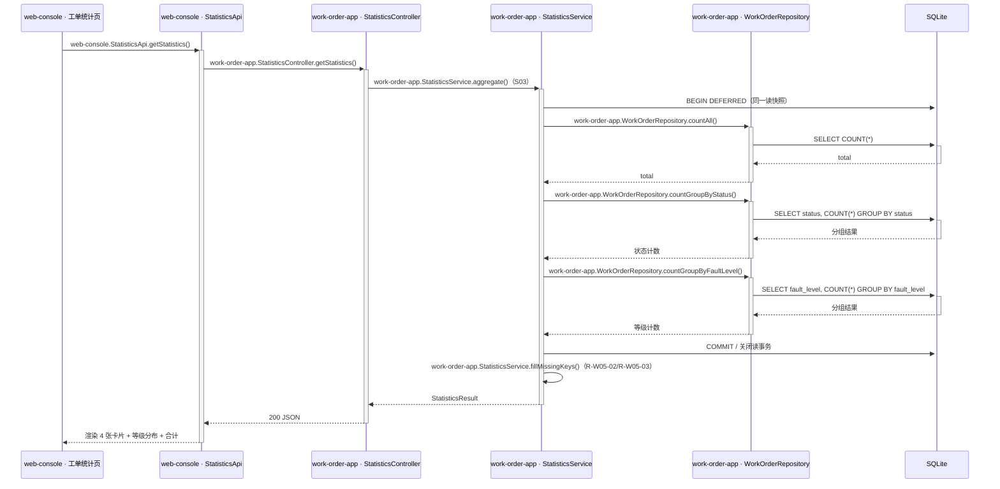

- **异常场景**：

| 异常场景 | 处理方式 |
|---|---|
| 库中无任何工单 | 返回 `total=0`、7 个键全为 0，前端显示 0 与空条形 |
| 聚合查询失败 | 500 `INTERNAL_ERROR`，前端显示错误提示与"重新加载"入口（BR-27） |
| 路由被 `{id}` 抢先匹配 | 视为缺陷；设计上强制静态路由优先，验收 AC-22 覆盖 |
| 与列表页筛选状态不一致 | 正常：统计独立于列表筛选（BR-25），前端在统计页明确展示"全量"口径 |

- **事务与并发控制（如适用）**：
  - 事务/回滚策略：只读事务；失败不影响数据，关闭连接即可。
  - 并发场景与控制策略：同一读快照内完成三次查询，避免写入造成总数与分组不一致；不做缓存，保证演示时数字实时变化（AC-20、AC-21）。

- **请求示例**：

```json
{}
```

- **响应示例**：

```json
{
  "total": 6,
  "by_status": {
    "待处理": 1,
    "处理中": 2,
    "已完成": 1,
    "已关闭": 2
  },
  "by_fault_level": {
    "高": 2,
    "中": 2,
    "低": 2
  }
}
```

##### 4.3.3.2 S03 统计聚合查询（F05）

- **接口类型**：内部接口（Service 方法）
- **方法签名**：`work-order-app.StatisticsService.aggregate()`
- **描述**：在单一读快照内完成总数与两组分组计数，补齐固定键后返回统计结果；仅被 W05 调用，其他模块不得复制聚合逻辑。
- **入参**：

| 参数名称 | 类型 | 是否必填 | 描述 |
|---|---|---|---|
| 无 | — | — | 全量口径，无参数 |

- **出参**：

| 参数名称 | 类型 | 描述 |
|---|---|---|
| total | integer | 工单总数 |
| byStatus | map<string, integer> | 4 个状态键的计数 |
| byFaultLevel | map<string, integer> | 3 个等级键的计数 |

- **错误码**：

| 错误码 | 说明 |
|---|---|
| INTERNAL_ERROR | 聚合失败，由 W05 转换为 500 |

- **业务规则**：

| 规则编号 | 规则描述 | 校验时机 | 不满足时的处理 |
|---|---|---|---|
| R-S03-01 | 复用工单管理模块仓储的三个只读方法，不直接拼 SQL | 调用时 | 违反视为跨层访问缺陷 |
| R-S03-02 | 三查询同一读快照，保证 `total` 与分组之和一致 | 聚合时 | 不一致时重试一次，仍不一致返回 500 |
| R-S03-03 | 固定键补 0，返回 map 不含未知状态/等级键 | 序列化 | 未知键丢弃并记录告警日志 |

- **处理时序图**：

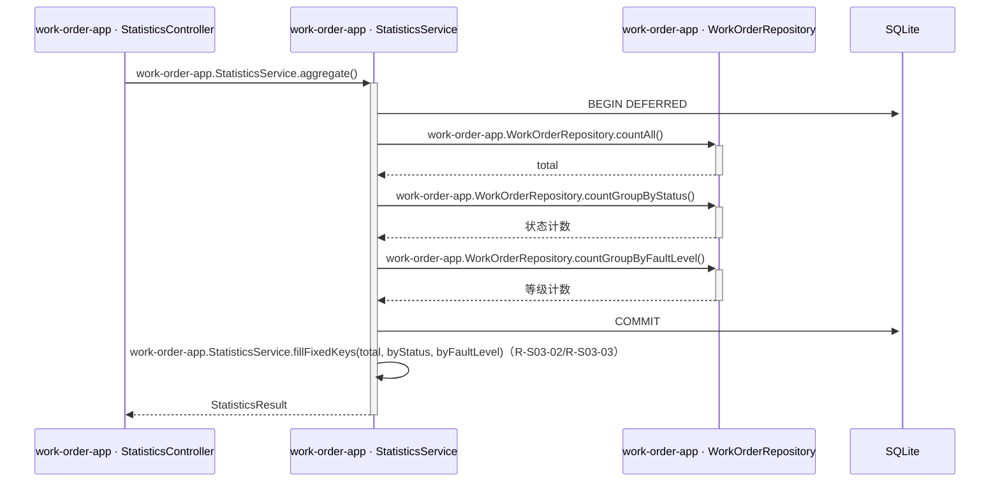

- **异常场景**：

| 异常场景 | 处理方式 |
|---|---|
| 某状态计数为 0 | 补 0 后返回，不省略键 |
| 三查询结果不一致 | 重试一次；仍不一致返回 500 并记录日志 |
| 数据库锁定（读） | 等待 SQLite 读锁释放，超时后返回 500 |

- **事务与并发控制（如适用）**：
  - 事务/回滚策略：只读事务，不产生回滚需求。
  - 并发场景与控制策略：读快照隔离；不引入统计缓存与定时任务，避免数据滞后与任务单点问题。

#### 4.3.4 状态机设计

**本项不适用**：本模块无独立实体与状态字段，统计为只读聚合；工单状态机见 4.2.4。

#### 4.3.5 模块自检结果

**功能点—接口对账表**

| F 编号 | 功能点名称 | 对应接口章节 | 时序图 | 业务规则表 | 异常场景 | 并发控制 | 状态 |
|---|---|---|---|---|---|---|---|
| F05 | 工单统计 | 4.3.3.1（W05）、4.3.3.2（S03） | 有 | 有（R-W05-01～06、R-S03-01～03） | 有 | 有（读快照一致性） | ✅通过 |

**表结构对账**

| Step 3 实体 | 本模块表结构 | 状态 |
|---|---|---|
| 无（统计不落表） | 4.3.1 已说明不适用原因，读取复用 `work_orders` | ✅不适用（已说明） |

**接口对账**

| 接口编号 | 详细定义 | 入参/出参表 | 错误码 | 示例 | 状态 |
|---|---|---|---|---|---|
| W05 | 4.3.3.1 | 有 | 有 | 有 | ✅通过 |
| S03 | 4.3.3.2 | 有 | 有 | 处理时序覆盖 | ✅通过 |

**仓储层对账**

| 读写操作 | 仓储方法 | 来源 | 状态 |
|---|---|---|---|
| 全量计数 | `countAll` | 4.2.2（依赖模块补充） | ✅通过 |
| 按状态分组计数 | `countGroupByStatus` | 4.2.2（依赖模块补充） | ✅通过 |
| 按等级分组计数 | `countGroupByFaultLevel` | 4.2.2（依赖模块补充） | ✅通过 |

**时序图归属对账**：2 张时序图的 Controller/Service/Repository 调用均带 `work-order-app.` 归属前缀；数据库节点使用 SQL 描述，无缺失归属的调用。

**状态机对账**

| 含状态字段的实体 | 状态 |
|---|---|
| 无 | ✅不适用（模块无实体与状态字段） |

**过度设计检查**

| 检查项 | 结论 |
|---|---|
| 是否引入统计表/定时任务/缓存 | 否。实时聚合足以满足 ≤1000 条与演示实时性要求 |
| 是否新增冗余接口 | 否。仅 W05 一个 oneapi，S03 为内部复用 |
| 是否返回前端可自行推导的数据 | 否。仅返回数值与总数，颜色/条形由前端按枚举映射 |

### 4.4 演示数据初始化与运行支撑模块

**模块职责**：应用启动时创建表结构与索引并幂等写入演示数据，同时提供 CORS、统一异常映射与请求日志，保证"删库可重建、重启不丢数据"。  
**覆盖功能点**：F06  
**依赖模块/接口**：工单管理模块（复用表结构定义与 `WorkOrderRepository.existsSeedData`、`insertOrder`、`insertLog`，见 4.2.2）

#### 4.4.1 表结构设计

**本模块不新增表。** 初始化对象为 4.2.1.1 `work_orders` 与 4.2.1.2 `work_order_logs`，建表与索引定义以 4.2.1 为唯一来源，不在本模块重复定义，避免双份结构漂移。

##### 4.4.1.1 初始化数据清单

演示工单 6 条（严格对应 PRD 5.3，创建时间倒序展示）：

| 工单编号 | 设备名称 | 设备编号 | 故障等级 | 状态 | 报修人 | 维修人员 | 创建时间 | 更新时间 |
|---|---|---|---|---|---|---|---|---|
| WO202611130002 | 空压机 A-03 | EQ-A-03 | 中 | 待处理 | 张伟 | NULL | 2026-11-13 09:12:00 | 2026-11-13 09:12:00 |
| WO202611130001 | 冷却水泵 P-11 | EQ-P-11 | 高 | 处理中 | 张伟 | 李强 | 2026-11-13 08:40:00 | 2026-11-13 09:05:00 |
| WO202611120002 | 压缩机 C-01 | EQ-C-01 | 高 | 处理中 | 张伟 | 王敏 | 2026-11-12 16:25:00 | 2026-11-13 08:40:00 |
| WO202611120001 | 传送带 M-07 | EQ-M-07 | 低 | 已完成 | 张伟 | 赵磊 | 2026-11-12 11:03:00 | 2026-11-12 13:40:00 |
| WO202611110002 | 注塑机 I-02 | EQ-I-02 | 中 | 已关闭 | 张伟 | 陈晨 | 2026-11-11 15:47:00 | 2026-11-11 18:05:00 |
| WO202611110001 | 包装机 B-05 | EQ-B-05 | 低 | 已关闭 | 张伟 | 陈晨 | 2026-11-11 10:22:00 | 2026-11-11 16:30:00 |

配套记录 21 条（按时间正序写入，详情页倒序展示）：

| 工单编号 | 记录序列（类型/操作人/时间/内容） | 条数 |
|---|---|---|
| WO202611130002 | 创建工单（status/张伟/09:12/创建工单） | 1 |
| WO202611130001 | 创建（status/张伟/08:40）→ 分派工单，维修人员：李强（status/张伟/08:52，状态待处理→待处理）→ 开始处理（status/李强/09:05，待处理→处理中） | 3 |
| WO202611120002 | 创建（status/张伟/11-12 16:25）→ 分派工单，维修人员：王敏（status/张伟/11-12 17:10）→ 分派并开始处理（status/王敏/11-13 08:40，待处理→处理中）→ 处理记录"已到达现场，初步判断为地脚螺栓松动"（handling/王敏/11-13 08:52） | 4 |
| WO202611120001 | 创建（status/张伟/11:03）→ 开始处理（status/赵磊/11:20）→ 处理记录"检查张紧机构松动，已重新张紧"（handling/赵磊/11:20）→ 完成工单（status/赵磊/13:40，处理中→已完成，处理方案"重新张紧输送带并复检运行状态"） | 4 |
| WO202611110002 | 创建（status/张伟/15:47）→ 开始处理（status/陈晨/16:00）→ 完成（status/陈晨/17:40）→ 关闭（status/张伟/18:05） | 4 |
| WO202611110001 | 创建（status/张伟/10:22）→ 开始处理（status/陈晨/10:40）→ 处理记录"检查热封刀温度偏低"（handling/陈晨/10:40）→ 完成（status/陈晨/15:55）→ 关闭（status/张伟/16:30） | 5 |

**初始化数据校验口径**：状态 待处理 1、处理中 2、已完成 1、已关闭 2，合计 6；等级 高 2、中 2、低 2；记录合计 21 条；已完成/已关闭工单必须有 `solution`，处理中工单 `assignee` 非空。

##### 4.4.1.2 枚举与常量定义

不新增枚举，复用 4.2.1.3。新增初始化常量：

| 常量名称 | 取值 | 用途 |
|---|---|---|
| SEED_ENABLED | 默认开启，可由环境变量关闭 | 控制是否写入演示数据（演示/培训开启，接入真实数据前关闭） |
| SEED_ORDER_COUNT | 6 | 初始化工单条数，用于日志与自检 |
| SEED_LOG_COUNT | 21 | 初始化记录条数，用于日志与自检 |

#### 4.4.2 仓储层设计

**本模块不新增仓储类**，复用 4.2.2 已定义方法：

| 归属应用 | 仓储类 | 方法名 | 关联实体/表 | 操作类型 | 核心查询/更新条件 | 入参 | 返回值 | 说明 |
|---|---|---|---|---|---|---|---|---|
| work-order-app | WorkOrderRepository | `existsSeedData` | work_orders | 查询 | `SELECT 1 ... LIMIT 1` | 无 | 布尔值 | 判断是否已有工单，决定跳过或写入 |
| work-order-app | WorkOrderRepository | `insertOrder` | work_orders | 新增 | 无 | 含固定 `order_no` 与时间的工单实体 | 新增行 `id` | 写入 6 条演示工单 |
| work-order-app | WorkOrderRepository | `insertLog` | work_order_logs | 新增 | 无 | 记录实体 | 新增行 `id` | 写入 21 条演示记录 |

建表与索引由运行支撑层的 `SchemaManager.createSchema()` 执行，不属于仓储数据操作。

#### 4.4.3 接口设计

| 接口编号 | 接口名称 | 类型 | 方法/触发方式 | 路径/方法签名 | 对应功能点 |
|---|---|---|---|---|---|
| I01 | 启动初始化：建表与演示数据种子 | 任务接口 | FastAPI startup 事件 | `DemoDataInitializer.initialize()` | F06 |

##### 4.4.3.1 I01 启动初始化：建表与演示数据种子（F06）

- **接口类型**：任务接口（应用启动事件，无 HTTP 入口）
- **方法签名**：`work-order-app.DemoDataInitializer.initialize()`
- **描述**：启动时确保表与索引存在；工单表为空且种子开关开启时，在同一事务写入 6 条演示工单与 21 条记录；已有数据时跳过，保证重启与重复启动幂等。
- **入参**：

| 参数名称 | 类型 | 是否必填 | 描述 |
|---|---|---|---|
| 无 | — | — | 依赖环境变量 `SEED_ENABLED`（默认开启）与数据库文件路径（默认 `backend/demo.db`） |

- **出参**：

| 参数名称 | 类型 | 描述 |
|---|---|---|
| schemaCreated | boolean | 本次是否实际新建了表或索引 |
| seeded | boolean | 本次是否写入演示数据 |
| orderCount | integer | 写入的工单条数（未写入为 0） |
| logCount | integer | 写入的记录条数（未写入为 0） |
| skippedReason | string / null | 跳过原因（如"已有工单数据""种子开关关闭"） |

- **错误码**：

| 错误码 | 说明 |
|---|---|
| INTERNAL_ERROR | 建表或写种子失败；记录错误日志并终止启动（fail-fast），避免以不完整数据结构对外提供服务 |

- **业务规则**：

| 规则编号 | 规则描述 | 校验时机 | 不满足时的处理 |
|---|---|---|---|
| R-I01-01 | 建表与索引使用"不存在才创建"，重复启动不报错、不重建、不丢数据 | 启动时 | 已存在则跳过，`schemaCreated=false` |
| R-I01-02 | 仅当工单表无任何数据且 `SEED_ENABLED` 开启时写入种子；已有数据一律跳过 | 启动时 | 返回 `seeded=false` 与 `skippedReason`，不修改已有数据 |
| R-I01-03 | 6 条工单与 21 条记录在同一事务写入；任一失败整体回滚 | 写入时 | 回滚并终止启动 |
| R-I01-04 | 种子数据严格使用 PRD 5.3 的编号、人员、状态、时间与记录序列，不重新生成编号、不使用当前时间 | 写入时 | 与清单不一致视为缺陷 |
| R-I01-05 | 记录中的状态快照与工单当前状态自洽：最后一条 `status` 记录的 `to_status` 必须等于工单 `status` | 写入后自检 | 不一致时回滚并记录错误 |
| R-I01-06 | 初始化完成后输出一条汇总日志：表创建情况、写入条数、跳过原因、统计口径校验结果 | 启动结束时 | 缺失日志视为可观测性缺陷 |
| R-I01-07 | 删除 `backend/demo.db` 后重启，自动重建表并恢复 6 条工单与 21 条记录（AC-27） | 启动时 | 按 R-I01-01～R-I01-03 执行 |

- **处理时序图**：

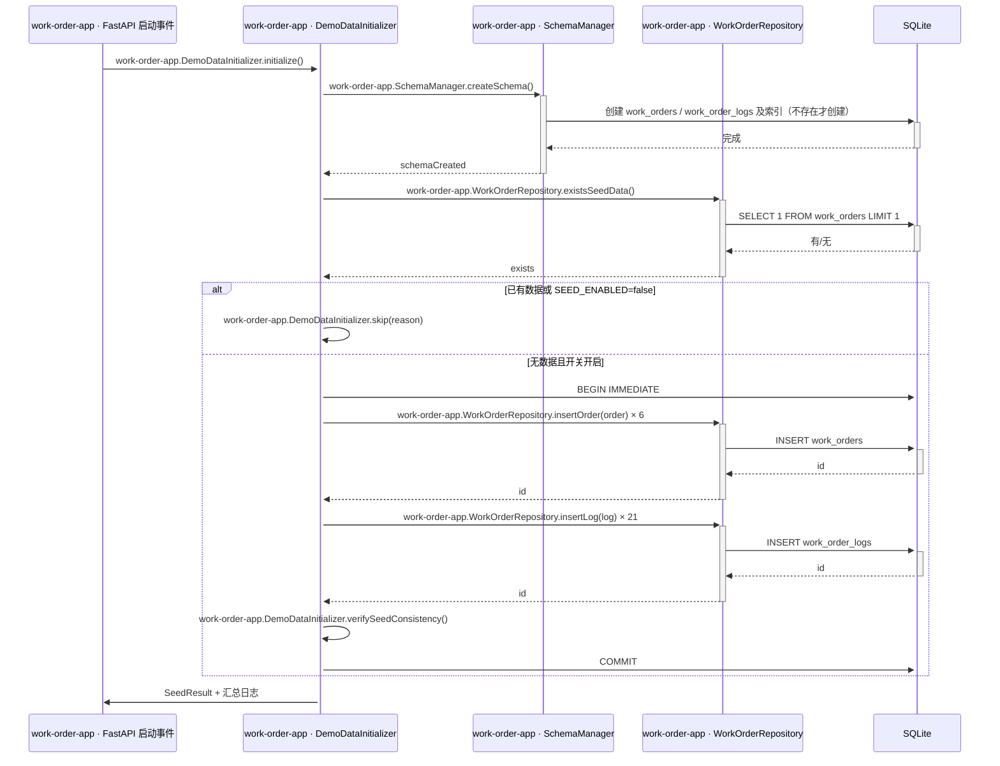

- **异常场景**：

| 异常场景 | 处理方式 |
|---|---|
| 数据库文件不存在 | 自动创建文件并建表，随后写入种子 |
| 表已存在但为空字符串脏数据 | 视为"已有数据"跳过，输出跳过原因，不覆盖 |
| 种子写入中途失败 | 事务回滚，数据库恢复为空表状态；记录错误并终止启动，重启后重试 |
| 两个进程同时启动 | 唯一约束 `uk_work_order_order_no` 拦截重复编号；后启动进程回滚并输出冲突日志（本机演示为单实例，属极端场景） |
| `SEED_ENABLED=false` 且表为空 | 跳过种子，输出 `skippedReason`；页面显示空态，不报错 |
| 磁盘只读/无权限 | 建表失败，终止启动并提示检查文件权限 |

- **事务与并发控制（如适用）**：
  - 事务/回滚策略：种子写入使用单个写事务；表创建为独立 DDL 步骤，失败终止启动。DDL 与数据事务分离，避免 SQLite DDL 隐式提交干扰。
  - 并发场景与控制策略：启动事件单进程串行执行；唯一约束兜底重复编号；不引入分布式锁（单实例，无必要）。

##### 4.4.3.2 运行支撑配置（非接口设计）

| 支撑项 | 设计内容 | 依据 |
|---|---|---|
| CORS | 允许来源 `http://localhost:5173`（端口可配置）；方法 `GET/POST/PATCH/OPTIONS`；请求头 `Content-Type`；不允许通配 `*` | PRD 3.3 约束 2、NFR-05 |
| 统一异常映射 | 业务异常 → `{"detail":{"code","message"}}`；参数校验 → 422 默认结构；未捕获异常 → 500 `INTERNAL_ERROR` 且不返回堆栈 | PRD 4.7、NFR-03 |
| 请求日志 | 每个请求记录方法、路径、状态码、耗时、错误码；写接口额外记录 `order_no` 与操作人 | 变更三板斧可监控要求 |
| 启动自检日志 | 记录数据库路径、表创建、种子条数、统计口径校验 | F06、AC-27 |
| 配置项 | 数据库路径、端口、CORS 来源、`SEED_ENABLED`、`DEFAULT_OPERATOR` | PRD 3.3、A-01 |
| README | 环境要求（Node、Python 版本）、`npm install` / `npm run dev` / `uvicorn app.main:app --reload --port 8000`、访问地址 5173 与 8000/docs、演示数据说明与重置方法 | PRD 3.3、NFR-08、AC-26 |

#### 4.4.4 状态机设计

**本项不适用**：本模块无独立状态字段。种子数据的 4 种状态取值必须落在 4.2.4 状态机定义的合法状态集合内，且其记录序列必须满足"创建→…→当前状态"的合法路径；该一致性由 R-I01-05 保证。

#### 4.4.5 模块自检结果

**功能点—接口对账表**

| F 编号 | 功能点名称 | 对应接口章节 | 时序图 | 业务规则表 | 异常场景 | 并发控制 | 状态 |
|---|---|---|---|---|---|---|---|
| F06 | 本机运行与演示数据初始化 | 4.4.3.1（I01）、4.4.3.2（运行支撑配置） | 有 | 有（R-I01-01～07） | 有 | 有（单启动事件 + 唯一约束兜底） | ✅通过 |

**表结构对账**

| Step 3 实体 | 本模块处理 | 状态 |
|---|---|---|
| 工单 WorkOrder、工单记录 WorkOrderLog | 复用 4.2.1 建表定义，本模块只负责创建与写入种子，不新增字段 | ✅通过（无重复定义） |

**接口对账**

| 接口编号 | 详细定义 | 入参/出参表 | 错误码 | 示例 | 状态 |
|---|---|---|---|---|---|
| I01 | 4.4.3.1 | 有 | 有 | 处理时序覆盖 | ✅通过 |

**仓储层对账**

| 操作 | 仓储方法 | 来源 | 状态 |
|---|---|---|---|
| 判断已有工单 | `existsSeedData` | 4.2.2（依赖模块补充） | ✅通过 |
| 写入工单 | `insertOrder` | 4.2.2 | ✅通过 |
| 写入记录 | `insertLog` | 4.2.2 | ✅通过 |

**时序图归属对账**：I01 时序图的启动事件、初始化器、SchemaManager、仓储调用均带 `work-order-app.` 归属前缀；数据库节点使用 SQL 描述，无缺失归属的调用。

**状态机对账**

| 含状态字段的实体 | 状态 |
|---|---|
| 无（种子数据遵循 4.2.4 状态机） | ✅不适用（已说明） |

**过度设计检查**

| 检查项 | 结论 |
|---|---|
| 是否引入独立种子脚本/命令行工具 | 否。启动事件内完成，满足"零额外步骤启动" |
| 是否新增表/配置中心 | 否。仅环境变量与本地配置文件 |
| 是否引入数据版本/迁移框架 | 否。本期只有新建表与初始化，无存量迁移；版本升级策略见第 5 章 |

### 4.5 跨模块调用链视图

本期跨模块协作仅两条链路：①前端页面经 oneapi 进入工单管理模块，写操作后由前端再次调用统计模块刷新数字；②启动期运行支撑模块向工单管理模块的表写入种子数据。被调用接口均已在对应模块中定义（W01–W05、S01–S03、I01）。

#### 4.5.1 演示闭环链路（创建 → 分派 → 完成 → 关闭 → 统计刷新）

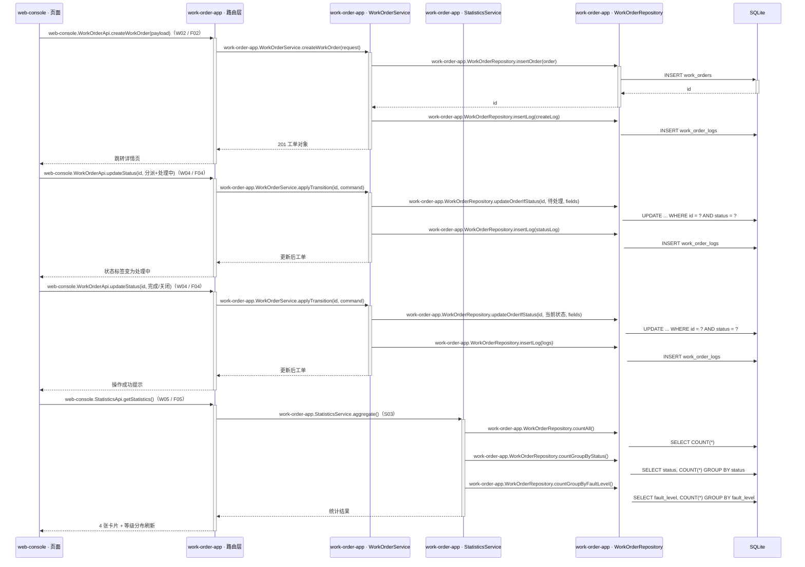

说明：统计模块不订阅写事件、不做异步刷新；统计页每次进入/刷新时重新调用 W05，保证数字实时（AC-20、AC-21）。写操作与统计读取之间无强一致要求，页面刷新顺序由用户操作保证。

#### 4.5.2 启动初始化链路

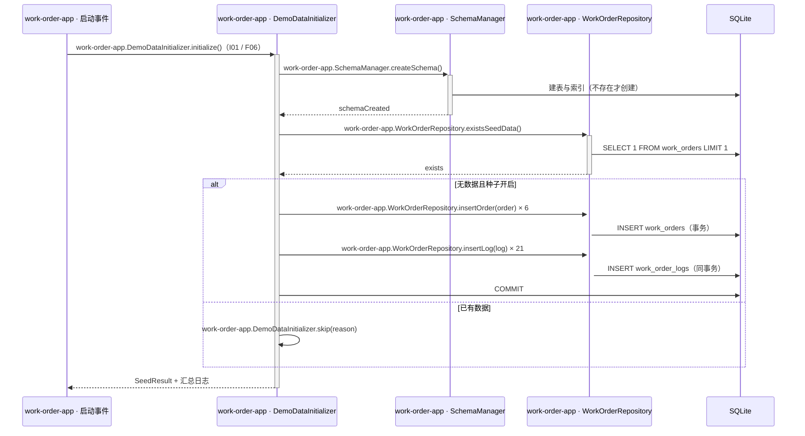

说明：初始化只调用工单管理模块的仓储写方法，不经过业务校验与状态机（种子为固定合法数据），避免启动期依赖 HTTP 层；被调用方法与表结构均已在 4.2 定义。

## 5. 非功能性需求设计

本章以可量化验收表承载设计结论。目标来源为 PRD 6.1 与 3.3/3.4；PRD 未给出的阈值（如日志字段覆盖率、备份 RTO）依据"本机演示"交付形态推导，并在"依据/假设"列标明。验收状态在开发完成后由对应责任方更新。

### 5.1 非功能验收表

| 验收编号 | 维度 | 目标/阈值 | 测量口径与周期 | 监控或告警 | 验证方法 | 责任方 | 验收状态 | 依据/假设 |
|---|---|---|---|---|---|---|---|---|
| NFR-01 | 性能（列表/详情） | 工单 ≤1000 条、本机单用户时，`GET /api/work-orders`、`GET /api/work-orders/{id}` 的 p95 < 500ms | 单接口连续请求 20 次，去除首次冷启动后取 p95；每次交付验收执行 | 请求日志记录单次耗时，>500ms 输出 WARN | 构造 1000 条工单 + 5000 条记录后实测，记录 p95 | 后端开发 + 测试 | 待验证 | PRD NFR-01 |
| NFR-02 | 性能（写操作反馈） | 创建/分派/完成/关闭点击到页面反馈 < 1s（不含人工填写时间） | 前端操作起止打点，取 10 次中位数；交付验收执行 | 浏览器 Performance 面板 + 后端请求耗时 | 按验收演示 4 步各执行 10 次 | 前端开发 | 待验证 | PRD NFR-01 |
| NFR-03 | 性能（统计） | `GET /api/work-orders/statistics` p95 < 500ms（≤1000 条） | 同 NFR-01 口径 | 请求日志耗时 | 1000 条数据下实测 | 后端开发 | 待验证 | PRD NFR-01 推导 |
| NFR-04 | 兼容性 | Chrome / Edge 最近两个大版本可完成全部页面操作；1280×720 无横向滚动、表格列不重叠 | 每个浏览器各 1 轮全流程；分辨率检查 1280×720 | 无自动监控 | 浏览器实测并截图留档 | 前端开发 + 测试 | 待验证 | PRD NFR-02、AC-28 |
| NFR-05 | 可用性（错误与空态） | 所有 400/404/422/500 错误返回中文 `message`；列表/记录/统计空数据均有明确空态文案；无未捕获异常白屏 | 按异常场景清单逐项触发，覆盖率 100% | 前端全局错误提示 + 后端异常日志 | 逐项执行 4.2.3/4.3.3 异常场景表 | 前端开发 + 后端开发 | 待验证 | PRD NFR-03、AC-23 |
| NFR-06 | 可靠性/持久化 | 重启后数据 100% 保留；删除 `demo.db` 后重启自动恢复 6 条工单 + 21 条记录 | 重启演练 1 次、删库演练 1 次；每次交付验收 | 启动自检日志（表创建、种子条数） | 重启与删库后比对列表与统计口径 | 后端开发 | 待验证 | PRD NFR-04、AC-27、R-I01-07 |
| NFR-07 | 可靠性/灾备 | RTO ≤ 5 分钟（重启服务 + 用备份文件覆盖）；RPO = 最近一次手工备份（演示前备份，允许丢失备份后新增数据） | 演练：备份 → 写入 1 条 → 覆盖文件 → 重启 → 校验 | 启动自检日志 | 本机灾备演练，记录起止时间与恢复后条数 | 后端开发 | 待验证 | PRD 3.4、O-6；RTO/RPO 为演示形态推导（A08） |
| NFR-08 | 可维护性 | 状态流转判定仅存在于 `WorkOrderService`（`services` 层），其他层无重复实现；分层目录与 3.2 一致 | 代码走查 1 次；每次涉及流转的变更 | 无 | 走查 Controller/Service/Repository 调用与目录结构 | 后端开发 | 待验证 | PRD NFR-06、R-S02-02 |
| NFR-09 | 可维护性（前端） | 页面不直接访问数据库；接口调用集中在 `src/api`；无硬编码业务数据 | 代码走查 1 次 | 无 | 走查 `views/components/api` 三层引用关系 | 前端开发 | 待验证 | PRD 3.2 约束 |
| NFR-10 | 可观测性 | 每个请求日志含：方法、路径、状态码、耗时、错误码（成功时错误码为空），覆盖率 100%；写操作额外含 `order_no`、`operator`；启动日志含数据库路径与种子条数 | 抽查 20 条请求日志与 1 次启动日志 | 日志输出到标准输出；ERROR 级别含异常摘要不含堆栈给前端 | 触发成功/失败/写操作各 5 次，核对字段 | 后端开发 | 待验证 | 本期可监控设计要求；PRD 未规定，按演示可排查性推导 |
| NFR-11 | 可观测性（统计口径） | 初始化后统计为 待处理 1/处理中 2/已完成 1/已关闭 2、等级 2/2/2，且 `total` = 状态之和 = 等级之和 | 每次启动自检 | 启动自检日志输出校验结果 | 启动后调用 W05 核对 | 后端开发 | 待验证 | PRD 5.3、AC-19、R-I01-05/06 |
| NFR-12 | 容量 | 单库支持工单 ≤1000 条、记录 ≤5000 条，`demo.db` ≤ 50MB；超出后性能目标不再承诺 | 数据量达上限时实测一次 | 请求日志耗时 + 文件大小检查 | 构造上限数据，执行 NFR-01 与文件大小检查 | 后端开发 | 待验证 | PRD NFR-01 量级推导；50MB 为假设阈值（A08） |
| NFR-13 | 接口文档 | `http://localhost:8000/docs` 可见 5 个接口，入参/出参/错误码与本文一致，可直接调试 | 每次交付验收打开核对 | 无 | Swagger UI 逐接口 Compare | 后端开发 | 待验证 | PRD NFR-07、AC-22 |
| NFR-14 | 可复现性 | 干净环境按 README 一次跑通：安装依赖 → 启动后端 → 启动前端 → 完成闭环 | 每次交付在干净目录演练 1 次 | 无 | 按 README 全流程执行并记录访问地址 | 后端开发 + 前端开发 | 待验证 | PRD NFR-08、AC-26 |
| NFR-15 | 时间与时区 | 记录时间与服务端系统时间偏差 ≤ 2s；全链路统一 `yyyy-MM-dd HH:mm:ss`，前端不做换算 | 创建 1 条工单后对比系统时间 | 无 | 手工对比系统时间与 `created_at` | 后端开发 | 待验证 | PRD NFR-09 |
| NFR-16 | 编码 | 页面与接口中文字符 100% 正常显示，无乱码 | 提交含中文的设备名/现象/处理方案各 1 条 | 无 | 列表、详情、统计、`/docs` 四处核对 | 前端开发 + 后端开发 | 待验证 | PRD NFR-10 |
| NFR-17 | 扩展性 | 本期不要求水平扩展与多实例；扩展点为仓储层隔离 SQL（可替换数据库）与接口契约稳定（新增字段不破坏前端） | 设计评审 1 次 | 无 | 架构评审确认无跨层 SQL、无前端硬编码 | 架构负责人 | 不适用（本期无扩展目标，已记录扩展点） | PRD O-6 本机演示 |
| NFR-18 | 定时任务 | 本项不适用，原因：本期无定时任务、无后台批处理，统计为请求时实时聚合 | — | — | — | — | 不适用 | PRD 4.5、4.3.1 设计结论 |

### 5.2 安全验收表

| 验收编号 | 资产/接口 | 风险或控制目标 | 设计措施 | 验证证据 | 责任方 | 验收状态 | 例外及审批 |
|---|---|---|---|---|---|---|---|
| SEC-01 | 全部 oneapi（W01–W05） | 未授权远程访问：演示环境无登录，须限制仅本机可访问 | 服务监听 `127.0.0.1`（不监听 `0.0.0.0`）；README 声明仅本机使用 | 启动参数与 `netstat` 核对；从其他主机访问失败记录 | 后端开发 | 待验证 | 无 |
| SEC-02 | 浏览器 → 后端跨域请求 | 恶意站点跨域调用写接口 | CORS 白名单仅 `http://localhost:5173`（端口可配置）；方法限 `GET/POST/PATCH/OPTIONS`；请求头限 `Content-Type`；不使用 `*` | 浏览器从非白名单来源请求被拦截；配置核对 | 后端开发 | 待验证 | 无 |
| SEC-03 | W02、W04 入参 | SQL 注入 | 全部 SQL 参数绑定，不拼接用户输入；长度与枚举白名单校验 | 代码走查 + 注入串（如 `' OR 1=1`）测试无异常 | 后端开发 | 待验证 | 无 |
| SEC-04 | W04 状态与人员 | 绕过前端直接调用接口篡改状态（跳步/回退/关闭后修改） | 服务端状态机校验（R-W04-02～R-W04-14）；条件更新防止并发覆盖；前端按钮状态仅作展示 | 直接调用接口提交非法流转，返回 400 且数据不变（AC-24、AC-14） | 后端开发 | 待验证 | 无 |
| SEC-05 | `assignee`、`operator` | 伪造维修人员/操作人 | `assignee` 必须属于固定名单（A02）；`operator` 缺省"张伟"，长度与字符校验；记录留痕 | 提交名单外人员返回 422；记录中操作人与请求一致 | 后端开发 | 待验证 | 无 |
| SEC-06 | 工单与记录数据 | 敏感个人信息泄露 | 仅采集姓名（报修人/维修人员），不采集手机号、邮箱、证件号、密码；无敏感字段需脱敏 | 数据表字段清单评审，确认无敏感字段 | 后端开发 | 待验证 | 不适用脱敏：无敏感字段（字段清单见 4.2.1） |
| SEC-07 | `work_order_logs` | 操作不可追溯、历史被篡改 | 记录只追加不更新不删除；含操作人、时间、前后状态、人员快照；写操作与记录同事务 | 详情页记录序列与操作一致；直接 UPDATE 记录不在接口暴露 | 后端开发 | 待验证 | 无 |
| SEC-08 | 错误响应 | 异常堆栈泄露实现细节 | 统一异常映射，500 仅返回 `INTERNAL_ERROR` 与中文提示；堆栈只进服务端日志 | 触发 500 场景，响应体无堆栈/SQL | 后端开发 | 待验证 | 无 |
| SEC-09 | 传输与存储加密 | 数据被窃听或明文泄露 | 本机回环访问，不承载生产数据，不做 HTTPS 与落盘加密 | 架构评审确认部署形态为本机演示 | 后端开发 | 不适用 | PRD O-6 明确不做 HTTPS；仅本机演示数据，风险接受 |
| SEC-10 | 认证/登录与租户隔离 | 账号体系与数据越权 | 本期无登录、无角色、无租户（Q-01 已确认） | 需求确认记录（PRD Q-01） | 产品负责人 | 不适用 | Q-01 已确认本期不引入 |
| SEC-11 | 滥用与限流 | 本机接口被脚本高频调用 | 单机单用户演示，不设计限流与防刷；SQLite 写事务串行化提供基础保护 | 设计评审确认无对外暴露 | 后端开发 | 不适用 | PRD O-6；无公网入口 |
| SEC-12 | 依赖组件 | 引入含已知高危漏洞的依赖 | 仅使用 Vue 3、Vite、Element Plus、FastAPI、uvicorn 与 Python 标准库 sqlite3；锁版本并在 README 记录版本 | `pip/npm` 依赖清单评审与版本核对 | 后端开发 + 前端开发 | 待验证 | 无 |

### 5.3 数据迁移验收表

本期为新建应用，**无存量数据迁移**；新增两张表并在首次启动写入演示数据，属于初始化而非存量迁移。为满足后续版本兼容要求，仍列出变更对象与兼容策略。

| 迁移编号 | 变更对象 | 前向方案 | 兼容性策略 | 回填/初始化 | 校验标准 | 回滚方案 | 执行窗口 | 责任方 | 验收状态 |
|---|---|---|---|---|---|---|---|---|---|
| MIG-01 | 新建表 `work_orders` | 启动时"不存在才创建"，含 1 个唯一索引与 3 个普通索引 | 新表无存量；后续升级只允许新增可空或有默认值的字段，不删除字段、不收窄类型 | 无需回填；表为空时由 MIG-03 写入种子 | 表存在、12 个字段齐全、4 组索引存在；`order_no` 唯一约束生效 | 停止服务，备份后删除 `demo.db` 由启动逻辑重建（演示数据可重放） | 首次启动 | 后端开发 | 待验证 |
| MIG-02 | 新建表 `work_order_logs` | 同 MIG-01，含 `work_order_id + created_at` 复合索引 | 记录表只追加；后续升级只新增可空字段 | 无需回填 | 表存在、9 个字段齐全、复合索引存在 | 同 MIG-01 | 首次启动 | 后端开发 | 待验证 |
| MIG-03 | 演示数据初始化（6 条工单 + 21 条记录） | 启动自检：表为空且 `SEED_ENABLED=true` 时单事务写入固定数据 | 已有数据一律跳过，不覆盖、不补齐（R-I01-02）；`SEED_ENABLED=false` 可关闭 | 初始化即回填；删除 `demo.db` 可重放 | 工单 6 条、记录 21 条；状态 1/2/1/2、等级 2/2/2；已完成/已关闭工单 `solution` 非空；最后一条状态记录与工单状态一致 | 删除 `demo.db` 后重启重建；或从备份文件恢复 | 首次启动/演示前重置 | 后端开发 | 待验证 |
| MIG-04 | 后续版本字段演进（预留规则） | 只新增字段且带默认值或允许 NULL；不删除字段、不修改字段类型与含义 | 新旧版本共用同一 `demo.db`：旧版本忽略新字段仍可运行；新版本对缺失字段取默认值 | 新增非空字段须先回填默认值再收紧约束（本期不做收紧） | 升级后用旧版本读同一库可正常启动与查询；新版本读写正常 | 回退到旧版本程序包；数据库因只增不删可被旧版本使用 | 后续版本发布窗口 | 后端开发 | 待验证 |

**迁移说明**：本期无生产数据、无不可逆变更；`.db` 文件可由启动逻辑重建，因此回滚成本极低。演示前建议手工复制 `demo.db` 作为备份（对应 NFR-07 的 RPO）。

## 6. 变更三板斧

本期为本机单实例演示应用，无集群、无灰度基础设施。三板斧设计以"可排查、可开关降级、可快速回退"为目标，明确区分能做到与做不到的部分。

### 6.1 可监控

**服务自身埋点（每个 oneapi 请求必打）**

| 埋点字段 | 内容 | 用途 |
|---|---|---|
| service | `work-order-app` | 区分应用 |
| api | 接口编号 + 路径（如 `W04 /api/work-orders/{id}/status`） | 定位接口 |
| method | HTTP 方法 | 区分读写 |
| path_params / query | 工单 id、筛选状态、等级（不含内容正文） | 复现问题 |
| result | HTTP 状态码 + 错误码（成功时错误码为空） | 统计成功率与错误分布 |
| cost_ms | 处理耗时（毫秒） | 性能目标 NFR-01/NFR-03 的可观测口径 |
| order_no | 写操作涉及的工单编号 | 串联同一工单的操作轨迹 |
| operator | 写操作人 | 审计与误操作排查 |

**依赖服务埋点**：本期无三方服务；唯一下游为 SQLite，记录"操作类型（查/增/改）、表名、耗时、失败原因"，用于区分业务错误与存储故障。

**启动埋点**：记录数据库文件路径、表/索引创建结果、种子写入条数、统计口径校验结果（NFR-11）。校验失败输出 ERROR 并终止启动，避免带病对外服务。

**告警阈值（本机以日志级别体现，无外部告警通道）**

| 场景 | 级别 | 处理 |
|---|---|---|
| 单接口耗时 > 500ms | WARN | 排查数据量与索引命中 |
| 任一 5xx | ERROR | 记录异常摘要（不含堆栈给前端），检查日志 |
| 非法流转拒绝（`INVALID_TRANSITION`/`ORDER_CLOSED`） | WARN | 判断是误操作、页面过期还是前端绕过 |
| 种子校验不一致 / 建表失败 | ERROR | 终止启动，按 6.3 应急 |
| 依赖 SQLite 操作失败 | ERROR | 检查文件权限、磁盘空间与文件是否被占用 |

**前端埋点**：全局请求失败统一弹中文提示，浏览器控制台输出接口编号与错误码；不引入前端上报服务（无采集端，属于过度设计）。

**可行性说明**：日志输出到标准输出，可用重定向落盘；不引入 Prometheus/Grafana/ELK（本机演示无监控基础设施，且 PRD 未要求）。验收方式为触发成功、400、500 各若干次后核对日志字段完整性（NFR-10）。

### 6.2 可灰度

**部署灰度：本项不适用。** 本期为单机单进程（Vite 5173 + Uvicorn 8000 单 worker），无网关、无多实例、无注册中心，无法按流量比例切分；PRD O-6 明确不做生产部署与高可用。

**替代方案（软件层开关 + 环境级并行验证）**

| 手段 | 设计 | 默认值 | 用途 |
|---|---|---|---|
| 演示数据开关 `SEED_ENABLED` | 启动时决定是否写入 6 条工单 + 21 条记录 | 开启 | 接入真实数据或干净演示时关闭 |
| 统计页开关 `ENABLE_STATISTICS_PAGE` | 前端菜单与路由是否展示统计页 | 开启 | 统计异常时先隐藏入口，保核心闭环 |
| 统计接口开关 `ENABLE_STATISTICS_API` | 后端是否注册 W05 | 开启 | 与前端开关配套使用 |
| 默认操作人 `DEFAULT_OPERATOR` | `operator` 缺省值 | 张伟 | 更换演示身份，无需改代码 |
| CORS 来源 `CORS_ORIGINS` | 允许的前端来源 | `http://localhost:5173` | 端口调整时同步 |
| 并行验证 | 新版本先用 5174/8001 端口启动，与旧版本共用同一份 `demo.db` 副本做对比，确认后切换端口 | — | 无灰度基础设施下的"人工灰度" |

**灰度顺序建议**：先验证 W01–W04 闭环（列表、创建、详情、流转），再开启统计页 W05；新版本先以副本数据库运行，确认读写与种子幂等后再切主库。开关变更均需重启进程生效（本机可接受）。

### 6.3 可应急

**应急场景与手段（按优先使用顺序）**

| 场景 | 应急手段 | 生效时间 | 数据影响 |
|---|---|---|---|
| 统计页异常/数据不符 | 关闭 `ENABLE_STATISTICS_PAGE`（必要时同时关闭 `ENABLE_STATISTICS_API`），隐藏入口，核心闭环继续演示 | 配置修改 + 重启前端/后端，< 1 分钟 | 无，统计为只读 |
| 演示数据被误改/演示需要重置 | 停止服务 → 用演示前备份的 `demo.db` 覆盖 → 重启；无备份时删除 `demo.db` 重启重建（丢失演示期间新增数据） | < 5 分钟（NFR-07 的 RTO） | 有：丢失备份点之后的数据；**删除文件不可恢复，必须先确认** |
| 后端无响应/端口占用 | 重启 uvicorn；更换端口并同步 CORS 与 README 地址；前端提示连接失败不白屏（AC-23） | < 1 分钟 | 无（数据在文件中） |
| 新版本存在缺陷 | 回退到上一版本代码/前端构建产物，重启；数据库因"只增不删字段"可被旧版本直接使用 | < 5 分钟 | 无 |
| 依赖 SQLite 文件损坏 | 用备份覆盖；无备份则删除重建（演示数据可重放） | < 5 分钟 | 有：丢失新增数据 |

**开关应急的默认与操作**：所有开关默认开启（保证开箱即用），应急时通过环境变量/配置文件改为关闭并重启。开关只影响展示与注册，不改变接口契约与数据结构，关闭后再次开启无需数据修复。

**回滚依赖检查**

| 依赖方向 | 检查结论 |
|---|---|
| 上游（浏览器） | Vue SPA 无 Service Worker、无本地持久缓存；刷新即加载当前版本，无版本错配风险 |
| 下游（SQLite） | 只新建两张表、只新增字段；旧版本不读取新字段仍可运行；不删除字段、不收窄类型（MIG-04） |
| 外部系统 | 无外部系统，无对外接口契约，回退不影响合作方 |
| 前端 ↔ 后端 | 5 个接口路径与字段契约不变；新增字段为可选，旧前端可忽略 |

**明确不可应急/不可回滚项**

1. 已删除的 `backend/demo.db`（且无备份）无法恢复历史新增数据，只能重建为初始 6 条。
2. 业务上"已关闭"工单不支持重新打开（Q-05），状态不可回退；误关闭只能新建工单，属于业务规则而非技术缺陷。
3. 本期无登录与权限，无法通过"切回旧账号/旧权限"应急；如后续引入，需要独立的权限开关设计。

**应急演练要求**：演示前执行一次"备份 → 写入 → 覆盖恢复"演练并记录耗时，确保 RTO ≤ 5 分钟（NFR-07）；同时确认关闭统计开关后列表与详情仍可用。

## 附录 A 方案检查结论

检查对象：`docs/changes/设备故障智能工单助手系分设计_20261113.md`（第 1–6 章，含 16 张 Mermaid 图、2 张表结构、9 个接口/任务定义）。检查方法：逐项对照 PRD V1.1 与需求原文；交叉核对功能点—接口—表—仓储—枚举—状态机；反例推演非法流转与并发；检查 Mermaid 代码块与章节衔接。

### A.1 检查清单

| # | 检查项 | 结论 | 依据与说明 |
|---|---|---|---|
| 1 | 模块划分合理性 | 通过（附论证） | 3 个模块职责均为单句可描述；无循环依赖。工单管理模块承载 F01–F04（4/6），比例超 50%，但其功能点全部围绕同一聚合根"工单"的生命周期，拆分查询与流转会造成 Service/仓储重复与跨模块事务，判定为合理；统计与初始化模块职责单一且薄 |
| 2 | 依赖关系合理性 | 通过 | 依赖单向：统计模块、初始化模块 → 工单管理模块；无外部依赖。下游 SQLite 故障时列表/详情/写操作不可用（无缓存兜底），统计页可经开关降级隐藏；已在本机演示形态下接受并记录（NFR-07、6.3） |
| 3 | 单点问题检查（部署） | 通过（已识别并接受） | 单进程 FastAPI 与 SQLite 单文件为单点；PRD O-6 明确不做生产部署与高可用，控制措施为备份/重建与启动自检，不引入集群 |
| 4 | 表模型设计范式检查 | 通过 | 两张表均满足 1NF/2NF/3NF：字段原子、主键单列、非主属性完全依赖主键；`work_order_logs.from_status/to_status/assignee` 为审计快照（事件数据），非传递依赖；索引列均 NOT NULL；无重复列名冲突 |
| 5 | 隐私安全检查 | 通过 | 仅存姓名（报修人/维修人员/操作人），无手机号、邮箱、证件号、密码；本机访问、无登录（Q-01）；不涉及脱敏与数据分级，例外已在 SEC-06/SEC-09 记录 |
| 6 | 兼容性检查（接口） | 通过（本期为新增） | 5 个 oneapi 为新增，无既有契约；后续扩展只新增可选字段，旧前端可忽略；前端只依赖 5 条路径与已有字段 |
| 7 | 兼容性检查（表） | 通过 | 两张表均为新建，无存量；MIG-04 规定后续只增可空/有默认值字段、不删字段、不收窄类型，旧版本可读同一 `demo.db` |
| 8 | 数据迁移检查 | 通过 | MIG-01/02 建表、MIG-03 种子初始化（6 工单 + 21 记录）、MIG-04 字段演进规则；均含校验标准、回滚方案、执行窗口与责任方，无存量回填缺口 |
| 9 | 一致性检查（功能点） | 通过 | F01→W01；F02→W02+S01；F03→W03；F04→W04+S02；F05→W05+S03；F06→I01。6/6 有接口、时序图、业务规则、异常场景与并发说明 |
| 10 | 一致性检查（表） | 通过 | WorkOrder→`work_orders`（12 字段、1 UK + 3 IDX）；WorkOrderLog→`work_order_logs`（9 字段、1 复合 IDX）；与 PRD 5.1 字段逐项一致 |
| 11 | 一致性检查（接口） | 通过 | W01–W05、S01–S03、I01 共 9 个定义均含入参/出参表、错误码、业务规则、时序图与异常场景；W02/W04 含请求与响应示例 |
| 12 | 仓储层设计检查 | 通过 | M1 定义 12 个方法并逐项映射到 W01–W04/S01/I01 的读写；M2 复用 3 个计数方法、M3 复用 3 个方法，均已回填至 4.2.2，无跨层直连 SQL |
| 13 | 时序图应用归属检查 | 通过 | 16 张图中 11 张时序图的 Controller/Service/Repository 调用均带 `work-order-app.` 或 `web-console.` 前缀；数据库节点使用 SQL 描述；无裸类名调用 |
| 14 | 一致性检查（枚举） | 通过 | `status` 4 值、`fault_level` 3 值、`log_type` 2 值在表结构、枚举表、状态机、统计键、种子数据中完全一致；8 个错误码在全局约定与各接口错误码表中一致；422 语义码歧义已修复（见 A.2） |
| 15 | 状态机完整性检查 | 通过 | 4 状态均从创建可达；3 条正向流转 + 2 类自环；`已关闭` 为终态无出边；每条流转可追溯至 W02/W04；无孤岛状态；工单记录表无状态字段已说明不适用 |
| 16 | 并发风险检查 | 通过 | 写操作用"条件更新 + 受影响行数判定"，创建用唯一约束 + 重试 1 次，写事务串行化；不引入 version/分布式锁，理由已记录；读接口无并发风险 |
| 17 | 单点问题检查（定时任务） | 不适用 | 本期无定时任务与后台批处理，统计为请求时实时聚合 |
| 18 | 非功能性设计可行性检查 | 通过 | 性能（≤1000 条、p95<500ms）、持久化、可维护性目标与单机架构匹配；可观测性用标准输出日志实现；无过度组件 |
| 19 | 非功能验收可验证性检查 | 通过 | 18 项均含目标/阈值、测量口径、监控、验证方法、责任方、状态；RTO ≤5 分钟、RPO=最近备份；性能项标明数据量与 p95 口径 |
| 20 | 安全验收可验证性检查 | 通过 | 12 项均含资产/接口、控制目标、设计措施、验证证据、责任方、状态与例外；认证、租户、传输加密、限流的不适用原因与审批依据明确 |
| 21 | 数据迁移验收可验证性检查 | 通过 | 4 项均含前向方案、兼容策略、初始化/回填、校验标准、回滚、执行窗口、责任方、状态；无存量迁移已说明 |
| 22 | 变更三板斧可行性检查（可监控） | 通过 | 服务埋点含接口、结果、耗时、工单号、操作人；下游 SQLite 埋点含操作类型与耗时；启动自检与阈值级别可落地；不引入监控组件的原因已说明 |
| 23 | 变更三板斧可行性检查（可灰度） | 通过（部署灰度不适用） | 单机单实例无流量灰度，已说明原因；以 5 个环境变量开关 + 双端口并行验证替代，默认值明确、生效方式明确 |
| 24 | 变更三板斧可行性检查（可应急） | 通过 | 覆盖统计异常、数据误改、服务不可用、版本缺陷、文件损坏；回退依赖已检查（上游无缓存、下游只增不删、无外部系统）；3 项不可回滚/不可应急边界已显式列出 |

### A.2 检查发现与修复记录

| 编号 | 发现 | 位置 | 修复 | 状态 |
|---|---|---|---|---|
| FIX-01 | 422 响应既声明"沿用 FastAPI 默认结构"，错误码表又列 `VALIDATION_ERROR`，存在结构歧义 | 4.1.1 全局约定、4.2.1.3 枚举表 | 明确 422 响应体不含自定义 `code` 字段，`VALIDATION_ERROR` 仅作日志与前端提示的语义码；已同步更新临时文件与最终文档 | 已修复 |
| FIX-02 | 模块划分检查中工单管理模块承载 4/6 功能点（>50%） | 2.2 模块清单 | 复核后判定为同聚合根内的合理集中，记录论证，不拆分 | 通过（附论证） |

未发现需要触发澄清的问题：PRD Q-02、Q-04、Q-05、Q-06 均已按"不影响本期交付"的默认规则设计，且改动影响范围已在 1.7 待确认项中标注；无新增范围、契约或数据边界冲突。

### A.3 方案检查结论

- 24 项检查：20 项通过、3 项通过（含论证/不适用替代）、1 项不适用；无未修复的"不通过"项。
- 功能点、实体、接口、仓储、枚举、状态机六个维度全部闭合，追溯链为 F 编号 → 接口编号 → 表/仓储方法 → 状态机流转。
- 最终设计文档：`docs/changes/设备故障智能工单助手系分设计_20261113.md`。
- 实施提示：开发阶段须同步维护 `docs/ARCHITECTURE.md` 与 `docs/modules/**`（本期未创建），并以 PRD 6.2 的 AC-01–AC-28 作为验收基线。
