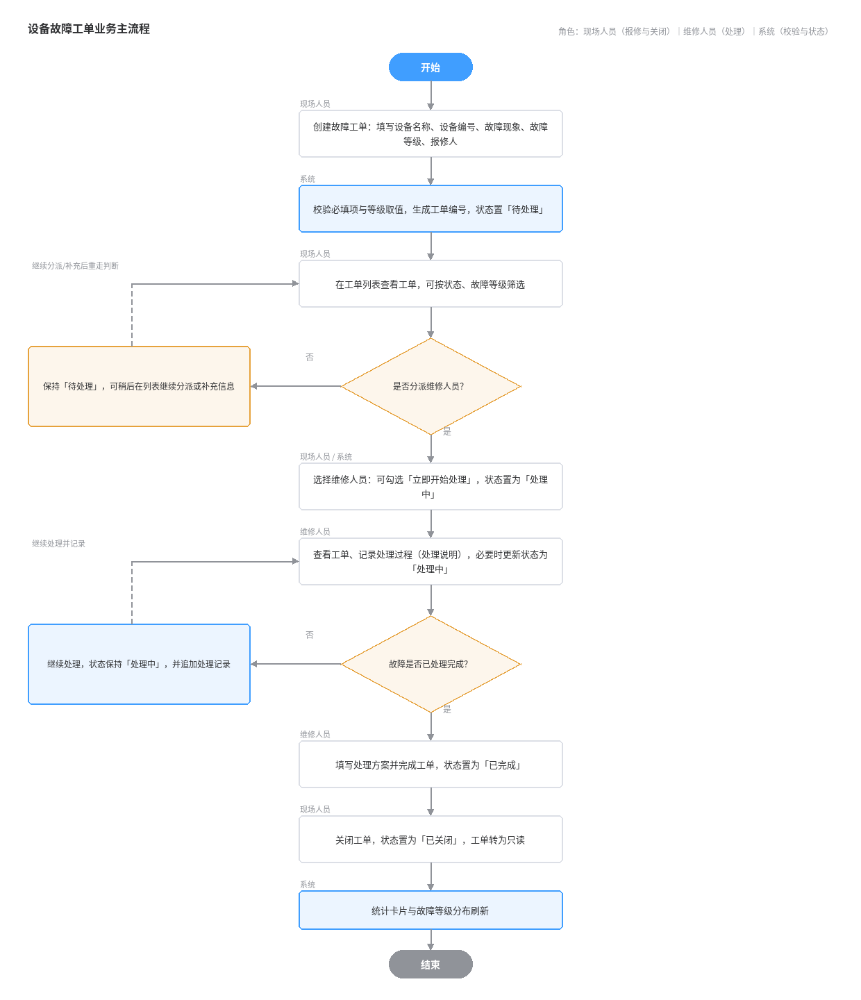
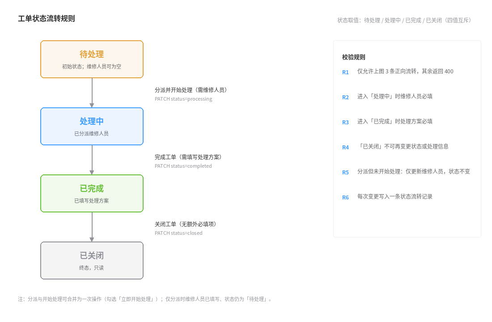
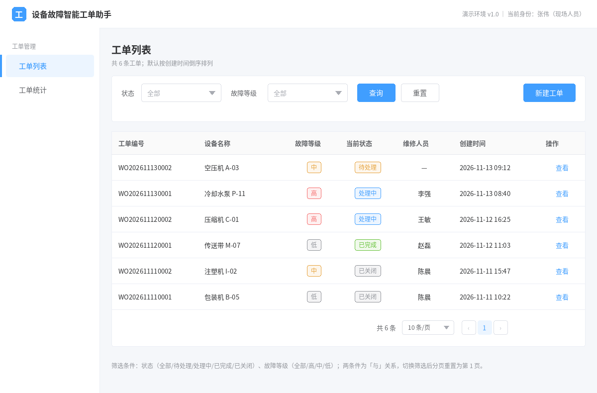
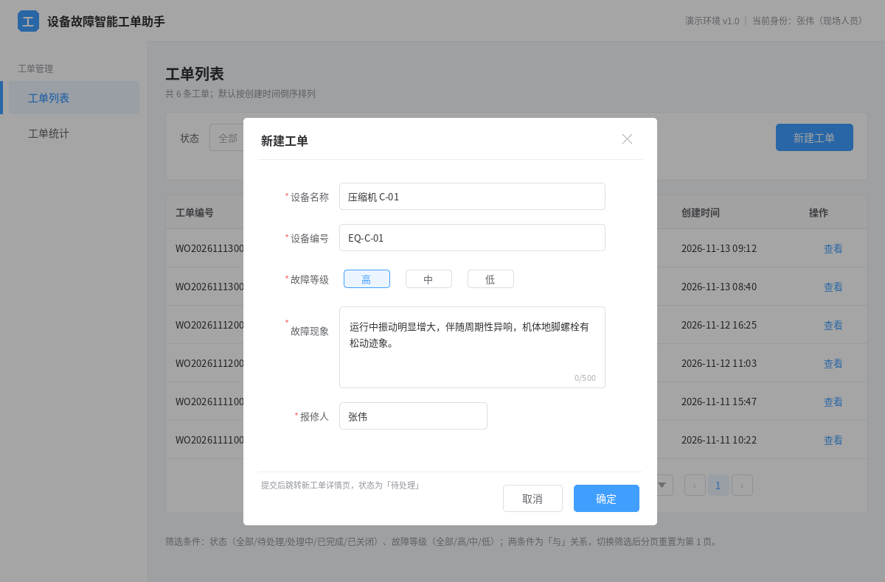
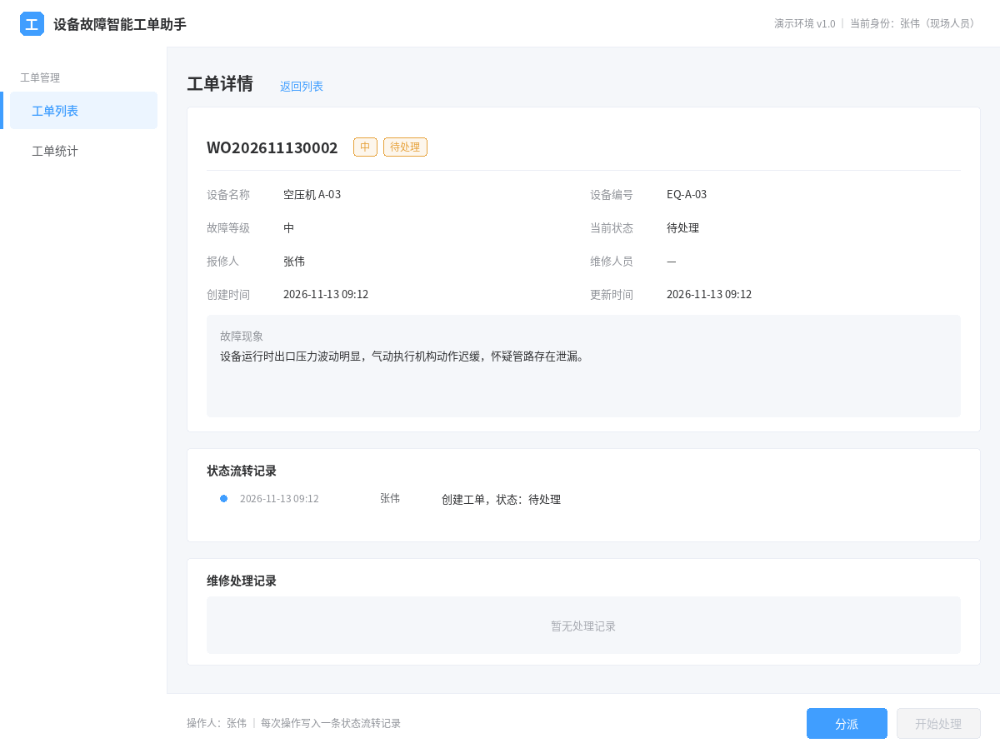
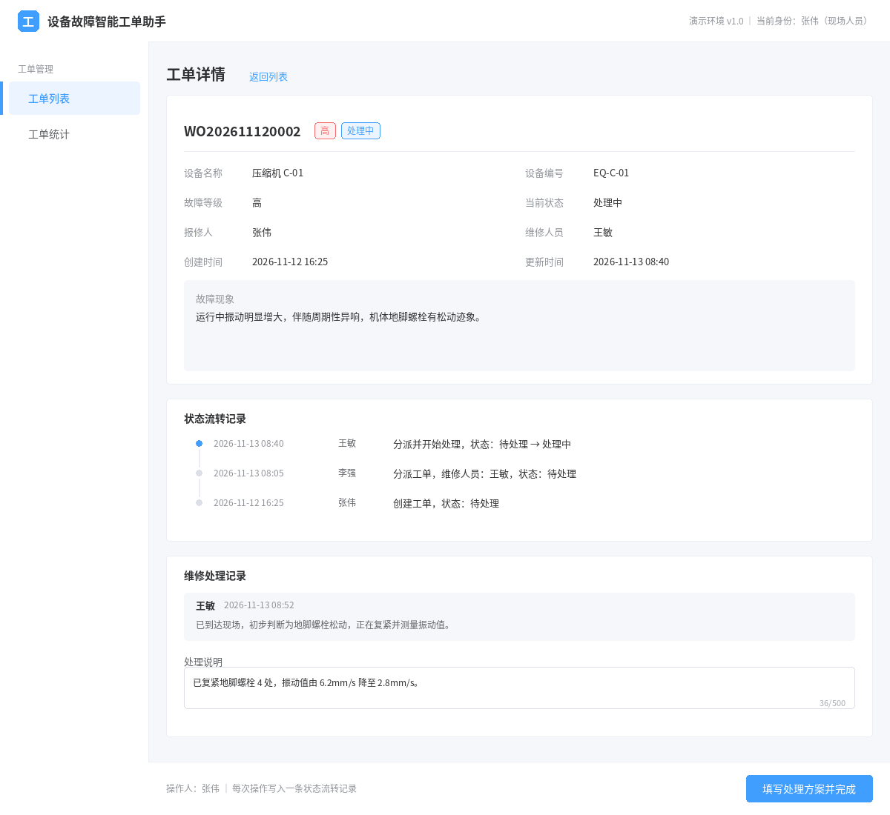
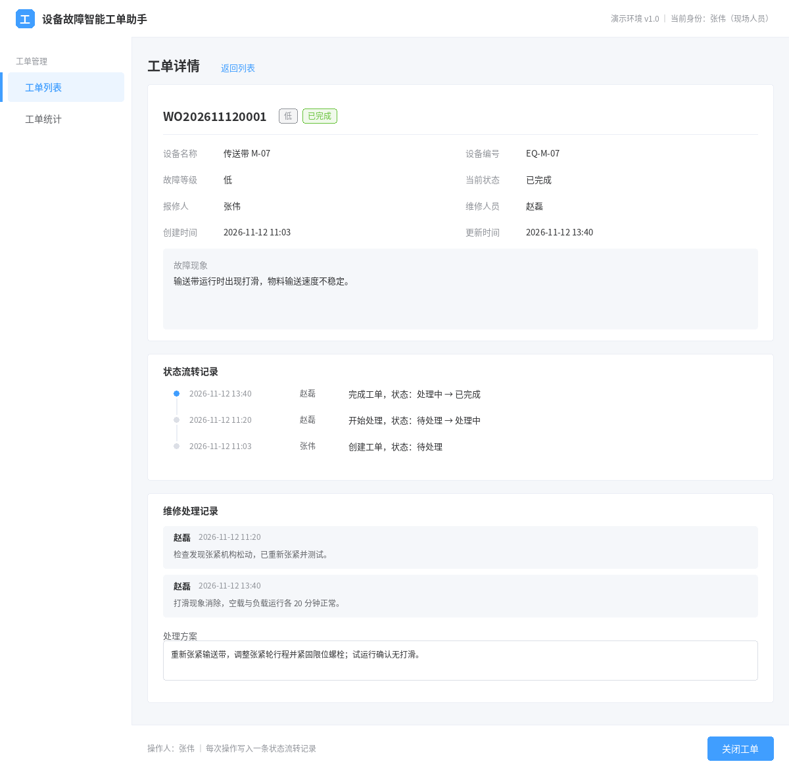
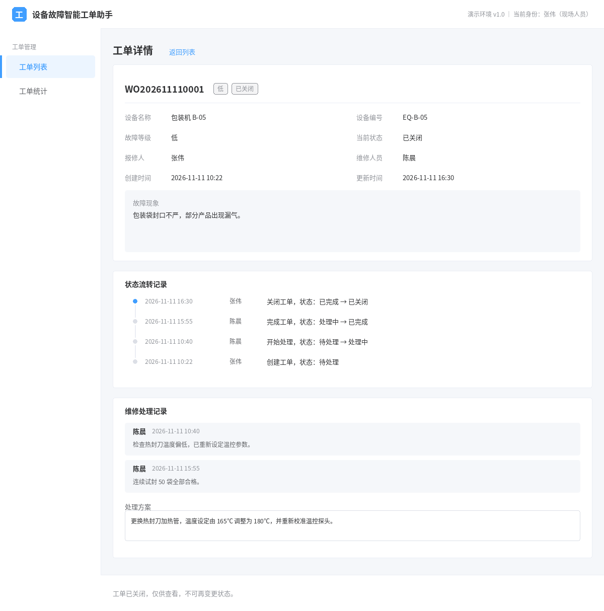
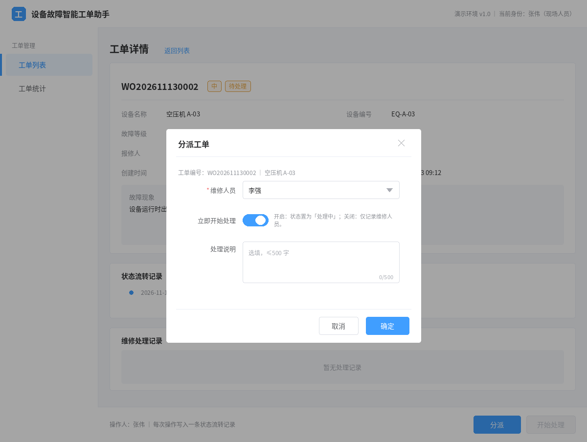
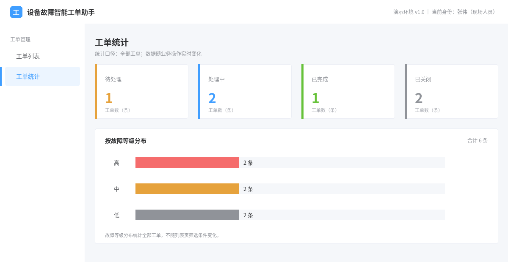

# 设备故障智能工单助手 产品需求文档（PRD）

| 项目 | 内容 |
|---|---|
| 文档名称 | 设备故障智能工单助手 产品需求文档 |
| 文档版本 | V1.1 |
| 文档状态 | 评审中（Q-01、Q-03 已确认） |
| 编写 | AiWork |
| 编写日期 | 2026-11-13 |
| 评审 / 批准 | 待填写 |
| 需求来源 | 需求描述第 2 章（统一技术栈选型）、第 4 章（选题一：设备故障智能工单助手） |
| 交付形态 | 本机可运行的演示项目（Vue 3 + Vite + Element Plus + FastAPI + SQLite） |

## 修订记录

| 版本 | 日期 | 修订内容 | 修订人 |
|---|---|---|---|
| V1.0 | 2026-11-13 | 首次编写：业务闭环、页面原型、状态规则、接口与数据定义、验收标准 | AiWork |
| V1.1 | 2026-11-13 | 业务确认 Q-01（不引入登录鉴权）、Q-03（统计页保留 4 张卡片）；同步附录 A/B/C 与追溯、检查记录 | AiWork |

## 目录

1. 引言
   1.1 背景与目标
   1.2 范围
   1.3 术语与定义
   1.4 依据与文档约定
2. 整体流程与功能概览
   2.1 角色与使用场景
   2.2 业务主流程
   2.3 工单状态流转
   2.4 功能清单
3. 技术栈与工程约束
   3.1 技术选型
   3.2 目录结构
   3.3 本机运行与访问地址
   3.4 数据存储与演示数据
4. 功能需求
   4.1 工单列表页
   4.2 新建工单
   4.3 工单详情与处理
   4.4 工单分派
   4.5 工单统计页
   4.6 状态与操作矩阵
   4.7 接口需求
5. 数据需求
   5.1 数据表结构
   5.2 工单编号规则
   5.3 演示初始数据
6. 非功能需求与验收
   6.1 非功能需求
   6.2 验收标准
附录 A 待确认项
附录 B 依据与追溯记录
附录 C 质量检查记录

## 1 引言

### 1.1 背景与目标

设备出现异常时，现场人员通过口头、电话或聊天工具报修，维修过程与结果缺少统一记录，导致故障历史无法追溯、处理进度不可见。本项目以"设备故障智能工单助手"为主题，构建一个可在本机直接启动的管理后台，用一条完整的工单记录串起报修、分派、处理、完成与关闭。

目标：

1. 现场人员可在 1 分钟内完成一条故障工单的录入，系统自动生成唯一工单编号。
2. 工单可被分派给指定维修人员，并在列表中直观看到当前状态与维修人员。
3. 维修人员可记录处理过程与处理方案，工单按固定规则流转，不允许跳步或回退。
4. 通过统计卡片与故障等级分布，管理者可掌握待处理、处理中、已完成的数量与等级构成。
5. 全套技术栈（Vue 3 / Vite / Element Plus / FastAPI / SQLite）可在本机零外部依赖启动，用于现场培训与 Demo 演示。

### 1.2 范围

**本期范围（V1.0）**

| 编号 | 内容 | 说明 |
|---|---|---|
| R-G1 | 工单列表页 | 展示工单编号、设备名称、故障等级、当前状态、维修人员、创建时间；按状态与故障等级筛选 |
| R-G2 | 新建工单 | 弹窗录入设备名称、设备编号、故障现象、故障等级、报修人 |
| R-G3 | 工单详情 | 基本信息、状态流转记录、维修处理记录；分派、开始处理、完成、关闭操作 |
| R-G4 | 工单统计 | 待处理 / 处理中 / 已完成数量，按故障等级分布 |
| R-G5 | 后端接口 | 工单查询、创建、详情、状态更新、统计共 5 个接口 |
| R-G6 | 本机运行 | 端口、启动命令、README 说明、演示初始数据 |

**本期不做（范围外）**

| 编号 | 内容 | 原因 |
|---|---|---|
| O-1 | 用户登录、密码、角色权限 | 演示环境单人使用；Q-01 已确认本期不实现 |
| O-2 | 设备台账主数据维护、维修人员主数据维护 | 需求仅要求填写设备名称与编号，人员为选择项，见 Q-02 |
| O-3 | 消息通知（短信、企业微信、邮件）、超时提醒 | 需求未提出 |
| O-4 | 附件上传（故障照片、维修单据） | 需求未提出 |
| O-5 | 报表导出（Excel/PDF）、多机型统计 | 需求未提出 |
| O-6 | 生产部署、HTTPS、多用户并发压测 | 交付目标为本机演示 |

### 1.3 术语与定义

| 术语 | 定义 |
|---|---|
| 工单 | 一条设备故障报修记录，包含设备信息、故障描述、等级、状态、人员与处理过程 |
| 工单编号 | 系统生成的唯一业务编号，格式 `WO` + `yyyyMMdd` + 4 位流水，如 `WO202611130001` |
| 故障等级 | 工单紧急程度，取值：高、中、低 |
| 报修人 | 创建工单的现场人员姓名，创建时手工填写 |
| 维修人员 | 被分派处理该故障的人员，取自演示人员名单 |
| 分派 | 为工单指定维修人员的动作，可同时开始处理 |
| 状态流转记录 | 每次状态变化生成的日志，含变更时间、操作人、前后状态 |
| 维修处理记录 | 维修人员填写的处理过程说明，追加写入，不覆盖历史 |
| 处理方案 | 工单完成时填写的最终处理结论，必填项之一 |
| 只读 | 工单关闭后，页面不再提供任何状态或内容变更入口 |

### 1.4 依据与文档约定

1. **已确认**：需求描述第 2 章技术栈与运行目标、第 4 章业务描述、页面要求、接口最低要求、数据字段建议、验收演示，均视为已确认输入。
2. **建议**：本 PRD 中标注 `S-xx` 的内容为本 PRD 提出的设计建议（如分页、统计页"已关闭"卡片），需业务确认后生效，见附录 B。
3. **假设**：无输入依据但影响实现的判断，标注 `A-xx` 并记录影响，见附录 B。
4. **待确认**：尚未确认且可能改变结果的事项，标注 `Q-xx`，见附录 A。
5. 页面原型图为示意稿，用于确认字段、操作与状态，不代表最终像素级样式；样式基线为 Element Plus 默认主题。
6. 时间统一格式 `yyyy-MM-dd HH:mm:ss`，取本机时区；接口请求与响应均为 JSON。

## 2 整体流程与功能概览

### 2.1 角色与使用场景

| 角色 | 在系统中的动作 | 可见页面 |
|---|---|---|
| 现场人员（报修人） | 创建工单、查询与筛选工单、分派维修人员、查看处理进度、关闭工单 | 列表页、新建弹窗、详情页、统计页 |
| 维修人员 | 查看被分派工单、记录处理过程、填写处理方案并完成工单 | 列表页、详情页 |
| 系统 | 校验必填与取值、生成工单编号、执行状态流转校验、写流转记录、刷新统计 | 全部页面与接口 |

说明：演示环境不区分登录身份，页头展示当前演示身份"张伟（现场人员）"，所有操作记入该身份（假设 A-01；Q-01 已确认本期不引入登录与权限）。

### 2.2 业务主流程

主流程覆盖"创建 → 分派 → 处理 → 完成 → 关闭"的最小业务闭环，并包含"暂不分派"与"未处理完成"两个返回分支。



图 1 说明：纵向为主路径，左侧为两个返回分支（虚线表示回到上一步继续处理）。角色标注在各节点上方，用于区分现场人员、维修人员与系统职责。流程中"保持待处理"分支不产生状态变化，仅结束本次分派操作。

### 2.3 工单状态流转



图 2 说明：状态共 4 个取值且互斥；仅允许 3 条正向流转，右侧列出 6 条校验规则（R1–R6）。同一工单的分派与开始处理可合并为一次操作，因此"待处理"可直接进入"处理中"。

状态与业务含义：

| 状态 | 含义 | 进入条件 | 是否终态 |
|---|---|---|---|
| 待处理 | 工单已创建，尚未开始维修；维修人员可能为空或已指定 | 创建工单成功 | 否 |
| 处理中 | 维修人员已受理并处理故障 | 由待处理流转，且维修人员已填写 | 否 |
| 已完成 | 故障已处理完成，处理方案已填写 | 由处理中流转，且处理方案已填写 | 否 |
| 已关闭 | 工单结束，页面只读 | 由已完成流转 | 是 |

### 2.4 功能清单

| 编号 | 功能 | 页面/接口 | 优先级 | 需求来源 |
|---|---|---|---|---|
| F-01 | 工单列表与筛选 | 工单列表页 / `GET /api/work-orders` | 必须 | 4.3-1、4.4 |
| F-02 | 新建工单 | 新建工单弹窗 / `POST /api/work-orders` | 必须 | 4.3-2、4.4 |
| F-03 | 工单详情与记录展示 | 工单详情页 / `GET /api/work-orders/{id}` | 必须 | 4.3-3、4.4 |
| F-04 | 分派、开始处理、完成、关闭 | 详情页操作 / `PATCH /api/work-orders/{id}/status` | 必须 | 4.3-3、4.4 |
| F-05 | 工单统计 | 工单统计页 / `GET /api/work-orders/statistics` | 必须（需求标注可选，本 PRD 纳入交付） | 4.3-4、4.4 |
| F-06 | 本机运行与说明 | README、启动命令 | 必须 | 2.3 |

## 3 技术栈与工程约束

### 3.1 技术选型

| 分层 | 技术选型 | 用途 |
|---|---|---|
| 前端框架 | Vue 3 | 页面组件、状态与交互逻辑 |
| 前端工程化 | Vite | 本机开发服务器、热更新与生产构建 |
| 前端组件库 | Element Plus | 表格、表单、按钮、弹窗、菜单、标签等管理后台组件 |
| 后端框架 | FastAPI | REST API、请求校验、自动接口文档 |
| 数据库 | SQLite | 本机单文件数据库，保存业务数据和演示初始数据 |
| 接口风格 | JSON REST API | 前后端联调与业务操作 |

选型说明（沿用需求第 2.1 节）：

1. Vue 3 负责构建浏览器中的业务页面和交互。
2. Vite 负责本地启动前端项目；开发中保存代码后，页面自动刷新。
3. Element Plus 提供统一的后台页面组件，减少手写样式时间。
4. FastAPI 实现后端 API，可通过 `http://localhost:8000/docs` 查看与调试接口。
5. SQLite 无需单独安装数据库服务；数据以 `.db` 文件保存在本机，适合现场培训和 Demo 演示。

### 3.2 目录结构

```text
demo-project/
├── frontend/                 # Vue 3 + Vite + Element Plus
│   ├── src/
│   │   ├── api/              # 调用后端接口
│   │   ├── views/            # 业务页面
│   │   ├── components/       # 公共组件
│   │   └── router/           # 页面路由
│   └── package.json
├── backend/                  # FastAPI
│   ├── app/
│   │   ├── main.py           # 应用入口
│   │   ├── models/           # 数据模型
│   │   ├── schemas/          # 请求/响应模型
│   │   ├── routers/          # API 路由
│   │   └── services/         # 业务逻辑
│   ├── requirements.txt
│   └── demo.db               # SQLite 数据库
└── README.md
```

约束：

1. 前端不得直接访问数据库，所有数据读写经 FastAPI 接口完成。
2. 状态流转校验必须放在后端 `services` 层，前端仅做按钮可见性控制。
3. 演示初始数据由后端启动或独立脚本写入，前端不硬编码业务数据。

### 3.3 本机运行与访问地址

```bash
# 后端：在 backend/ 目录执行
uvicorn app.main:app --reload --port 8000

# 前端：在 frontend/ 目录执行
npm install
npm run dev
```

| 项目 | 地址 | 说明 |
|---|---|---|
| 前端访问 | http://localhost:5173 | 业务页面入口 |
| 后端接口文档 | http://localhost:8000/docs | Swagger UI，可直接调试接口 |
| 数据库文件 | backend/demo.db | 单文件，可删除后由初始化逻辑重建 |

约束：

1. 端口可按实际环境调整，但 README 必须写明最终访问地址与启动命令。
2. 前端 5173 访问 8000 属于跨域，后端需允许该来源的 CORS 请求（含 `GET/POST/PATCH` 与 JSON 请求头）。
3. README 至少包含：环境要求（Node、Python 版本）、安装命令、启动命令、访问地址、演示数据说明。

### 3.4 数据存储与演示数据

1. 数据库文件 `backend/demo.db`，首次启动时自动建表；表为空时写入演示数据（见 5.3）。
2. 数据持久化在文件中，重启服务后工单与记录不丢失。
3. 时间字段以 `yyyy-MM-dd HH:mm:ss` 文本存储，取服务端本机时间。
4. 演示数据可重复生成：清空表或删除 `.db` 文件后重启即可恢复初始 6 条工单。

## 4 功能需求

### 4.1 工单列表页

目标：集中查看全部工单的处理情况，并快速定位某一状态或某一等级范围的工单。入口为左侧菜单"工单列表"，也是系统默认首页。前置条件：后端服务与数据库可用。完成结果：按筛选条件返回工单集合，点击"查看"进入工单详情。

#### 用户流程与处理流程

1. 进入页面，系统按创建时间倒序加载第 1 页工单，筛选条件为空（全部）。
2. 用户选择"状态"和/或"故障等级"，点击"查询"，系统按"与"关系过滤并回到第 1 页。
3. 点击"重置"，清空两个筛选条件并重新加载全量第 1 页。
4. 点击"新建工单"，打开新建弹窗（见 4.2）。
5. 点击某行"查看"，进入该工单详情页（见 4.3）。
6. 无数据时表格区显示"暂无数据"，不显示分页组件。



图 3 说明：页面由页头（产品名、演示身份）、左侧菜单（工单列表、工单统计）、筛选卡片、表格卡片与分页组成。故障等级与当前状态用标签呈现（高=红、中=橙、低=灰；待处理=橙、处理中=蓝、已完成=绿、已关闭=灰）。图中筛选条件均为"全部"，列表为默认排序。

#### 要素说明

筛选区：

| 要素名称 | 类型/格式 | 是否必填 | 默认值 | 约束与校验 | 来源或去向 | 备注 |
|---|---|---|---|---|---|---|
| 状态 | 下拉单选 | 否 | 全部 | 取值：全部、待处理、处理中、已完成、已关闭 | 作为 `status` 查询参数 | "全部"表示不传该参数 |
| 故障等级 | 下拉单选 | 否 | 全部 | 取值：全部、高、中、低 | 作为 `fault_level` 查询参数 | 同上 |
| 查询 | 按钮（主色） | — | — | 点击后按当前条件请求列表，页码重置为 1 | 调用列表接口 | 条件不变时重复点击不报错 |
| 重置 | 按钮（默认） | — | — | 清空两个下拉并请求全量第 1 页 | 调用列表接口 | — |
| 新建工单 | 按钮（主色） | — | — | 始终可用 | 打开新建工单弹窗 | 见 4.2 |

表格列：

| 列名 | 数据来源 | 格式 | 说明 |
|---|---|---|---|
| 工单编号 | `order_no` | 文本 | 创建时由系统生成，不可编辑 |
| 设备名称 | `device_name` | 文本 | 超长时单行省略，悬停显示全文 |
| 故障等级 | `fault_level` | 标签 | 高 / 中 / 低 |
| 当前状态 | `status` | 标签 | 4 种状态色见上图说明 |
| 维修人员 | `assignee` | 文本 | 未分派时显示"—" |
| 创建时间 | `created_at` | `yyyy-MM-dd HH:mm:ss` | 默认排序字段，倒序 |
| 操作 | — | 链接 | 仅"查看"，进入详情页 |

| 要素名称 | 类型/格式 | 是否必填 | 默认值 | 约束与校验 | 来源或去向 | 备注 |
|---|---|---|---|---|---|---|
| 总数文案 | 文本 | — | — | 展示"共 N 条"，与接口 `total` 一致 | 列表接口 | 位于分页区左侧 |
| 分页 | 分页器 | — | 第 1 页，10 条/页 | 页码从 1 开始；每页可选 10/20/50（S-02） | 列表接口 `page`、`page_size` | 需求未规定分页，作为建议项 |

#### 业务规则

| 编号 | 触发操作或条件 | 处理规则 | 用户提示/系统结果 |
|---|---|---|---|
| BR-01 | 进入列表页 | 默认不传筛选参数，按 `created_at` 倒序、`id` 倒序返回 | 显示全量工单第 1 页 |
| BR-02 | 同时选择状态与等级 | 两个条件为"与"关系 | 仅返回同时满足的工单 |
| BR-03 | 修改任一筛选条件并查询 | 页码重置为第 1 页 | 避免空页 |
| BR-04 | 查询结果为空 | 表格显示"暂无数据"，隐藏分页 | 不视为错误 |
| BR-05 | 工单未分派 | "维修人员"列显示"—" | — |
| BR-06 | 列表接口返回失败 | 页面提示错误信息，保留当前筛选条件 | 支持用户重试 |

#### 验收标准

| 编号 | 验收项 |
|---|---|
| AC-01 | 打开列表页，按创建时间倒序展示 6 条演示工单，字段与 5.3 一致。 |
| AC-02 | 故障等级选择"高"并查询，仅返回高等级工单（演示数据中为 2 条）。 |
| AC-03 | 状态选择"处理中"并查询，仅返回处理中工单；再叠加等级"高"，结果为两个条件的交集。 |
| AC-04 | 点击"重置"，两个下拉回到"全部"，列表恢复全量 6 条且页码为 1。 |
| AC-05 | 未分派工单的维修人员列显示"—"，不显示空白或 `null`。 |
| AC-06 | 点击任意行"查看"，进入对应工单详情页且工单编号一致。 |

### 4.2 新建工单

目标：录入一条设备故障报修记录并生成待处理工单。入口：列表页右上角"新建工单"。前置条件：无。完成结果：工单创建成功，页面跳转该工单详情页。

#### 用户流程与处理流程

1. 点击"新建工单"，弹出对话框；报修人默认带出当前演示身份"张伟"，可修改。
2. 用户填写设备名称、设备编号、故障现象、选择故障等级、填写报修人。
3. 点击"确定"：前端做必填与长度校验，通过后调用创建接口。
4. 后端再次校验，生成工单编号，状态置为"待处理"，写入一条创建记录。
5. 创建成功：关闭弹窗，跳转新工单详情页，提示"创建成功"。
6. 创建失败：弹窗保持打开，字段下方展示错误信息（如必填缺失、故障现象超长），已填内容不丢失。
7. 点击"取消"或右上角关闭图标：关闭弹窗，不保存任何内容。



图 4 说明：弹窗覆盖在列表页之上，标题"新建工单"，字段纵向排列、标签右对齐、必填项以红色星号标识；故障现象为多行文本并显示字数计数；底部左对齐显示提交后跳转说明，右侧为"取消/确定"。

#### 要素说明

| 要素名称 | 类型/格式 | 是否必填 | 默认值 | 约束与校验 | 来源或去向 | 备注 |
|---|---|---|---|---|---|---|
| 设备名称 | 文本输入 | 是 | 空 | 1–50 字；前后空格去除后不得为空 | 写入 `device_name` | 例：压缩机 C-01 |
| 设备编号 | 文本输入 | 是 | 空 | 1–32 字；允许字母、数字、`-`、`_` | 写入 `device_code` | 例：EQ-C-01 |
| 故障等级 | 单选按钮组 | 是 | 无预选（A-04） | 取值：高、中、低 | 写入 `fault_level` | 默认不选中，强制用户判断 |
| 故障现象 | 多行文本 | 是 | 空 | 1–500 字；显示 `已输入/500` 计数 | 写入 `fault_description` | 支持换行 |
| 报修人 | 文本输入 | 是 | 张伟（当前演示身份） | 1–20 字 | 写入 `reporter` | 可修改为其他现场人员 |
| 取消 | 按钮 | — | — | 关闭弹窗，丢弃输入 | — | 不做二次确认 |
| 确定 | 按钮（主色） | — | — | 提交中禁用并显示加载态，防重复提交 | 调用 `POST /api/work-orders` | — |

#### 业务规则

| 编号 | 触发操作或条件 | 处理规则 | 用户提示/系统结果 |
|---|---|---|---|
| BR-07 | 提交时必填项为空 | 拦截提交，对应字段下方提示"请输入/请选择…" | 弹窗不关闭 |
| BR-08 | 故障现象超过 500 字 | 输入框限制继续输入并提示已达上限 | 计数显示 500/500 |
| BR-09 | 提交成功 | 生成 `order_no`，`status=待处理`，`assignee` 为空，`solution` 为空，写入创建日志 | 返回 201 与新工单对象，前端跳转详情页 |
| BR-10 | 提交重复点击 | 提交期间"确定"按钮禁用 | 只产生一条工单 |
| BR-11 | 服务端校验失败 | 返回 422 及字段级错误信息 | 弹窗保持打开并高亮出错字段 |

工单编号规则见 5.2；同一设备可存在多条不同工单，不做设备维度去重。

#### 验收标准

| 编号 | 验收项 |
|---|---|
| AC-07 | 填写"压缩机振动异常"相关字段（设备名称、设备编号、故障现象、等级=高、报修人）后提交，创建成功并跳转详情页，状态为"待处理"。 |
| AC-08 | 不填故障现象直接提交，弹窗不关闭且提示必填，接口未被调用。 |
| AC-09 | 提交成功后列表页出现该工单，编号符合 `WO+yyyyMMdd+4位流水`，创建时间与当前时间一致。 |
| AC-10 | 连续快速点击"确定"两次，仅生成一条工单。 |

### 4.3 工单详情与处理

目标：查看单条工单的全部信息与处理历史，并按规则推进状态。入口：列表页"查看"、创建成功后跳转。前置条件：工单存在。完成结果：工单状态推进到下一合法状态，或保持原状态不变。

#### 用户流程与处理流程

1. 进入详情页，系统加载基本信息、状态流转记录（倒序，最新在上）、维修处理记录（倒序）与当前可用操作。
2. 待处理且无维修人员：可"分派"；"开始处理"禁用并提示"请先分派维修人员"。
3. 点击"分派"：打开分派弹窗（见 4.4）。
4. 处理中：可填写"处理说明"并点击"填写处理方案并完成"，打开完成表单，填写处理方案后提交。
5. 已完成：可"关闭工单"。
6. 已关闭：仅展示信息，操作区显示"工单已关闭，仅供查看，不可再变更状态"。
7. 每次操作成功后，页面刷新工单与记录，并提示操作结果。



图 5 说明：待处理且未分派。基本信息卡片顶部为工单编号与等级、状态标签，网格展示 8 个字段，故障现象独立区块展示；下方为状态流转记录（仅 1 条创建记录）与维修处理记录（空态）；底部固定操作栏提供"分派"，"开始处理"置灰。



图 6 说明：处理中状态。状态流转记录含创建、分派、开始处理三条；维修处理记录已有 1 条处理过程；底部增加"处理说明"输入区与"填写处理方案并完成"按钮。



图 7 说明：已完成状态。维修处理记录为 2 条；底部展示只读的"处理方案"；操作栏仅保留"关闭工单"。



图 8 说明：终态。4 条状态流转记录完整呈现流转轨迹；处理方案只读；无任何操作按钮，仅提示文本。

#### 要素说明

基本信息：

| 要素名称 | 类型/格式 | 是否必填 | 默认值 | 约束与校验 | 来源或去向 | 备注 |
|---|---|---|---|---|---|---|
| 工单编号 | 文本 | — | — | 只读，唯一 | `order_no` | 与标签同行展示 |
| 故障等级标签 | 标签 | — | — | 只读 | `fault_level` | 颜色同列表页 |
| 状态标签 | 标签 | — | — | 只读 | `status` | 颜色同列表页 |
| 设备名称 | 文本 | — | — | 只读 | `device_name` | — |
| 设备编号 | 文本 | — | — | 只读 | `device_code` | — |
| 故障等级 | 文本 | — | — | 只读 | `fault_level` | 与标签信息一致 |
| 当前状态 | 文本 | — | — | 只读 | `status` | — |
| 报修人 | 文本 | — | — | 只读 | `reporter` | — |
| 维修人员 | 文本 | — | — | 只读 | `assignee` | 为空显示"—" |
| 创建时间 / 更新时间 | 文本 | — | — | 只读 | `created_at` / `updated_at` | 格式 `yyyy-MM-dd HH:mm:ss` |
| 故障现象 | 文本块 | — | — | 只读，保留换行 | `fault_description` | — |

状态流转记录与处理记录：

| 要素名称 | 类型/格式 | 是否必填 | 默认值 | 约束与校验 | 来源或去向 | 备注 |
|---|---|---|---|---|---|---|
| 变更时间 | 文本 | — | — | 按时间倒序 | `work_order_logs.created_at` | — |
| 操作人 | 文本 | — | — | 只读 | `operator` | 默认当前演示身份 |
| 变更描述 | 文本 | — | — | 形如"分派并开始处理，状态：待处理 → 处理中" | 由日志字段拼装 | 首条记录为创建 |
| 处理记录条目 | 卡片 | — | — | 追加写入，不覆盖 | `log_type=handling` | 含操作人、时间、内容 |
| 处理说明 | 多行文本 | 否 | 空 | ≤500 字，默认选填（Q-06） | `PATCH note` | 处理中状态可编辑 |
| 处理方案 | 多行文本 | 是（完成时） | 空 | 1–500 字 | `PATCH solution` | 完成后只读展示 |

操作区（按状态）：

| 操作 | 按钮样式 | 可用状态 | 处理结果 |
|---|---|---|---|
| 分派 | 主色 | 待处理、处理中 | 打开分派弹窗，见 4.4 |
| 开始处理 | 默认，未满足条件时置灰 | 待处理且已有维修人员 | 状态 → 处理中 |
| 填写处理方案并完成 | 主色 | 处理中 | 打开完成表单，提交后状态 → 已完成 |
| 关闭工单 | 主色 | 已完成 | 状态 → 已关闭，页面转只读 |

#### 业务规则

| 编号 | 触发操作或条件 | 处理规则 | 用户提示/系统结果 |
|---|---|---|---|
| BR-12 | 打开详情 | 按 `created_at` 倒序返回状态流转记录与处理记录 | 记录为空时显示"暂无处理记录" |
| BR-13 | 待处理且无维修人员点击"开始处理" | 前端禁用按钮；若绕过前端调用接口，后端返回 400 `ASSIGNEE_REQUIRED` | "请先分派维修人员" |
| BR-14 | 处理中点击"完成"但未填处理方案 | 拦截提交，处理方案字段提示必填 | 状态不变 |
| BR-15 | 完成成功 | `status=已完成`，写入 `solution`，追加状态流转记录，`updated_at` 刷新 | 提示"工单已完成"，操作区变为"关闭工单" |
| BR-16 | 关闭成功 | `status=已关闭`，追加状态流转记录，删除全部操作入口 | 提示"工单已关闭" |
| BR-17 | 已关闭工单收到任何更新请求 | 后端返回 400 `ORDER_CLOSED`，不写日志 | 前端提示"工单已关闭，不可修改" |
| BR-18 | 并发或重复提交 | 后端以当前库中状态为准校验流转，失败即拒绝 | 提示当前状态已变化，请刷新 |
| BR-19 | 详情接口返回 404 | 页面提示"工单不存在"，提供返回列表入口 | 不显示空白页 |

#### 验收标准

| 编号 | 验收项 |
|---|---|
| AC-11 | 待处理且未分派的工单，详情页"开始处理"为禁用态，"分派"可用。 |
| AC-12 | 处理中工单填写处理说明并完成，状态变为"已完成"，处理方案在处理记录下方只读展示。 |
| AC-13 | 已完成工单点击"关闭工单"后，状态变为"已关闭"，页面无任何操作按钮。 |
| AC-14 | 已关闭工单通过接口再次提交状态更新，返回 400 且记录不再新增。 |
| AC-15 | 每次状态变化后，状态流转记录新增一条且时间、操作人、前后状态正确，最新记录在最上方。 |

### 4.4 工单分派

目标：为工单指定维修人员，可选择同时开始处理。入口：详情页"分派"。前置条件：工单状态为待处理或处理中。完成结果：工单记录维修人员，状态视勾选结果变为"处理中"或保持原状态。

#### 用户流程与处理流程

1. 点击"分派"，弹出对话框，展示工单编号与设备名称以便确认对象。
2. 选择维修人员（必填，取演示人员名单）。
3. 按需切换"立即开始处理"：开启表示分派同时受理；关闭表示仅记录维修人员。
4. 可填写处理说明（选填，≤500 字）。
5. 点击"确定"：后端校验状态与维修人员，成功则更新 `assignee`、按需更新 `status`，并写入一条状态流转记录（含维修人员信息）。
6. 成功后关闭弹窗，刷新详情页；失败则保留弹窗并提示原因。



图 9 说明：弹窗覆盖在待处理详情页之上，顶部提示工单编号与设备名称；"维修人员"下拉必填；"立即开始处理"为开关，右侧说明两种结果；"处理说明"为选填多行文本并带计数。

#### 要素说明

| 要素名称 | 类型/格式 | 是否必填 | 默认值 | 约束与校验 | 来源或去向 | 备注 |
|---|---|---|---|---|---|---|
| 工单编号提示 | 文本 | — | — | 只读 | `order_no` + `device_name` | 防止分派错对象 |
| 维修人员 | 下拉单选 | 是 | 空 | 必须选自演示人员名单（A-02） | `PATCH assignee` | 支持再次分派覆盖原人员 |
| 立即开始处理 | 开关 | 否 | 开 | 开 → 状态置"处理中"；关 → 状态不变 | `PATCH status` | 与 BR-20 对应 |
| 处理说明 | 多行文本 | 否 | 空 | ≤500 字 | `PATCH note`，写入处理记录 | 便于交接 |
| 取消 / 确定 | 按钮 | — | — | 提交期间禁用"确定" | — | — |

#### 业务规则

| 编号 | 触发操作或条件 | 处理规则 | 用户提示/系统结果 |
|---|---|---|---|
| BR-20 | 勾选"立即开始处理"并提交 | `assignee` 写入，`status` 由待处理置为处理中，写一条"分派并开始处理"记录 | 详情页状态标签变为"处理中" |
| BR-21 | 取消勾选并提交 | 仅写入 `assignee`，`status` 保持原值，写一条"分派工单"记录 | 详情页"维修人员"有值，状态不变 |
| BR-22 | 未选择维修人员 | 拦截提交，下拉下方提示"请选择维修人员" | 弹窗不关闭 |
| BR-23 | 对处理中工单再次分派 | 允许更换维修人员，状态不变，追加记录 | 记录中体现新旧人员 |
| BR-24 | 对已关闭工单分派 | 不允许，返回 400 `ORDER_CLOSED` | 前端不提供入口 |

#### 验收标准

| 编号 | 验收项 |
|---|---|
| AC-16 | 待处理工单选择"李强"并保持开关开启提交，状态变为"处理中"，维修人员为"李强"，状态流转记录新增一条。 |
| AC-17 | 关闭开关后分派，维修人员写入但状态仍为"待处理"，且"开始处理"按钮变为可用。 |
| AC-18 | 不选维修人员提交，弹窗保持打开并提示必填。 |

### 4.5 工单统计页

目标：以卡片与条形图展示工单总量与结构，供演示时快速说明处理情况。入口：左侧菜单"工单统计"。前置条件：无。完成结果：页面展示各状态数量与故障等级分布。

#### 用户流程与处理流程

1. 进入统计页，系统请求统计接口并渲染状态卡片与等级分布。
2. 演示操作（新建、分派、完成、关闭）后重新进入或刷新该页，数字随之变化。
3. 统计与列表筛选条件相互独立，统计始终按全量工单计算。



图 10 说明：上方 4 个状态卡片（待处理/处理中/已完成/已关闭），左侧色条与数字使用对应状态色；下方为"按故障等级分布"条形图，条形长度按各等级数量占比绘制，右侧标注条数与合计。

#### 要素说明

| 要素名称 | 类型/格式 | 是否必填 | 默认值 | 约束与校验 | 来源或去向 | 备注 |
|---|---|---|---|---|---|---|
| 状态卡片 | 数字卡片 | — | — | 数值与 `by_status` 一致，整数 | `GET /api/work-orders/statistics` | 4 张卡片 |
| 等级分布条 | 条形图 | — | — | 按数量占比绘制，标注"N 条" | `by_fault_level` | 高/中/低三行 |
| 合计 | 文本 | — | — | 等于各等级数量之和，也等于工单总数 | `total` | 与卡片之和一致 |

#### 业务规则

| 编号 | 触发操作或条件 | 处理规则 | 用户提示/系统结果 |
|---|---|---|---|
| BR-25 | 统计页加载 | 按库中全部工单聚合，不区分筛选条件、不做时间范围过滤 | 数字实时反映当前数据 |
| BR-26 | 某状态数量为 0 | 卡片显示 0，不隐藏 | 条形图不绘制该等级 |
| BR-27 | 统计接口失败 | 显示错误提示与"重新加载"入口 | 页面不整体崩溃 |

"已关闭"卡片为建议扩展 S-01，需求原文仅列出待处理、处理中、已完成三项；Q-03 已确认保留 4 张卡片。

#### 验收标准

| 编号 | 验收项 |
|---|---|
| AC-19 | 演示数据下统计页显示待处理 1、处理中 2、已完成 1、已关闭 2，等级分布为高 2、中 2、低 2。 |
| AC-20 | 新建一条工单后返回统计页，待处理数量加 1，总数加 1。 |
| AC-21 | 将处理中工单完成后，处理中数量减 1、已完成数量加 1。 |

### 4.6 状态与操作矩阵

| 工单状态 | 可用操作 | 适用角色或条件 | 处理结果/后续状态 |
|---|---|---|---|
| 待处理（无维修人员） | 分派、查看 | 现场人员 | 分派→处理中（勾选开始）或仍为待处理 |
| 待处理（有维修人员） | 分派（换人）、开始处理、查看 | 现场人员、维修人员 | 开始处理→处理中 |
| 处理中 | 分派（换人）、填写处理说明、填写处理方案并完成、查看 | 维修人员 | 完成→已完成 |
| 已完成 | 关闭工单、查看 | 现场人员 | 关闭→已关闭 |
| 已关闭 | 查看 | 全部角色 | 无状态变化，只读 |

补充说明：

1. 状态不可回退，任何"处理中 → 待处理"或"已完成 → 处理中"的请求均返回 400。
2. 关闭为终态，不支持重新打开（待确认 Q-05）。

### 4.7 接口需求

统一约定：基础路径 `/api`，请求与响应均为 `application/json`，时间格式 `yyyy-MM-dd HH:mm:ss`。业务错误（400/404/500）响应体为 `{"detail": {"code": "<错误码>", "message": "<中文说明>"}}`；参数校验失败（422）沿用 FastAPI 默认结构 `{"detail": [{字段路径, 错误说明}]}`，前端按字段展开提示。

| 方法 | 路径 | 说明 | 必须 |
|---|---|---|---|
| GET | `/api/work-orders` | 查询工单列表，支持状态/等级筛选，分页 | 是 |
| POST | `/api/work-orders` | 创建工单 | 是 |
| GET | `/api/work-orders/{id}` | 查询工单详情（含记录） | 是 |
| PATCH | `/api/work-orders/{id}/status` | 更新工单状态、维修人员或处理说明/处理方案 | 是 |
| GET | `/api/work-orders/statistics` | 查询工单统计数据 | 是（需求标注可选） |

**GET /api/work-orders**

| 参数 | 位置 | 类型 | 必填 | 说明 |
|---|---|---|---|---|
| status | query | string | 否 | 待处理 / 处理中 / 已完成 / 已关闭；缺省为全部 |
| fault_level | query | string | 否 | 高 / 中 / 低；缺省为全部 |
| page | query | int | 否 | 默认 1，最小 1（S-02） |
| page_size | query | int | 否 | 默认 10，范围 1–100（S-02） |

响应 200（示例为节选，`items` 仅列 1 条，`total` 为符合筛选条件的总数）：

```json
{
  "total": 2,
  "page": 1,
  "page_size": 10,
  "items": [
    {
      "id": 5,
      "order_no": "WO202611130001",
      "device_name": "冷却水泵 P-11",
      "device_code": "EQ-P-11",
      "fault_level": "高",
      "status": "处理中",
      "reporter": "张伟",
      "assignee": "李强",
      "created_at": "2026-11-13 08:40:00",
      "updated_at": "2026-11-13 09:05:00"
    }
  ]
}
```

**POST /api/work-orders**

请求体：

```json
{
  "device_name": "压缩机 C-01",
  "device_code": "EQ-C-01",
  "fault_description": "运行中振动明显增大，伴随周期性异响。",
  "fault_level": "高",
  "reporter": "张伟"
}
```

响应 201：返回完整工单对象（字段同列表，另含 `fault_description`、`solution`）。

| 场景 | 状态码 | code |
|---|---|---|
| 必填缺失、长度超限、等级非枚举 | 422 | `VALIDATION_ERROR` |
| 编号生成冲突（兜底重试失败） | 500 | `ORDER_NO_CONFLICT` |

**GET /api/work-orders/{id}**

响应 200：工单对象 + `logs` 数组，`logs` 按 `created_at` 倒序。

```json
{
  "id": 4,
  "order_no": "WO202611120002",
  "status": "处理中",
  "assignee": "王敏",
  "logs": [
    {"log_type": "status", "from_status": "待处理", "to_status": "处理中",
     "operator": "王敏", "content": "分派并开始处理", "created_at": "2026-11-13 08:40:00"},
    {"log_type": "handling", "operator": "王敏",
     "content": "已到达现场，初步判断为地脚螺栓松动。", "created_at": "2026-11-13 08:52:00"}
  ]
}
```

| 场景 | 状态码 | code |
|---|---|---|
| 工单不存在 | 404 | `ORDER_NOT_FOUND` |

**PATCH /api/work-orders/{id}/status**

请求体字段均为可选，但至少提交一项：

| 字段 | 类型 | 必填 | 说明 |
|---|---|---|---|
| status | string | 否 | 目标状态：处理中 / 已完成 / 已关闭 |
| assignee | string | 否 | 维修人员姓名 |
| solution | string | 否 | 处理方案，≤500 字 |
| note | string | 否 | 处理说明，≤500 字，写入处理记录 |
| operator | string | 否 | 操作人，缺省为当前演示身份 |

典型调用：

| 场景 | 请求体 | 结果 |
|---|---|---|
| 分派并开始处理 | `{"assignee":"李强","status":"处理中","operator":"张伟"}` | 状态→处理中，写 1 条记录 |
| 仅分派 | `{"assignee":"李强","operator":"张伟"}` | 状态不变，写 1 条记录 |
| 开始处理（已分派） | `{"status":"处理中","operator":"王敏"}` | 状态→处理中 |
| 完成 | `{"status":"已完成","solution":"已复紧地脚螺栓…","operator":"王敏"}` | 状态→已完成 |
| 关闭 | `{"status":"已关闭","operator":"张伟"}` | 状态→已关闭 |

| 场景 | 状态码 | code |
|---|---|---|
| 非法流转（跳步、回退、同状态重复提交） | 400 | `INVALID_TRANSITION` |
| 进入处理中但维修人员为空 | 400 | `ASSIGNEE_REQUIRED` |
| 进入已完成但处理方案为空 | 400 | `SOLUTION_REQUIRED` |
| 工单已关闭仍提交更新 | 400 | `ORDER_CLOSED` |
| 工单不存在 | 404 | `ORDER_NOT_FOUND` |
| 字段格式错误（超长、空对象） | 422 | `VALIDATION_ERROR` |

**GET /api/work-orders/statistics**

响应 200：

```json
{
  "total": 6,
  "by_status": {"待处理": 1, "处理中": 2, "已完成": 1, "已关闭": 2},
  "by_fault_level": {"高": 2, "中": 2, "低": 2}
}
```

实现约束：`/api/work-orders/statistics` 与 `/api/work-orders/{id}` 同时存在时，`{id}` 必须声明为整型或优先注册静态路由，否则 `/statistics` 会被当成 `id` 解析并返回 422。

## 5 数据需求

### 5.1 数据表结构

**表 1 工单主表 `work_orders`**

| 字段 | 类型 | 允许空 | 说明 |
|---|---|---|---|
| id | INTEGER | 否 | 主键，自增 |
| order_no | TEXT(16) | 否 | 工单编号，唯一索引 |
| device_name | TEXT(50) | 否 | 设备名称 |
| device_code | TEXT(32) | 否 | 设备编号 |
| fault_description | TEXT(500) | 否 | 故障现象 |
| fault_level | TEXT(2) | 否 | 故障等级：高 / 中 / 低 |
| status | TEXT(4) | 否 | 状态：待处理 / 处理中 / 已完成 / 已关闭，默认"待处理" |
| reporter | TEXT(20) | 否 | 报修人 |
| assignee | TEXT(20) | 是 | 维修人员，未分派为 NULL |
| solution | TEXT(500) | 是 | 处理方案，完成时写入 |
| created_at | TEXT(19) | 否 | 创建时间 `yyyy-MM-dd HH:mm:ss` |
| updated_at | TEXT(19) | 否 | 最后更新时间 |

索引：`UNIQUE(order_no)`、`INDEX(status)`、`INDEX(fault_level)`、`INDEX(created_at)`。

**表 2 工单记录表 `work_order_logs`**

| 字段 | 类型 | 允许空 | 说明 |
|---|---|---|---|
| id | INTEGER | 否 | 主键，自增 |
| work_order_id | INTEGER | 否 | 关联 `work_orders.id` |
| log_type | TEXT(8) | 否 | `status`（状态流转）/ `handling`（处理记录） |
| from_status | TEXT(4) | 是 | 变更前状态，`handling` 类型为 NULL |
| to_status | TEXT(4) | 是 | 变更后状态，`handling` 类型为 NULL |
| assignee | TEXT(20) | 是 | 本次变更涉及的维修人员快照 |
| operator | TEXT(20) | 否 | 操作人 |
| content | TEXT(500) | 是 | 记录内容：变更说明或处理说明 |
| created_at | TEXT(19) | 否 | 记录时间 |

索引：`INDEX(work_order_id, created_at)`。

数据约束：

1. `status` 与 `fault_level` 采用中文枚举值直接存储，便于演示与排查；不使用状态码映射。
2. `assignee` 与 `solution` 的空值语义：NULL 表示未填写，空字符串视为未填写。
3. 删除工单不在本期范围内，接口不提供删除能力。

### 5.2 工单编号规则

1. 格式：`WO` + `yyyyMMdd`（创建日期）+ 4 位当日流水，例如 `WO202611130001`。
2. 流水按自然日从 `0001` 开始，取"当日已存在的最大流水 + 1"。
3. 生成逻辑放在后端服务层，与工单写入同一事务；`order_no` 唯一约束兜底，冲突时重试一次。
4. 跨天不延续前一天流水（待确认 Q-04）。
5. 编号一旦生成不可修改，前端不提供编辑入口。

### 5.3 演示初始数据

设备故障工单 6 条（按创建时间倒序展示，与图 3 一致）：

| 工单编号 | 设备名称 | 设备编号 | 等级 | 状态 | 报修人 | 维修人员 | 创建时间 | 更新时间 |
|---|---|---|---|---|---|---|---|---|
| WO202611130002 | 空压机 A-03 | EQ-A-03 | 中 | 待处理 | 张伟 | — | 2026-11-13 09:12:00 | 2026-11-13 09:12:00 |
| WO202611130001 | 冷却水泵 P-11 | EQ-P-11 | 高 | 处理中 | 张伟 | 李强 | 2026-11-13 08:40:00 | 2026-11-13 09:05:00 |
| WO202611120002 | 压缩机 C-01 | EQ-C-01 | 高 | 处理中 | 张伟 | 王敏 | 2026-11-12 16:25:00 | 2026-11-13 08:40:00 |
| WO202611120001 | 传送带 M-07 | EQ-M-07 | 低 | 已完成 | 张伟 | 赵磊 | 2026-11-12 11:03:00 | 2026-11-12 13:40:00 |
| WO202611110002 | 注塑机 I-02 | EQ-I-02 | 中 | 已关闭 | 张伟 | 陈晨 | 2026-11-11 15:47:00 | 2026-11-11 18:05:00 |
| WO202611110001 | 包装机 B-05 | EQ-B-05 | 低 | 已关闭 | 张伟 | 陈晨 | 2026-11-11 10:22:00 | 2026-11-11 16:30:00 |

统计口径校验：待处理 1、处理中 2、已完成 1、已关闭 2，合计 6；故障等级高 2、中 2、低 2。

配套状态流转记录（用于详情页演示，按时间正序生成）：

| 工单编号 | 记录序列 |
|---|---|
| WO202611130002 | 创建工单（张伟，09:12） |
| WO202611130001 | 创建（张伟，08:40）→ 分派工单，维修人员：李强（张伟，08:52）→ 开始处理（李强，09:05） |
| WO202611120002 | 创建（张伟，11-12 16:25）→ 分派工单，维修人员：王敏（张伟，11-12 17:10）→ 分派并开始处理（王敏，11-13 08:40）→ 处理记录"已到达现场，初步判断为地脚螺栓松动"（王敏，11-13 08:52） |
| WO202611120001 | 创建（张伟，11-12 11:03）→ 开始处理（赵磊，11:20）→ 处理记录"检查张紧机构松动，已重新张紧"（赵磊，11:20）→ 完成工单，处理方案"重新张紧输送带…"（赵磊，13:40） |
| WO202611110002 | 创建（张伟，11-11 15:47）→ 开始处理（陈晨，16:00）→ 完成（陈晨，17:40）→ 关闭（张伟，18:05） |
| WO202611110001 | 创建（张伟，10:22）→ 开始处理（陈晨，10:40）→ 处理记录"检查热封刀温度偏低"（陈晨，10:40）→ 完成（陈晨，15:55）→ 关闭（张伟，16:30） |

演示人员名单（分派下拉选项，假设 A-02）：李强、王敏、赵磊、陈晨。

## 6 非功能需求与验收

### 6.1 非功能需求

| 编号 | 类别 | 要求 | 验证方式 |
|---|---|---|---|
| NFR-01 | 性能 | 本机单用户、工单量 ≤ 1000 条时，列表与详情接口响应 < 500ms；页面操作反馈 < 1s | 用演示数据与批量构造数据实测接口耗时 |
| NFR-02 | 兼容性 | Chrome / Edge 最近两个大版本；最小分辨率 1280×720，页面无横向滚动 | 浏览器实测 |
| NFR-03 | 可用性 | 所有错误提示为中文，指明原因与处理建议；空数据有明确空态文案 | 触发各类异常逐项检查 |
| NFR-04 | 数据持久化 | 服务重启后数据不丢失；`.db` 文件删除后可重建表并写入演示数据 | 重启与删除文件后重跑 |
| NFR-05 | 安全 | 仅本机访问（localhost），演示环境不做登录鉴权（Q-01 已确认）；后端 CORS 仅允许前端来源；所有写操作经接口校验，不信任前端传入的状态 | 检查 CORS 配置；直接调用接口验证非法流转被拒 |
| NFR-06 | 可维护性 | 前后端分层目录与 3.2 一致；状态流转规则集中在 `services` 层，可单点修改 | 代码走查 |
| NFR-07 | 接口文档 | `/docs` 可访问，包含 5 个接口的请求/响应示例与错误码 | 打开 Swagger UI 核对 |
| NFR-08 | 可复现演示 | README 写明环境要求、安装、启动命令与访问地址；按 README 在干净环境可一次跑通 | 按 README 全流程执行 |
| NFR-09 | 时间与时区 | 服务端按本机时区生成时间，统一 `yyyy-MM-dd HH:mm:ss`；前端不做时区换算 | 对比系统时间与记录时间 |
| NFR-10 | 编码 | 全部页面与接口使用 UTF-8，中文不乱码 | 实测提交与展示中文内容 |

### 6.2 验收标准

需求第 4.6 节的验收演示映射：

| 演示步骤 | 对应验收项 | 预期结果 |
|---|---|---|
| 1. 新建一条"压缩机振动异常"工单 | AC-07、AC-09 | 创建成功，状态待处理，编号符合规则 |
| 2. 在列表中筛选"高"故障等级工单 | AC-02 | 仅显示高等级工单 |
| 3. 将工单分派给维修人员，更新为"处理中" | AC-16 | 状态处理中，维修人员已写入 |
| 4. 填写处理方案后将工单关闭，并在统计区域看到数据变化 | AC-12、AC-13、AC-20、AC-21 | 关闭成功，统计数字随之变化 |

补充验收项：

| 编号 | 验收项 |
|---|---|
| AC-22 | 5 个接口在 `/docs` 中可见且可直接调用成功。 |
| AC-23 | 关闭后端服务后前端给出连接失败提示，不出现白屏或未捕获异常。 |
| AC-24 | 直接调用 `PATCH /api/work-orders/{id}/status` 提交 `{"status":"已关闭"}` 给待处理工单，返回 400 `INVALID_TRANSITION`。 |
| AC-25 | 直接调用创建接口提交空 `device_name`，返回 422 且工单未写入。 |
| AC-26 | 按 README 从零启动（含 `npm install`、`uvicorn`），前端 5173、后端 8000 均可访问，页面可完成一次完整闭环。 |
| AC-27 | 删除 `backend/demo.db` 后重启，表结构与 6 条演示数据自动恢复。 |
| AC-28 | 页面在 1280×720 分辨率下无横向滚动条，表格列不重叠。 |

## 附录 A 待确认项

| 编号 | 待确认事项 | 当前处理方式 | 影响 | 状态 |
|---|---|---|---|---|
| Q-01 | 是否需要登录与角色权限（现场人员 / 维修人员 / 管理员） | 演示环境不鉴权，操作人固定为页头演示身份"张伟"，接口可通过 `operator` 覆盖 | 若需要，须增加用户表、登录页与接口鉴权，页面与接口范围扩大 | 已确认（2026-11-13）：本期不引入登录与权限 |
| Q-02 | 维修人员名单来源：固定名单、接口同步还是人员主数据维护 | 使用固定 4 人名单（李强、王敏、赵磊、陈晨），不建人员表 | 若需维护人员，需增加人员管理页面与接口 | 待确认（不影响本期交付） |
| Q-03 | 统计页是否保留"已关闭"卡片（S-01） | 保留并展示，接口 `by_status` 含 4 个键 | 移除仅影响统计页展示，不影响接口字段 | 已确认（2026-11-13）：保留 4 张卡片 |
| Q-04 | 工单编号是否按自然日重置流水 | 按日重置，跨天从 0001 开始 | 若要求全局递增，需改为全局序列并调整示例数据 | 待确认（不影响本期交付） |
| Q-05 | 已关闭工单是否需要"重新打开" | 不支持，关闭为终态 | 若需要，须增加"已关闭 → 处理中"流转与审计记录 | 待确认（不影响本期交付） |
| Q-06 | 处理中状态的"处理说明"是否必填 | 选填，仅"处理方案"在完成时必填 | 若必填，需调整 BR-14 与前端校验 | 待确认（不影响本期交付） |

## 附录 B 依据与追溯记录

### B.1 输入来源

| 编号 | 来源 | 位置/版本 | 使用方式 |
|---|---|---|---|
| SRC-01 | 需求描述第 2 章"统一技术栈选型" | 本次任务输入，无历史版本 | 技术栈、目录结构、运行目标、端口与 README 要求 |
| SRC-02 | 需求描述第 4 章"选题一：设备故障智能工单助手" | 本次任务输入，无历史版本 | 业务闭环、页面要求、接口最低要求、字段建议、验收演示 |
| SRC-03 | 现有仓库 | 仓库根目录（`README.md`、`sort.go`、`test*.md` 等） | 仅确认仓库无既有 PRD 模板与业务代码，未复用其中任何业务规则 |
| SRC-04 | 视觉基线 | 无客户模板与既有界面截图（见 B.3） | 原型样式锚定为 Element Plus 默认主题 |

说明：仓库内既有文件与本题无关，未作为需求依据；本 PRD 未引用任何未读或读取失败的材料。

### B.2 需求到成果的对应

| 需求条目 | 成果位置 | 覆盖情况 |
|---|---|---|
| 2 技术栈选型 | 3.1 | 完整落表 |
| 2.2 推荐目录结构 | 3.2 | 逐条对应，补充分层约束 |
| 2.3 本机运行目标 | 3.3、NFR-08、AC-26 | 完整 |
| 4.1 业务描述、4.2 最小闭环 | 2.2 图 1、2.3 图 2、4.3、4.4、4.6 | 完整 |
| 4.3-1 工单列表页 | 4.1、图 3 | 完整 |
| 4.3-2 新建工单 | 4.2、图 4 | 完整 |
| 4.3-3 工单详情页 | 4.3、图 5/6/7/8、图 9、4.6 | 完整 |
| 4.3-4 可选统计页 | 4.5、图 10 | 纳入交付（超出"可选"，见 B.4 说明） |
| 4.4 后端 API 最低要求 | 4.7 | 5 个接口全覆盖，补充错误码与示例 |
| 4.5 数据字段建议 | 5.1、5.2 | 全部字段保留，补充记录表 |
| 4.6 验收演示 | 6.2 映射表、AC-01 至 AC-21 | 4 个步骤全部可验收 |

### B.3 图件样式基线与复核记录

| 图号 | 用途 | 样式基线 | 沿用特征 | 允许变化 | 复核结论 |
|---|---|---|---|---|---|
| 图 1 | 业务主流程 | 无既有流程图，按业务语义定义 | 自上而下主路径、左侧返回分支虚线、角色标注 | 节点文案与分支数量 | 通过：分支闭合，含未分派/未完成两条返回路径 |
| 图 2 | 状态流转 | 同图 1 | 状态节点 + 有向箭头 + 规则清单 | 状态数量、校验规则文案 | 通过：4 状态 3 流转与 BR-20/21 一致 |
| 图 3–图 10 | 页面原型 | Element Plus 默认主题（需求 2.1 指定组件库） | 顶部页头 + 左侧菜单 + 卡片容器、表格、标签、按钮、弹窗、开关、分页的默认视觉语法；主色 `#409EFF`，状态语义色（成功 `#67C23A`、警告 `#E6A23C`、危险 `#F56C6C`、信息 `#909399`） | 业务字段、列、文案与状态 | 通过：10 张图共用同一套控件与配色，状态标签色在列表页与详情页一致 |

图件统一由脚本按固定坐标绘制（无手绘偏差），画布宽度 1100–1240 px，正文按原始尺寸嵌入，未做缩放裁切。视觉复核方式：逐张回读 PNG，检查文本是否溢出容器、元素是否重叠、状态与数据是否与 5.3 演示数据一致。

### B.4 建议与假设

| 编号 | 类型 | 内容 | 理由 | 影响 |
|---|---|---|---|---|
| S-01 | 建议 | 统计页增加"已关闭"卡片 | 4 状态完整呈现，便于演示说明工单全部去向 | 超出需求原文列举的三项；Q-03 已确认保留 |
| S-02 | 建议 | 列表分页（`page`、`page_size`，默认 10 条/页） | 避免工单增长后一次渲染全部数据 | 需求未规定分页；接口与页面均需遵循 |
| S-03 | 建议 | 状态与故障等级使用标签色区分 | 列表快速识别，降低误读 | 仅视觉层，无业务含义 |
| S-04 | 建议 | 详情页操作栏固定底部 | 记录较长时无需滚动即可操作 | 仅布局 |
| A-01 | 假设 | 演示环境无登录，操作人固定为页头身份"张伟"，可通过 `operator` 覆盖 | 需求未提出用户体系 | Q-01 已确认不引入登录，按此实现；后续引入登录需改造记录写入 |
| A-02 | 假设 | 维修人员为固定 4 人名单，不做主数据维护 | 需求仅要求"分派给维修人员" | 与 Q-02 关联 |
| A-03 | 假设 | 演示数据为 2026-11-11 至 2026-11-13 的 6 条工单 | 需要覆盖 4 种状态与 3 种等级，便于验证筛选与统计 | 若初始数据要求不同，需同步调整 5.3 与图 3 |
| A-04 | 假设 | 新建工单的故障等级不预选 | 强制用户判断等级，避免默认"低"导致漏报 | 若需默认值，修改 4.2 要素表 |
| A-05 | 假设 | 处理说明选填、处理方案完成时必填 | 需求要求"更新处理过程和处理结果" | 与 Q-06 关联 |

## 附录 C 质量检查记录

检查对象：本 PRD V1.1 正文（6 章 + 3 附录）与 `assets/` 下 10 张图件。检查方式：逐条比对输入需求；回读 Markdown 与 PNG；对关键规则做反例推演；跨章节交叉核对字段、状态、接口与演示数据。

| 编号 | 类别 | 检查对象/位置 | 预期与依据 | 方法 | 实际观察 | 结果 |
|---|---|---|---|---|---|---|
| QC-01 | 需求覆盖 | 1.2 范围、B.2 追溯表 | 需求 2、4 章每条均有落地位置 | 逐条比对 SRC-01/02 | 6 项范围、5 个页面、5 个接口、12 个字段均有对应章节 | 通过 |
| QC-02 | 需求覆盖 | 4.5 统计页 | 需求仅列 3 项状态数量 | 比对 4.3-4 原文 | 页面含 4 张卡片，已在 4.5 标注 S-01；Q-03 已确认保留，超出项已获业务确认 | 通过 |
| QC-03 | 交互与视觉 | 图 3、图 5、图 6、图 7、图 8 | 每个状态有对应原型，操作按钮与 4.6 矩阵一致 | 图与表逐一比对 | 4 个状态 4 张图；按钮组合与矩阵一致；已关闭无按钮 | 通过 |
| QC-04 | 交互与视觉 | 图 4、图 9 弹窗 | 必填项有标识，弹窗底部按钮可见 | 回读 PNG | 红色星号可见；按钮未被输入区遮挡；无文本溢出 | 通过 |
| QC-05 | 交互与视觉 | 图 3 列表数据 | 与 5.3 演示数据一致 | 逐行比对 6 条工单 | 编号、等级、状态、人员、时间一致；编号前缀与创建日期一致 | 通过 |
| QC-06 | 要素与规则 | 4.1–4.5 要素表 | 输入项有类型、必填、默认值、约束 | 对照接口字段与表结构 | 字段名与 5.1/4.7 一致；长度约束前后一致（500/50/32/20） | 通过 |
| QC-07 | 要素与规则 | 4.6、4.7、图 2 | 状态、操作、接口、接口错误码互不冲突 | 反例推演：待处理直接关闭、已完成回退、已关闭再更新 | 三例均被 BR-13/R1/R4 与 400 错误码覆盖 | 通过 |
| QC-08 | 流程与集成 | 图 1 主流程 | 含主干、两个返回分支、结束 | 路径走查 | 分支均回到上一步，无死路；开始/结束唯一 | 通过 |
| QC-09 | 流程与集成 | 4.4 分派 + BR-20/21 | 分派与开始处理合并时状态一致，不产生第五种状态 | 事件顺序推演：分派→开始→完成→关闭 | 4 状态闭环成立；仅分派时状态保持待处理，无隐藏状态 | 通过 |
| QC-10 | 可验收性 | 6.2、AC-01–AC-28 | 每条验收可观察，覆盖主路径与异常 | 核对验收项与规则编号 | 主路径、筛选、权限边界、非法流转、只读、统计变化均有对应项 | 通过 |
| QC-11 | 可验收性 | 4.7 接口示例 | 示例字段与表结构、错误码自洽 | 手工比对示例 JSON | 字段名一致；`statistics` 响应结构与 4.5 卡片、条形图对应 | 通过 |
| QC-12 | 可信度 | 3.3、3.4、NFR 系列 | 不超出需求与实际可验证范围 | 核对依据 | 端口、命令、目录均来自需求；性能数值为演示假设值，已给验证方式 | 通过 |
| QC-13 | 可信度 | 附录 A/B | 假设、建议、待确认清晰可区分 | 逐条核对编号引用 | Q-01–Q-06、S-01–S-04、A-01–A-05 在正文均有引用位置 | 通过 |
| QC-14 | 交付完整性 | `docs/prd/` 目录 | 正文、图件、追溯与检查记录完整 | 列目录 + 回读文件 | 正文 1 个、PNG 10 张、追溯 JSON、检查 JSON 均存在 | 通过 |

未关闭事项：无。Q-01、Q-03 已于 2026-11-13 确认，QC-02 转通过；Q-02、Q-04、Q-05、Q-06 保留为后续澄清项，不阻塞本期交付。

未验证范围：本 PRD 未验证系统实现与运行结果（当前阶段仅产出需求文档），AC 项需在开发完成后按 6.2 执行；未在真实浏览器中打开页面（原型为静态图，非可运行前端）。
