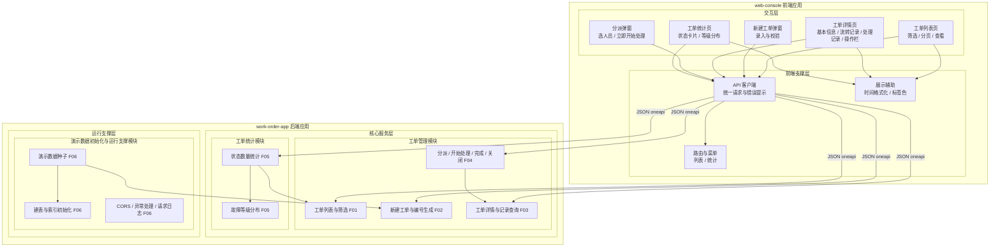
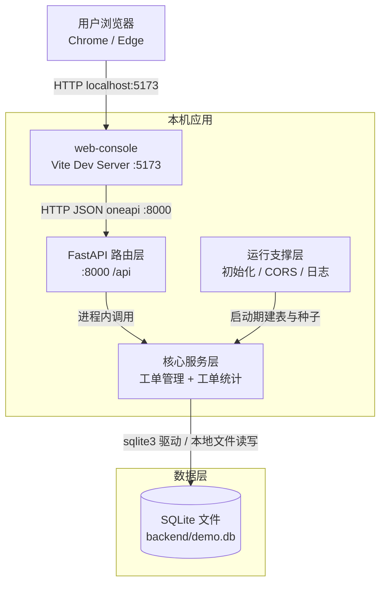
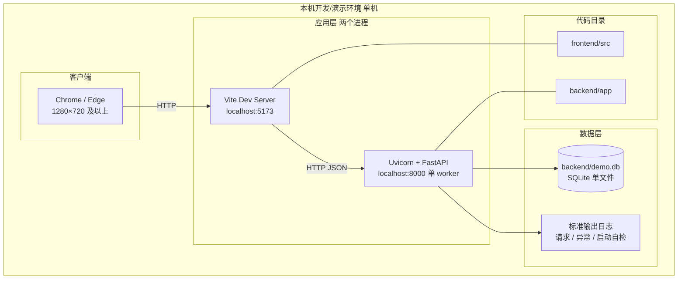

## 2. 架构与模块

### 2.1 架构形态与分层

本期为**本机单实例、前后端分离的两进程应用**：前端 `web-console`（Vue 3 + Vite + Element Plus）通过 JSON REST 调用后端 `work-order-app`（FastAPI），后端独占访问 SQLite 单文件 `demo.db`。不存在微服务拆分、消息中间件、缓存与外部系统集成。

- 前端分层：交互层（5 个页面/弹窗）→ 前端支撑层（API 客户端、路由与菜单、公共格式化与标签色）。
- 后端分层：路由层（Controller）→ 业务层（Service，状态流转校验唯一入口）→ 仓储层（Repository，封装 SQLite 访问）→ 数据层（`work_orders`、`work_order_logs`）。
- 运行支撑：应用启动时完成建表与演示数据种子（幂等），并注册 CORS、统一异常处理与请求日志。

### 2.2 功能架构

- **交互层说明**：仅承担录入、展示、按钮可用性与前端校验，不实现状态流转判定；所有数据来自后端接口。
- **核心服务层说明**：工单管理模块是唯一写入方，负责编号生成、状态机校验、记录追加与事务；工单统计模块只读聚合，复用工单管理模块的查询能力，不直接写库。
- **运行支撑层说明**：启动期完成表结构创建与演示数据初始化；运行期提供 CORS、统一异常映射与请求日志。该层不参与业务请求链路。

**模块清单**

| 模块 | 职责（一句话） | 包含的功能点 | 依赖的模块 |
|---|---|---|---|
| 工单管理模块（`work-order-app`） | 维护工单全生命周期：列表查询、创建与编号生成、详情与记录查询、分派与状态流转校验 | F01、F02、F03、F04 | 无（仅依赖 SQLite 数据层） |
| 工单统计模块（`work-order-app`） | 按全量工单聚合状态数量与故障等级分布 | F05 | 工单管理模块（复用其仓储只读查询：按状态计数、按等级计数、总数） |
| 演示数据初始化与运行支撑模块（`work-order-app`） | 启动时建表并幂等写入演示数据，提供 CORS、统一异常与请求日志 | F06 | 工单管理模块（复用其表结构定义与仓储写入/计数） |

依赖方向：`工单统计模块 → 工单管理模块`、`演示数据初始化与运行支撑模块 → 工单管理模块`，工单管理模块不反向依赖任何业务模块，**无循环依赖**。

### 2.3 应用集成架构

本期无外部业务系统、无第三方 API、无消息/缓存中间件。集成点仅为本机三跳：浏览器 → 前端开发服务器 → 后端 API → SQLite 文件。

**集成关系说明**

| 调用方 | 被调用方 | 协议 | 接口类型 | 说明 |
|---|---|---|---|---|
| 用户浏览器 | web-console（Vite :5173） | HTTP | 页面资源 | 加载 Vue 单页应用 |
| web-console | work-order-app（FastAPI :8000） | HTTP + JSON | oneapi REST | 5 个业务接口，跨域需 CORS 允许 `http://localhost:5173` |
| work-order-app 核心服务层 | SQLite `demo.db` | 本地文件（sqlite3 驱动） | SQL | 单连接/短连接读写；无外键、无存储过程 |
| 运行支撑层 | 核心服务层 | 进程内方法调用 | 内部接口 | 启动时建表与演示数据种子，幂等 |
| 外部业务系统 | — | — | — | **本项不适用**：需求与 PRD 均未涉及外部系统对接，本期不设计 OpenAPI 与外部集成层 |

### 2.4 部署架构

**部署说明**

- **客户端层**：单一浏览器，无 CDN、无反向代理。
- **应用层**：`npm run dev` 启动 Vite（5173），`uvicorn app.main:app --reload --port 8000` 启动 FastAPI（8000，单 worker）。端口可按环境调整，README 必须写明最终地址。
- **数据层**：SQLite 单文件 `backend/demo.db`；首次启动自动建表，表为空时写入 6 条演示工单及配套记录；删除文件后重启可恢复。
- **单点说明**：FastAPI 单进程与 SQLite 单文件均为单点，属于本机演示交付形态（PRD O-6 明确不做生产部署与高可用），**本期不设计负载均衡与多副本**；风险控制为"数据文件可备份/可重建 + 启动自检日志"，不引入集群能力。
- **无定时任务、无后台批处理**：不涉及任务单点与并发调度问题。
