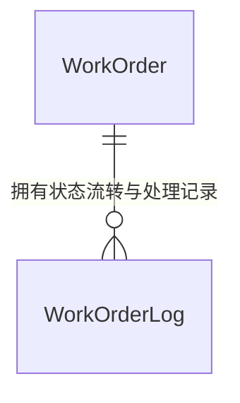

## 3. 数据模型与存储

### 3.1 实体清单

| 实体名称 | 实体说明 | 所属模块 | 与其他实体的关系 |
|---|---|---|---|
| 工单 WorkOrder（`work_orders`） | 一条设备故障报修记录，承载设备信息、故障现象、等级、当前状态、报修人、维修人员、处理方案与时间戳；核心业务标识为 `order_no` | 工单管理模块 | 与工单记录一对多（1 条工单对应 N 条记录） |
| 工单记录 WorkOrderLog（`work_order_logs`） | 工单的追加型流水，包含状态流转记录（`status`）与维修处理记录（`handling`），记录变更前后状态、涉及人员、操作人与内容；核心业务标识为 `work_order_id` + `created_at` 的归属关系 | 工单管理模块 | 与工单多对一（N 条记录归属 1 条工单） |

**非实体说明**

| 对象 | 处理方式 | 原因 |
|---|---|---|
| 维修人员名单（李强、王敏、赵磊、陈晨） | 后端常量，不建表 | PRD Q-02 当前处理方式；需求未要求人员主数据维护 |
| 统计结果（状态数量、等级分布） | 实时聚合，不落表、不缓存 | 数据量 ≤ 1000，聚合成本低；避免统计与工单数据不一致 |
| 演示数据种子 | 启动期初始化逻辑，不建独立实体 | 内容为 6 条工单与配套记录，直接写入上述两张表 |
| 操作人/演示身份 | 请求参数与记录字段，不建用户实体 | PRD Q-01 已确认本期不引入登录与用户体系 |

### 3.2 实体关系图

### 3.3 模型说明

1. **一对多与聚合边界**：工单为聚合根，工单记录只能通过工单产生，不单独对外提供读写接口；记录不做更新与删除，保证处理历史不可篡改（PRD 4.3 BR-12、BR-15、BR-16）。
2. **状态唯一权威**：`work_orders.status` 是当前状态唯一权威来源；`work_order_logs.from_status/to_status` 仅为流转轨迹快照，任何状态判断均以工单主表为准（PRD BR-18）。
3. **人员快照**：`work_order_logs.assignee` 记录本次变更涉及的维修人员快照，使换人历史可追溯（PRD BR-23）；`work_orders.assignee` 为当前维修人员。
4. **记录类型互斥**：`log_type` 取 `status`（状态流转）或 `handling`（处理记录）；`handling` 类型不写前后状态，`status` 类型必须有前后状态（创建记录除外，`from_status` 为空）。
5. **不设物理外键**：遵循项目数据库规范（禁止外键），关联完整性由服务层与同一事务写入保证。
6. **无租户字段**：本机单用户演示、无登录体系（PRD Q-01、NFR-05），不存在数据隔离诉求，不引入 `tenant_id`。
7. **无缓存与 MQ**：本期为单机演示，读写直连 SQLite；引入缓存/MQ 无性能或可用性依据，属于过度设计。
8. **命名与规范差异（已在决策文件登记）**：表名沿用 PRD 5.1 的 `work_orders`、`work_order_logs`（复数形式）；时间字段沿用 PRD 的 `created_at`、`updated_at`（未使用规范的 `gmt_create`、`gmt_modified`），以保持与 PRD 字段契约一致；索引名按 `uk_`/`idx_` 前缀规范命名。
