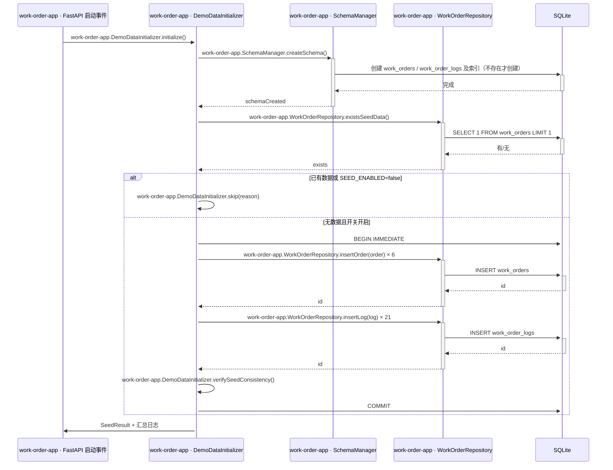

### 4.4 演示数据初始化与运行支撑模块

**模块职责**：应用启动时创建表结构与索引并幂等写入演示数据，同时提供 CORS、统一异常映射与请求日志，保证"删库可重建、重启不丢数据"。  
**覆盖功能点**：F06  
**依赖模块/接口**：工单管理模块（复用表结构定义与 `WorkOrderRepository.existsSeedData`、`insertOrder`、`insertLog`，见 4.2.2）

#### 4.4.1 表结构设计

**本模块不新增表。** 初始化对象为 4.2.1.1 `work_orders` 与 4.2.1.2 `work_order_logs`，建表与索引定义以 4.2.1 为唯一来源，不在本模块重复定义，避免双份结构漂移。

##### 4.4.1.1 初始化数据清单

演示工单 6 条（严格对应 PRD 5.3，创建时间倒序展示）：

| 工单编号 | 设备名称 | 设备编号 | 故障等级 | 状态 | 报修人 | 维修人员 | 创建时间 | 更新时间 |
|---|---|---|---|---|---|---|---|---|
| WO202611130002 | 空压机 A-03 | EQ-A-03 | 中 | 待处理 | 张伟 | NULL | 2026-11-13 09:12:00 | 2026-11-13 09:12:00 |
| WO202611130001 | 冷却水泵 P-11 | EQ-P-11 | 高 | 处理中 | 张伟 | 李强 | 2026-11-13 08:40:00 | 2026-11-13 09:05:00 |
| WO202611120002 | 压缩机 C-01 | EQ-C-01 | 高 | 处理中 | 张伟 | 王敏 | 2026-11-12 16:25:00 | 2026-11-13 08:40:00 |
| WO202611120001 | 传送带 M-07 | EQ-M-07 | 低 | 已完成 | 张伟 | 赵磊 | 2026-11-12 11:03:00 | 2026-11-12 13:40:00 |
| WO202611110002 | 注塑机 I-02 | EQ-I-02 | 中 | 已关闭 | 张伟 | 陈晨 | 2026-11-11 15:47:00 | 2026-11-11 18:05:00 |
| WO202611110001 | 包装机 B-05 | EQ-B-05 | 低 | 已关闭 | 张伟 | 陈晨 | 2026-11-11 10:22:00 | 2026-11-11 16:30:00 |

配套记录 21 条（按时间正序写入，详情页倒序展示）：

| 工单编号 | 记录序列（类型/操作人/时间/内容） | 条数 |
|---|---|---|
| WO202611130002 | 创建工单（status/张伟/09:12/创建工单） | 1 |
| WO202611130001 | 创建（status/张伟/08:40）→ 分派工单，维修人员：李强（status/张伟/08:52，状态待处理→待处理）→ 开始处理（status/李强/09:05，待处理→处理中） | 3 |
| WO202611120002 | 创建（status/张伟/11-12 16:25）→ 分派工单，维修人员：王敏（status/张伟/11-12 17:10）→ 分派并开始处理（status/王敏/11-13 08:40，待处理→处理中）→ 处理记录"已到达现场，初步判断为地脚螺栓松动"（handling/王敏/11-13 08:52） | 4 |
| WO202611120001 | 创建（status/张伟/11:03）→ 开始处理（status/赵磊/11:20）→ 处理记录"检查张紧机构松动，已重新张紧"（handling/赵磊/11:20）→ 完成工单（status/赵磊/13:40，处理中→已完成，处理方案"重新张紧输送带并复检运行状态"） | 4 |
| WO202611110002 | 创建（status/张伟/15:47）→ 开始处理（status/陈晨/16:00）→ 完成（status/陈晨/17:40）→ 关闭（status/张伟/18:05） | 4 |
| WO202611110001 | 创建（status/张伟/10:22）→ 开始处理（status/陈晨/10:40）→ 处理记录"检查热封刀温度偏低"（handling/陈晨/10:40）→ 完成（status/陈晨/15:55）→ 关闭（status/张伟/16:30） | 5 |

**初始化数据校验口径**：状态 待处理 1、处理中 2、已完成 1、已关闭 2，合计 6；等级 高 2、中 2、低 2；记录合计 21 条；已完成/已关闭工单必须有 `solution`，处理中工单 `assignee` 非空。

##### 4.4.1.2 枚举与常量定义

不新增枚举，复用 4.2.1.3。新增初始化常量：

| 常量名称 | 取值 | 用途 |
|---|---|---|
| SEED_ENABLED | 默认开启，可由环境变量关闭 | 控制是否写入演示数据（演示/培训开启，接入真实数据前关闭） |
| SEED_ORDER_COUNT | 6 | 初始化工单条数，用于日志与自检 |
| SEED_LOG_COUNT | 21 | 初始化记录条数，用于日志与自检 |

#### 4.4.2 仓储层设计

**本模块不新增仓储类**，复用 4.2.2 已定义方法：

| 归属应用 | 仓储类 | 方法名 | 关联实体/表 | 操作类型 | 核心查询/更新条件 | 入参 | 返回值 | 说明 |
|---|---|---|---|---|---|---|---|---|
| work-order-app | WorkOrderRepository | `existsSeedData` | work_orders | 查询 | `SELECT 1 ... LIMIT 1` | 无 | 布尔值 | 判断是否已有工单，决定跳过或写入 |
| work-order-app | WorkOrderRepository | `insertOrder` | work_orders | 新增 | 无 | 含固定 `order_no` 与时间的工单实体 | 新增行 `id` | 写入 6 条演示工单 |
| work-order-app | WorkOrderRepository | `insertLog` | work_order_logs | 新增 | 无 | 记录实体 | 新增行 `id` | 写入 21 条演示记录 |

建表与索引由运行支撑层的 `SchemaManager.createSchema()` 执行，不属于仓储数据操作。

#### 4.4.3 接口设计

| 接口编号 | 接口名称 | 类型 | 方法/触发方式 | 路径/方法签名 | 对应功能点 |
|---|---|---|---|---|---|
| I01 | 启动初始化：建表与演示数据种子 | 任务接口 | FastAPI startup 事件 | `DemoDataInitializer.initialize()` | F06 |

##### 4.4.3.1 I01 启动初始化：建表与演示数据种子（F06）

- **接口类型**：任务接口（应用启动事件，无 HTTP 入口）
- **方法签名**：`work-order-app.DemoDataInitializer.initialize()`
- **描述**：启动时确保表与索引存在；工单表为空且种子开关开启时，在同一事务写入 6 条演示工单与 21 条记录；已有数据时跳过，保证重启与重复启动幂等。
- **入参**：

| 参数名称 | 类型 | 是否必填 | 描述 |
|---|---|---|---|
| 无 | — | — | 依赖环境变量 `SEED_ENABLED`（默认开启）与数据库文件路径（默认 `backend/demo.db`） |

- **出参**：

| 参数名称 | 类型 | 描述 |
|---|---|---|
| schemaCreated | boolean | 本次是否实际新建了表或索引 |
| seeded | boolean | 本次是否写入演示数据 |
| orderCount | integer | 写入的工单条数（未写入为 0） |
| logCount | integer | 写入的记录条数（未写入为 0） |
| skippedReason | string / null | 跳过原因（如"已有工单数据""种子开关关闭"） |

- **错误码**：

| 错误码 | 说明 |
|---|---|
| INTERNAL_ERROR | 建表或写种子失败；记录错误日志并终止启动（fail-fast），避免以不完整数据结构对外提供服务 |

- **业务规则**：

| 规则编号 | 规则描述 | 校验时机 | 不满足时的处理 |
|---|---|---|---|
| R-I01-01 | 建表与索引使用"不存在才创建"，重复启动不报错、不重建、不丢数据 | 启动时 | 已存在则跳过，`schemaCreated=false` |
| R-I01-02 | 仅当工单表无任何数据且 `SEED_ENABLED` 开启时写入种子；已有数据一律跳过 | 启动时 | 返回 `seeded=false` 与 `skippedReason`，不修改已有数据 |
| R-I01-03 | 6 条工单与 21 条记录在同一事务写入；任一失败整体回滚 | 写入时 | 回滚并终止启动 |
| R-I01-04 | 种子数据严格使用 PRD 5.3 的编号、人员、状态、时间与记录序列，不重新生成编号、不使用当前时间 | 写入时 | 与清单不一致视为缺陷 |
| R-I01-05 | 记录中的状态快照与工单当前状态自洽：最后一条 `status` 记录的 `to_status` 必须等于工单 `status` | 写入后自检 | 不一致时回滚并记录错误 |
| R-I01-06 | 初始化完成后输出一条汇总日志：表创建情况、写入条数、跳过原因、统计口径校验结果 | 启动结束时 | 缺失日志视为可观测性缺陷 |
| R-I01-07 | 删除 `backend/demo.db` 后重启，自动重建表并恢复 6 条工单与 21 条记录（AC-27） | 启动时 | 按 R-I01-01～R-I01-03 执行 |

- **处理时序图**：

- **异常场景**：

| 异常场景 | 处理方式 |
|---|---|
| 数据库文件不存在 | 自动创建文件并建表，随后写入种子 |
| 表已存在但为空字符串脏数据 | 视为"已有数据"跳过，输出跳过原因，不覆盖 |
| 种子写入中途失败 | 事务回滚，数据库恢复为空表状态；记录错误并终止启动，重启后重试 |
| 两个进程同时启动 | 唯一约束 `uk_work_order_order_no` 拦截重复编号；后启动进程回滚并输出冲突日志（本机演示为单实例，属极端场景） |
| `SEED_ENABLED=false` 且表为空 | 跳过种子，输出 `skippedReason`；页面显示空态，不报错 |
| 磁盘只读/无权限 | 建表失败，终止启动并提示检查文件权限 |

- **事务与并发控制（如适用）**：
  - 事务/回滚策略：种子写入使用单个写事务；表创建为独立 DDL 步骤，失败终止启动。DDL 与数据事务分离，避免 SQLite DDL 隐式提交干扰。
  - 并发场景与控制策略：启动事件单进程串行执行；唯一约束兜底重复编号；不引入分布式锁（单实例，无必要）。

##### 4.4.3.2 运行支撑配置（非接口设计）

| 支撑项 | 设计内容 | 依据 |
|---|---|---|
| CORS | 允许来源 `http://localhost:5173`（端口可配置）；方法 `GET/POST/PATCH/OPTIONS`；请求头 `Content-Type`；不允许通配 `*` | PRD 3.3 约束 2、NFR-05 |
| 统一异常映射 | 业务异常 → `{"detail":{"code","message"}}`；参数校验 → 422 默认结构；未捕获异常 → 500 `INTERNAL_ERROR` 且不返回堆栈 | PRD 4.7、NFR-03 |
| 请求日志 | 每个请求记录方法、路径、状态码、耗时、错误码；写接口额外记录 `order_no` 与操作人 | 变更三板斧可监控要求 |
| 启动自检日志 | 记录数据库路径、表创建、种子条数、统计口径校验 | F06、AC-27 |
| 配置项 | 数据库路径、端口、CORS 来源、`SEED_ENABLED`、`DEFAULT_OPERATOR` | PRD 3.3、A-01 |
| README | 环境要求（Node、Python 版本）、`npm install` / `npm run dev` / `uvicorn app.main:app --reload --port 8000`、访问地址 5173 与 8000/docs、演示数据说明与重置方法 | PRD 3.3、NFR-08、AC-26 |

#### 4.4.4 状态机设计

**本项不适用**：本模块无独立状态字段。种子数据的 4 种状态取值必须落在 4.2.4 状态机定义的合法状态集合内，且其记录序列必须满足"创建→…→当前状态"的合法路径；该一致性由 R-I01-05 保证。

#### 4.4.5 模块自检结果

**功能点—接口对账表**

| F 编号 | 功能点名称 | 对应接口章节 | 时序图 | 业务规则表 | 异常场景 | 并发控制 | 状态 |
|---|---|---|---|---|---|---|---|
| F06 | 本机运行与演示数据初始化 | 4.4.3.1（I01）、4.4.3.2（运行支撑配置） | 有 | 有（R-I01-01～07） | 有 | 有（单启动事件 + 唯一约束兜底） | ✅通过 |

**表结构对账**

| Step 3 实体 | 本模块处理 | 状态 |
|---|---|---|
| 工单 WorkOrder、工单记录 WorkOrderLog | 复用 4.2.1 建表定义，本模块只负责创建与写入种子，不新增字段 | ✅通过（无重复定义） |

**接口对账**

| 接口编号 | 详细定义 | 入参/出参表 | 错误码 | 示例 | 状态 |
|---|---|---|---|---|---|
| I01 | 4.4.3.1 | 有 | 有 | 处理时序覆盖 | ✅通过 |

**仓储层对账**

| 操作 | 仓储方法 | 来源 | 状态 |
|---|---|---|---|
| 判断已有工单 | `existsSeedData` | 4.2.2（依赖模块补充） | ✅通过 |
| 写入工单 | `insertOrder` | 4.2.2 | ✅通过 |
| 写入记录 | `insertLog` | 4.2.2 | ✅通过 |

**时序图归属对账**：I01 时序图的启动事件、初始化器、SchemaManager、仓储调用均带 `work-order-app.` 归属前缀；数据库节点使用 SQL 描述，无缺失归属的调用。

**状态机对账**

| 含状态字段的实体 | 状态 |
|---|---|
| 无（种子数据遵循 4.2.4 状态机） | ✅不适用（已说明） |

**过度设计检查**

| 检查项 | 结论 |
|---|---|
| 是否引入独立种子脚本/命令行工具 | 否。启动事件内完成，满足"零额外步骤启动" |
| 是否新增表/配置中心 | 否。仅环境变量与本地配置文件 |
| 是否引入数据版本/迁移框架 | 否。本期只有新建表与初始化，无存量迁移；版本升级策略见第 5 章 |
