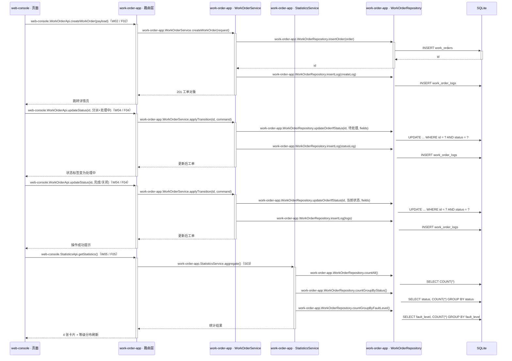
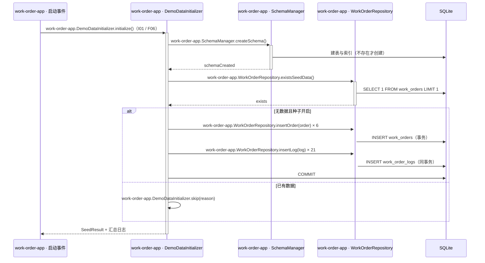

### 4.5 跨模块调用链视图

本期跨模块协作仅两条链路：①前端页面经 oneapi 进入工单管理模块，写操作后由前端再次调用统计模块刷新数字；②启动期运行支撑模块向工单管理模块的表写入种子数据。被调用接口均已在对应模块中定义（W01–W05、S01–S03、I01）。

#### 4.5.1 演示闭环链路（创建 → 分派 → 完成 → 关闭 → 统计刷新）

说明：统计模块不订阅写事件、不做异步刷新；统计页每次进入/刷新时重新调用 W05，保证数字实时（AC-20、AC-21）。写操作与统计读取之间无强一致要求，页面刷新顺序由用户操作保证。

#### 4.5.2 启动初始化链路

说明：初始化只调用工单管理模块的仓储写方法，不经过业务校验与状态机（种子为固定合法数据），避免启动期依赖 HTTP 层；被调用方法与表结构均已在 4.2 定义。
