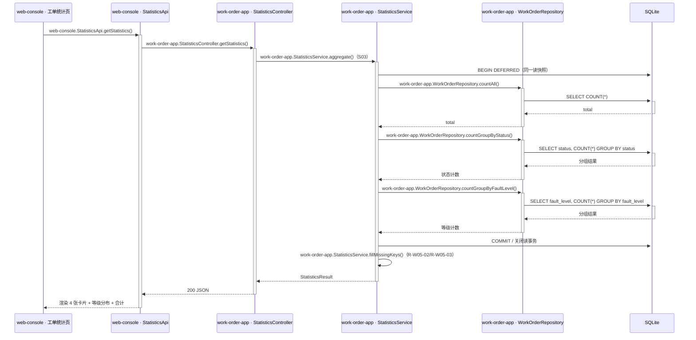
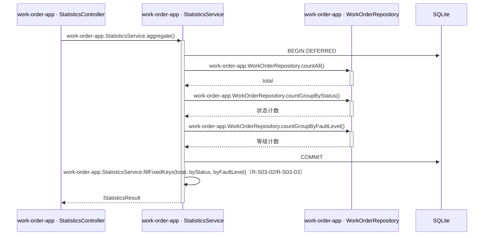

### 4.3 工单统计模块

**模块职责**：按全量工单实时聚合 4 种状态数量、3 种故障等级分布与总数，供统计页与演示验收使用。  
**覆盖功能点**：F05  
**依赖模块/接口**：工单管理模块（复用 `WorkOrderRepository.countAll`、`countGroupByStatus`、`countGroupByFaultLevel`，见 4.2.2）

#### 4.3.1 表结构设计

**本模块无独立表结构。** 原因：统计结果为工单主表的实时聚合，不落统计表、不做定时快照；数据量 ≤ 1000 条（NFR-01），聚合成本可接受，引入统计表会带来一致性与额外写入负担。读取字段与索引复用 4.2.1.1 `work_orders`（`status`、`fault_level` 上已有索引）。

##### 4.3.1.1 枚举与常量定义

本模块不新增枚举，复用 4.2.1.3 的 `WorkOrderStatus`、`FaultLevel`；新增统计口径常量：

| 常量名称 | 取值 | 用途 |
|---|---|---|
| STATUS_KEYS | 待处理、处理中、已完成、已关闭 | `by_status` 必须包含的 4 个键，缺失补 0 |
| FAULT_LEVEL_KEYS | 高、中、低 | `by_fault_level` 必须包含的 3 个键，缺失补 0 |
| STAT_CLOCK | 服务端请求时刻 | 统计口径时间点，不做时间范围过滤 |

#### 4.3.2 仓储层设计

本模块**不新增仓储类**，复用工单管理模块已定义的只读方法；为保证依赖闭合，下列方法已在 4.2.2 中补充定义：

| 归属应用 | 仓储类 | 方法名 | 关联实体/表 | 操作类型 | 核心查询/更新条件 | 入参 | 返回值 | 说明 |
|---|---|---|---|---|---|---|---|---|
| work-order-app | WorkOrderRepository | `countAll` | work_orders | 查询 | 无 | 无 | 整数 | 统计 `total` |
| work-order-app | WorkOrderRepository | `countGroupByStatus` | work_orders | 查询 | `GROUP BY status` | 无 | 状态→数量映射 | 统计卡片 |
| work-order-app | WorkOrderRepository | `countGroupByFaultLevel` | work_orders | 查询 | `GROUP BY fault_level` | 无 | 等级→数量映射 | 等级分布 |

约束：三次查询必须在同一读事务（同一快照）内执行，避免并发写入导致 `total` 与分组之和不一致。

#### 4.3.3 接口设计

| 接口编号 | 接口名称 | 类型 | 方法/触发方式 | 路径/方法签名 | 对应功能点 |
|---|---|---|---|---|---|
| W05 | 查询工单统计 | oneapi | GET | `/api/work-orders/statistics` | F05 |
| S03 | 统计聚合查询 | 内部接口 | 方法调用 | `StatisticsService.aggregate()` | F05 |

##### 4.3.3.1 W05 查询工单统计（F05）

- **URI**：GET `/api/work-orders/statistics`
- **接口类型**：oneapi
- **描述**：返回全量工单总数、按状态数量与按故障等级分布，用于统计页 4 张卡片、等级条形图与合计。
- **入参**：

| 参数名称 | 类型 | 是否必填 | 描述 |
|---|---|---|---|
| 无 | — | — | 不接受筛选、分页或时间范围参数；传入的额外查询参数一律忽略 |

- **出参**：

| 参数名称 | 类型 | 描述 |
|---|---|---|
| total | integer | 全量工单总数 |
| by_status | object | 状态→数量映射，固定含 待处理/处理中/已完成/已关闭 4 个键 |
| by_status.待处理 | integer | 待处理数量，无数据为 0 |
| by_status.处理中 | integer | 处理中数量，无数据为 0 |
| by_status.已完成 | integer | 已完成数量，无数据为 0 |
| by_status.已关闭 | integer | 已关闭数量，无数据为 0 |
| by_fault_level | object | 等级→数量映射，固定含 高/中/低 3 个键 |
| by_fault_level.高 | integer | 高等级数量，无数据为 0 |
| by_fault_level.中 | integer | 中等级数量，无数据为 0 |
| by_fault_level.低 | integer | 低等级数量，无数据为 0 |

- **错误码**：

| 错误码 | 说明 |
|---|---|
| INTERNAL_ERROR（500） | 数据库不可用或聚合查询异常 |

- **业务规则**：

| 规则编号 | 规则描述 | 校验时机 | 不满足时的处理 |
|---|---|---|---|
| R-W05-01 | 统计口径为库中全部工单，不区分列表筛选、不做时间范围过滤（BR-25） | 查询构造 | 忽略任何筛选参数 |
| R-W05-02 | `by_status` 固定输出 4 个键，`by_fault_level` 固定输出 3 个键，无数据补 0，不省略键（BR-26） | 序列化 | 缺失键补 0，前端卡片始终渲染 4 张 |
| R-W05-03 | `total` = 各状态数量之和 = 各等级数量之和；不一致视为缺陷 | 聚合后 | 以同一读快照保证一致，必要时重试一次 |
| R-W05-04 | 路由必须先于 `/api/work-orders/{id}` 注册，或 `{id}` 声明为整型，确保 `statistics` 不被解析为 id（PRD 4.7 实现约束） | 路由注册 | 路由冲突视为缺陷，`/statistics` 必须返回统计结构而非 422 |
| R-W05-05 | 状态卡片颜色与列表标签一致：待处理橙、处理中蓝、已完成绿、已关闭灰；本接口只返回数值，不返回颜色 | 接口边界 | 前端按枚举映射颜色 |
| R-W05-06 | 等级分布条形按数量占 `total` 的比例绘制；`total=0` 时不绘制条形，显示合计 0 | 前端渲染 | 不出现除零 |

- **处理时序图**：



- **异常场景**：

| 异常场景 | 处理方式 |
|---|---|
| 库中无任何工单 | 返回 `total=0`、7 个键全为 0，前端显示 0 与空条形 |
| 聚合查询失败 | 500 `INTERNAL_ERROR`，前端显示错误提示与"重新加载"入口（BR-27） |
| 路由被 `{id}` 抢先匹配 | 视为缺陷；设计上强制静态路由优先，验收 AC-22 覆盖 |
| 与列表页筛选状态不一致 | 正常：统计独立于列表筛选（BR-25），前端在统计页明确展示"全量"口径 |

- **事务与并发控制（如适用）**：
  - 事务/回滚策略：只读事务；失败不影响数据，关闭连接即可。
  - 并发场景与控制策略：同一读快照内完成三次查询，避免写入造成总数与分组不一致；不做缓存，保证演示时数字实时变化（AC-20、AC-21）。

- **请求示例**：

```json
{}
```

- **响应示例**：

```json
{
  "total": 6,
  "by_status": {
    "待处理": 1,
    "处理中": 2,
    "已完成": 1,
    "已关闭": 2
  },
  "by_fault_level": {
    "高": 2,
    "中": 2,
    "低": 2
  }
}
```

##### 4.3.3.2 S03 统计聚合查询（F05）

- **接口类型**：内部接口（Service 方法）
- **方法签名**：`work-order-app.StatisticsService.aggregate()`
- **描述**：在单一读快照内完成总数与两组分组计数，补齐固定键后返回统计结果；仅被 W05 调用，其他模块不得复制聚合逻辑。
- **入参**：

| 参数名称 | 类型 | 是否必填 | 描述 |
|---|---|---|---|
| 无 | — | — | 全量口径，无参数 |

- **出参**：

| 参数名称 | 类型 | 描述 |
|---|---|---|
| total | integer | 工单总数 |
| byStatus | map<string, integer> | 4 个状态键的计数 |
| byFaultLevel | map<string, integer> | 3 个等级键的计数 |

- **错误码**：

| 错误码 | 说明 |
|---|---|
| INTERNAL_ERROR | 聚合失败，由 W05 转换为 500 |

- **业务规则**：

| 规则编号 | 规则描述 | 校验时机 | 不满足时的处理 |
|---|---|---|---|
| R-S03-01 | 复用工单管理模块仓储的三个只读方法，不直接拼 SQL | 调用时 | 违反视为跨层访问缺陷 |
| R-S03-02 | 三查询同一读快照，保证 `total` 与分组之和一致 | 聚合时 | 不一致时重试一次，仍不一致返回 500 |
| R-S03-03 | 固定键补 0，返回 map 不含未知状态/等级键 | 序列化 | 未知键丢弃并记录告警日志 |

- **处理时序图**：



- **异常场景**：

| 异常场景 | 处理方式 |
|---|---|
| 某状态计数为 0 | 补 0 后返回，不省略键 |
| 三查询结果不一致 | 重试一次；仍不一致返回 500 并记录日志 |
| 数据库锁定（读） | 等待 SQLite 读锁释放，超时后返回 500 |

- **事务与并发控制（如适用）**：
  - 事务/回滚策略：只读事务，不产生回滚需求。
  - 并发场景与控制策略：读快照隔离；不引入统计缓存与定时任务，避免数据滞后与任务单点问题。

#### 4.3.4 状态机设计

**本项不适用**：本模块无独立实体与状态字段，统计为只读聚合；工单状态机见 4.2.4。

#### 4.3.5 模块自检结果

**功能点—接口对账表**

| F 编号 | 功能点名称 | 对应接口章节 | 时序图 | 业务规则表 | 异常场景 | 并发控制 | 状态 |
|---|---|---|---|---|---|---|---|
| F05 | 工单统计 | 4.3.3.1（W05）、4.3.3.2（S03） | 有 | 有（R-W05-01～06、R-S03-01～03） | 有 | 有（读快照一致性） | ✅通过 |

**表结构对账**

| Step 3 实体 | 本模块表结构 | 状态 |
|---|---|---|
| 无（统计不落表） | 4.3.1 已说明不适用原因，读取复用 `work_orders` | ✅不适用（已说明） |

**接口对账**

| 接口编号 | 详细定义 | 入参/出参表 | 错误码 | 示例 | 状态 |
|---|---|---|---|---|---|
| W05 | 4.3.3.1 | 有 | 有 | 有 | ✅通过 |
| S03 | 4.3.3.2 | 有 | 有 | 处理时序覆盖 | ✅通过 |

**仓储层对账**

| 读写操作 | 仓储方法 | 来源 | 状态 |
|---|---|---|---|
| 全量计数 | `countAll` | 4.2.2（依赖模块补充） | ✅通过 |
| 按状态分组计数 | `countGroupByStatus` | 4.2.2（依赖模块补充） | ✅通过 |
| 按等级分组计数 | `countGroupByFaultLevel` | 4.2.2（依赖模块补充） | ✅通过 |

**时序图归属对账**：2 张时序图的 Controller/Service/Repository 调用均带 `work-order-app.` 归属前缀；数据库节点使用 SQL 描述，无缺失归属的调用。

**状态机对账**

| 含状态字段的实体 | 状态 |
|---|---|
| 无 | ✅不适用（模块无实体与状态字段） |

**过度设计检查**

| 检查项 | 结论 |
|---|---|
| 是否引入统计表/定时任务/缓存 | 否。实时聚合足以满足 ≤1000 条与演示实时性要求 |
| 是否新增冗余接口 | 否。仅 W05 一个 oneapi，S03 为内部复用 |
| 是否返回前端可自行推导的数据 | 否。仅返回数值与总数，颜色/条形由前端按枚举映射 |
