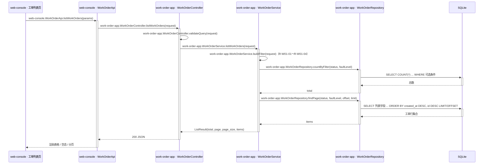
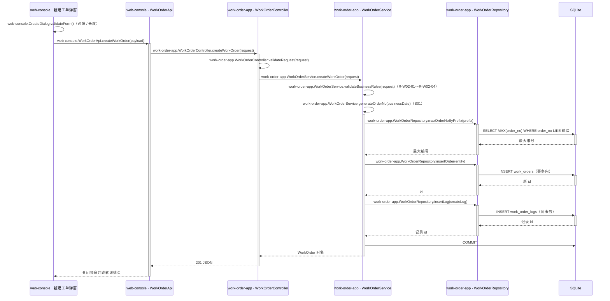
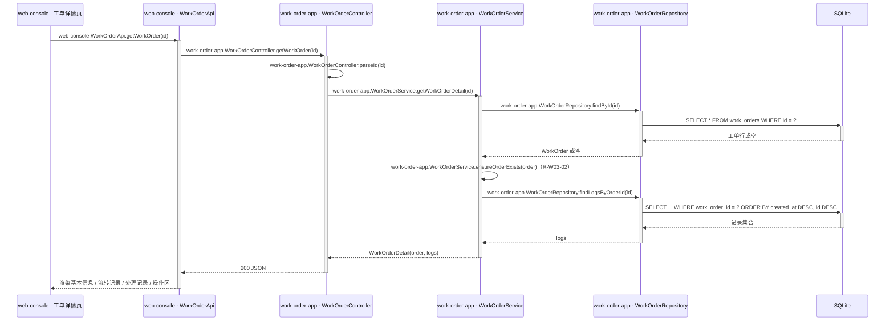
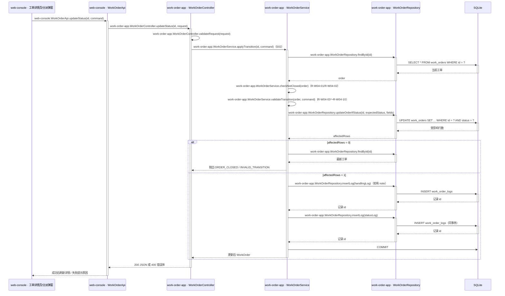
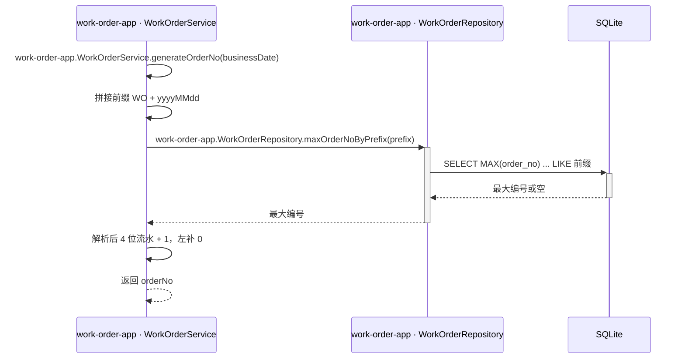
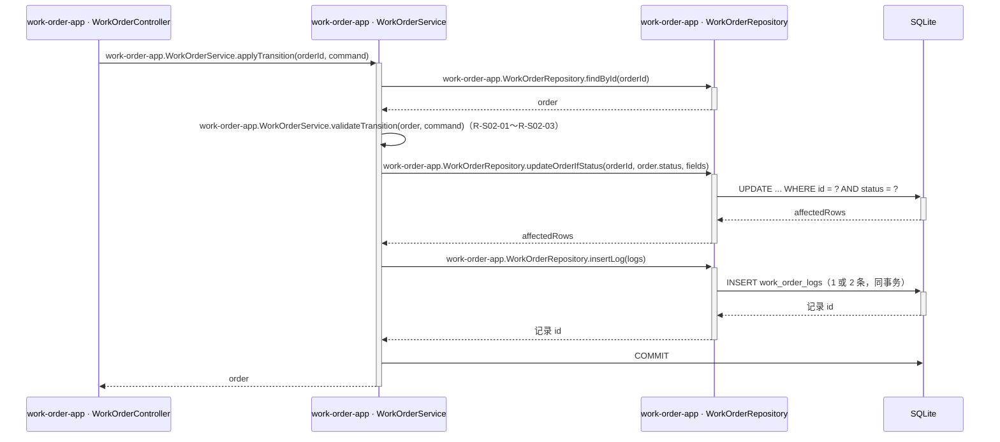
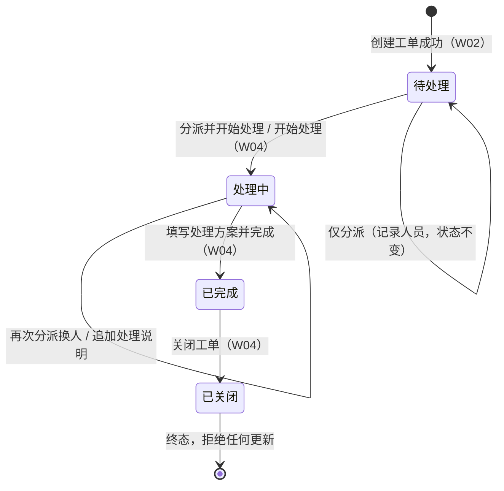

### 4.2 工单管理模块

**模块职责**：维护工单全生命周期——列表查询、创建与编号生成、详情与记录查询、分派与状态流转校验，是两张业务表的唯一写入方。  
**覆盖功能点**：F01、F02、F03、F04  
**依赖模块/接口**：无（仅依赖 SQLite 数据层；向工单统计模块与运行支撑模块提供按状态/等级计数、总数统计、按日最大编号查询与记录写入能力）

#### 4.2.1 表结构设计

##### 4.2.1.1 工单主表 `work_orders`

| 字段名 | 数据类型 | 约束 | 默认值 | 说明 |
|---|---|---|---|---|
| id | INTEGER | PK，自增，NOT NULL | — | 系统自增主键，接口路径中的 `id` |
| order_no | TEXT(16) | NOT NULL，唯一 | — | 工单编号，`WO` + `yyyyMMdd` + 4 位当日流水，如 `WO202611130001` |
| device_name | TEXT(50) | NOT NULL | — | 设备名称，1–50 字 |
| device_code | TEXT(32) | NOT NULL | — | 设备编号，1–32 字，允许字母、数字、`-`、`_` |
| fault_description | TEXT(500) | NOT NULL | — | 故障现象，1–500 字，保留换行 |
| fault_level | TEXT(2) | NOT NULL | — | 故障等级：高 / 中 / 低 |
| status | TEXT(4) | NOT NULL | `待处理` | 当前状态：待处理 / 处理中 / 已完成 / 已关闭 |
| reporter | TEXT(20) | NOT NULL | — | 报修人，1–20 字 |
| assignee | TEXT(20) | NULL | NULL | 当前维修人员；NULL 表示未分派 |
| solution | TEXT(500) | NULL | NULL | 处理方案，完成时写入；NULL 表示未填写 |
| created_at | TEXT(19) | NOT NULL | — | 创建时间，`yyyy-MM-dd HH:mm:ss`，服务端本机时间 |
| updated_at | TEXT(19) | NOT NULL | — | 最后更新时间，每次写操作刷新 |

**数据约束说明**：`status`、`fault_level` 直接存中文枚举值（PRD 5.1 数据约束 1）；`assignee`、`solution` 的 NULL 与空字符串均视为未填写，服务端统一落 NULL（PRD 5.1 数据约束 2）；无删除标记，本期不删除工单；无物理外键（项目数据库规范）。

**索引：**

- PK：`pk_work_orders`（`id`，SQLite `INTEGER PRIMARY KEY` 隐含主键索引）
- UK：`uk_work_order_order_no`（`order_no`）——保证编号唯一并支撑编号冲突兜底
- IDX：`idx_work_order_status`（`status`）——支撑状态筛选与按状态计数
- IDX：`idx_work_order_level`（`fault_level`）——支撑等级筛选与按等级计数
- IDX：`idx_work_order_created`（`created_at`）——支撑默认排序

##### 4.2.1.2 工单记录表 `work_order_logs`

| 字段名 | 数据类型 | 约束 | 默认值 | 说明 |
|---|---|---|---|---|
| id | INTEGER | PK，自增，NOT NULL | — | 系统自增主键 |
| work_order_id | INTEGER | NOT NULL | — | 关联 `work_orders.id`，逻辑关联，不建外键 |
| log_type | TEXT(8) | NOT NULL | — | 记录类型：`status` 状态流转 / `handling` 处理记录 |
| from_status | TEXT(4) | NULL | NULL | 变更前状态；创建记录为 NULL，`handling` 类型为 NULL |
| to_status | TEXT(4) | NULL | NULL | 变更后状态；`handling` 类型为 NULL |
| assignee | TEXT(20) | NULL | NULL | 本次变更涉及的维修人员快照（记录换人历史） |
| operator | TEXT(20) | NOT NULL | — | 操作人姓名，缺省演示身份"张伟" |
| content | TEXT(500) | NULL | NULL | 记录内容：状态变更说明或处理说明 |
| created_at | TEXT(19) | NOT NULL | — | 记录时间，`yyyy-MM-dd HH:mm:ss`，与该次工单 `updated_at` 一致 |

**索引：**

- PK：`pk_work_order_logs`（`id`，SQLite `INTEGER PRIMARY KEY` 隐含主键索引）
- IDX：`idx_wo_log_order_created`（`work_order_id`, `created_at`）——支撑按工单查询记录并按时间倒序

**表设计说明**：记录表为追加型流水，不提供更新与删除，因此只保留 `created_at`，不设 `updated_at`（与规范的 `gmt_create/gmt_modified` 模板差异已在决策文件登记，理由为记录不可变更）。`work_order_id` 与 `created_at` 组合索引按左前缀可用 `work_order_id` 单条件查询，满足详情页读取。

##### 4.2.1.3 枚举与常量定义

| 枚举名称 | 取值 | 含义 | 关联字段 |
|---|---|---|---|
| WorkOrderStatus | 待处理 | 工单已创建，尚未开始维修；维修人员可能为空或已指定 | `work_orders.status`；`work_order_logs.from_status` / `to_status` |
| WorkOrderStatus | 处理中 | 维修人员已受理并处理故障 | 同上 |
| WorkOrderStatus | 已完成 | 故障已处理完成，处理方案已填写 | 同上 |
| WorkOrderStatus | 已关闭 | 工单结束，页面只读，终态 | 同上 |
| FaultLevel | 高 | 高紧急程度，红色标签 | `work_orders.fault_level` |
| FaultLevel | 中 | 中紧急程度，橙色标签 | `work_orders.fault_level` |
| FaultLevel | 低 | 低紧急程度，灰色标签 | `work_orders.fault_level` |
| LogType | status | 状态流转记录，必须有 `to_status`，`from_status` 创建时为空 | `work_order_logs.log_type` |
| LogType | handling | 维修处理记录，`from_status`/`to_status` 为空 | `work_order_logs.log_type` |
| ErrorCode | VALIDATION_ERROR | 字段格式/取值校验失败（422） | 错误响应 `detail.code` |
| ErrorCode | ORDER_NOT_FOUND | 工单不存在（404） | 错误响应 `detail.code` |
| ErrorCode | ORDER_NO_CONFLICT | 编号生成冲突且重试后仍失败（500） | 错误响应 `detail.code` |
| ErrorCode | INVALID_TRANSITION | 非法状态流转（跳步、回退、重复提交）（400） | 错误响应 `detail.code` |
| ErrorCode | ASSIGNEE_REQUIRED | 进入处理中但维修人员为空（400） | 错误响应 `detail.code` |
| ErrorCode | SOLUTION_REQUIRED | 进入已完成但处理方案为空（400） | 错误响应 `detail.code` |
| ErrorCode | ORDER_CLOSED | 工单已关闭仍提交更新（400） | 错误响应 `detail.code` |
| ErrorCode | INTERNAL_ERROR | 未预期异常兜底（500） | 错误响应 `detail.code` |

**常量定义：**

| 常量名称 | 取值 | 用途 |
|---|---|---|
| DEMO_ASSIGNEES | 李强、王敏、赵磊、陈晨 | 分派下拉选项与 `assignee` 取值校验（A02） |
| DEFAULT_OPERATOR | 张伟 | `operator` 缺省值（A01） |
| ORDER_NO_PREFIX | `WO` | 工单编号前缀 |
| ORDER_NO_DATE_FORMAT | `yyyyMMdd` | 编号中的创建日期段 |
| ORDER_NO_SEQ_LENGTH | 4 | 当日流水位数，`0001` 起 |
| ORDER_NO_RETRY_TIMES | 1 | 唯一约束冲突后的重试次数 |
| MAX_PAGE_SIZE | 100 | 分页上限 |
| DEFAULT_PAGE_SIZE | 10 | 分页默认值 |

#### 4.2.2 仓储层设计

| 归属应用 | 仓储类 | 方法名 | 关联实体/表 | 操作类型 | 核心查询/更新条件 | 入参 | 返回值 | 说明 |
|---|---|---|---|---|---|---|---|---|
| work-order-app | WorkOrderRepository | `insertOrder` | work_orders | 新增 | 无（插入新行） | 工单实体（含 `order_no`、时间戳） | 新增行 `id` | 创建工单主记录 |
| work-order-app | WorkOrderRepository | `updateOrderIfStatus` | work_orders | 更新 | `id = :id AND status = :expectedStatus` | `id`、`expectedStatus`、待更新字段（`status`/`assignee`/`solution`/`updated_at`） | 受影响行数 | 带状态条件更新，行数为 0 表示状态已被改变 |
| work-order-app | WorkOrderRepository | `findById` | work_orders | 查询 | `id = :id` | `id` | 工单实体或空 | 详情与流转前读取当前状态 |
| work-order-app | WorkOrderRepository | `findPage` | work_orders | 查询 | 可选 `status = :status`、`fault_level = :level`；排序 `created_at DESC, id DESC`；`LIMIT :limit OFFSET :offset` | `status`、`faultLevel`、`offset`、`limit` | 工单列表 | 列表页数据；不返回 `fault_description`、`solution` 与 `logs`（按需在查询层裁列） |
| work-order-app | WorkOrderRepository | `countByFilter` | work_orders | 查询 | 与 `findPage` 相同的可选筛选条件 | `status`、`faultLevel` | 整数总数 | 列表总数，保证与 `items` 同一口径 |
| work-order-app | WorkOrderRepository | `findLogsByOrderId` | work_order_logs | 查询 | `work_order_id = :orderId`，排序 `created_at DESC, id DESC` | `orderId` | 记录列表 | 详情页状态流转与处理记录 |
| work-order-app | WorkOrderRepository | `insertLog` | work_order_logs | 新增 | 无 | 记录实体 | 新增行 `id` | 状态流转与处理记录追加 |
| work-order-app | WorkOrderRepository | `maxOrderNoByPrefix` | work_orders | 查询 | `order_no LIKE :prefix || '%'`，取最大 `order_no` | 编号前缀（`WO` + 日期） | 最大编号或空 | 供 S01 计算当日下一流水 |
| work-order-app | WorkOrderRepository | `countAll` | work_orders | 查询 | 无 | 无 | 整数总数 | 统计数据 `total`；供统计模块 S03 复用 |
| work-order-app | WorkOrderRepository | `countGroupByStatus` | work_orders | 查询 | 按 `status` 分组计数 | 无 | 状态→数量映射（4 个键，无数据补 0） | 供统计模块 S03 复用 |
| work-order-app | WorkOrderRepository | `countGroupByFaultLevel` | work_orders | 查询 | 按 `fault_level` 分组计数 | 无 | 等级→数量映射（3 个键，无数据补 0） | 供统计模块 S03 复用 |
| work-order-app | WorkOrderRepository | `existsSeedData` | work_orders | 查询 | `SELECT 1 ... LIMIT 1` | 无 | 布尔值 | 供运行支撑模块 I01 判断是否需要写入演示数据 |

**仓储一致性要求**：所有 SQL 使用参数绑定，不拼接用户输入；写方法由调用方开启事务，仓储不自行提交；`findPage` 与 `countByFilter` 必须共用同一筛选条件构造逻辑，避免总数与列表不一致。

#### 4.2.3 接口设计

| 接口编号 | 接口名称 | 类型 | 方法/触发方式 | 路径/方法签名 | 对应功能点 |
|---|---|---|---|---|---|
| W01 | 查询工单列表 | oneapi | GET | `/api/work-orders` | F01 |
| W02 | 创建工单 | oneapi | POST | `/api/work-orders` | F02 |
| W03 | 查询工单详情 | oneapi | GET | `/api/work-orders/{id}` | F03 |
| W04 | 更新工单状态/人员/处理信息 | oneapi | PATCH | `/api/work-orders/{id}/status` | F04 |
| S01 | 工单编号生成 | 内部接口 | 方法调用 | `WorkOrderService.generateOrderNo(businessDate)` | F02 |
| S02 | 工单状态流转校验与执行 | 内部接口 | 方法调用 | `WorkOrderService.applyTransition(orderId, command)` | F04 |

##### 4.2.3.1 W01 查询工单列表（F01）

- **URI**：GET `/api/work-orders`
- **接口类型**：oneapi
- **描述**：按状态、故障等级筛选并以创建时间倒序分页返回工单列表，用于列表页展示与筛选。
- **入参**：

| 参数名称 | 类型 | 是否必填 | 描述 |
|---|---|---|---|
| status | string（query） | 否 | 待处理 / 处理中 / 已完成 / 已关闭；缺省或空串表示全部 |
| fault_level | string（query） | 否 | 高 / 中 / 低；缺省或空串表示全部 |
| page | integer（query） | 否 | 页码，默认 1，最小 1 |
| page_size | integer（query） | 否 | 每页条数，默认 10，范围 1–100 |

- **出参**：

| 参数名称 | 类型 | 描述 |
|---|---|---|
| total | integer | 符合筛选条件的工单总数 |
| page | integer | 当前页码 |
| page_size | integer | 每页条数 |
| items | array | 工单列表，按 `created_at DESC, id DESC` 排序 |
| items[].id | integer | 工单主键 |
| items[].order_no | string | 工单编号 |
| items[].device_name | string | 设备名称 |
| items[].device_code | string | 设备编号 |
| items[].fault_level | string | 故障等级 |
| items[].status | string | 当前状态 |
| items[].reporter | string | 报修人 |
| items[].assignee | string / null | 维修人员，未分派为 null |
| items[].created_at | string | 创建时间 `yyyy-MM-dd HH:mm:ss` |
| items[].updated_at | string | 最后更新时间 |

- **错误码**：

| 错误码 | 说明 |
|---|---|
| VALIDATION_ERROR（422） | `status`/`fault_level` 非枚举值、`page` < 1、`page_size` 越界、`page` 非整数 |
| INTERNAL_ERROR（500） | 数据库不可用或未预期异常 |

- **业务规则**：

| 规则编号 | 规则描述 | 校验时机 | 不满足时的处理 |
|---|---|---|---|
| R-W01-01 | `status` 若传值必须属于 WorkOrderStatus 四值；空串按未传处理 | 参数校验 | 返回 422 `VALIDATION_ERROR`，`msg` 指明字段 |
| R-W01-02 | `fault_level` 若传值必须属于 FaultLevel 三值 | 参数校验 | 返回 422 `VALIDATION_ERROR` |
| R-W01-03 | `page` 最小 1，`page_size` 范围 1–100 | 参数校验 | 返回 422 `VALIDATION_ERROR` |
| R-W01-04 | 两个筛选条件为"与"关系 | 查询构造 | 仅返回同时满足的工单（BR-02） |
| R-W01-05 | 固定按 `created_at DESC, id DESC` 排序 | 查询构造 | 忽略任何排序意图，保证分页稳定 |
| R-W01-06 | `total` 与 `items` 使用同一筛选条件 | 查询构造 | 二者口径不一致视为缺陷 |
| R-W01-07 | 无匹配数据返回 200、`total=0`、`items` 为空数组 | 查询结果 | 前端显示"暂无数据"并隐藏分页（BR-04） |
| R-W01-08 | 列表项不返回 `fault_description`、`solution`、`logs` | 出参裁剪 | 减少传输量，详情字段由 W03 提供 |
| R-W01-09 | `assignee` 为空时输出 null，不输出空字符串或 `"None"` | 序列化 | 前端统一显示"—"（BR-05） |

- **处理时序图**：



- **异常场景**：

| 异常场景 | 处理方式 |
|---|---|
| 状态或等级传入非法值 | 返回 422 `VALIDATION_ERROR`，前端定位下拉并提示 |
| 页码超出总页数 | 返回 200 且 `items` 为空，前端按空态展示并保留筛选条件 |
| 数据库文件被删除或不可读 | 返回 500 `INTERNAL_ERROR`，前端提示"服务暂不可用，请检查后端服务" |
| 服务未启动 | 前端请求失败，提示连接失败，保留筛选条件（AC-23） |

- **事务与并发控制（如适用）**：
  - 事务/回滚策略：只读查询，不开显式事务。
  - 并发场景与控制策略：读多写少，无并发风险；同一毫秒创建的多条工单用 `id DESC` 保证分页稳定。

- **请求示例**：

```json
{
  "status": "处理中",
  "fault_level": "高",
  "page": 1,
  "page_size": 10
}
```

- **响应示例**：

```json
{
  "total": 2,
  "page": 1,
  "page_size": 10,
  "items": [
    {
      "id": 5,
      "order_no": "WO202611130001",
      "device_name": "冷却水泵 P-11",
      "device_code": "EQ-P-11",
      "fault_level": "高",
      "status": "处理中",
      "reporter": "张伟",
      "assignee": "李强",
      "created_at": "2026-11-13 08:40:00",
      "updated_at": "2026-11-13 09:05:00"
    }
  ]
}
```

##### 4.2.3.2 W02 创建工单（F02）

- **URI**：POST `/api/work-orders`
- **接口类型**：oneapi
- **描述**：校验必填与长度，生成当日唯一工单编号，写入一条状态为"待处理"的工单及一条创建记录，返回 201 与完整工单对象。
- **入参**：

| 参数名称 | 类型 | 是否必填 | 描述 |
|---|---|---|---|
| device_name | string | 是 | 设备名称，去除首尾空格后 1–50 字 |
| device_code | string | 是 | 设备编号，1–32 字，允许字母、数字、`-`、`_` |
| fault_description | string | 是 | 故障现象，1–500 字，允许换行 |
| fault_level | string | 是 | 高 / 中 / 低 |
| reporter | string | 是 | 报修人，去除首尾空格后 1–20 字 |
| operator | string | 否 | 操作人，缺省"张伟"；不落主表，仅写入创建记录 |

- **出参**：

| 参数名称 | 类型 | 描述 |
|---|---|---|
| id | integer | 工单主键 |
| order_no | string | 生成的工单编号 |
| device_name | string | 设备名称（已去首尾空格） |
| device_code | string | 设备编号 |
| fault_description | string | 故障现象 |
| fault_level | string | 故障等级 |
| status | string | 固定为 `待处理` |
| reporter | string | 报修人 |
| assignee | null | 创建时未分派 |
| solution | null | 创建时无处理方案 |
| created_at | string | 创建时间 |
| updated_at | string | 与 `created_at` 相同 |

- **错误码**：

| 错误码 | 说明 |
|---|---|
| VALIDATION_ERROR（422） | 必填缺失、去空格后为空、长度超限、设备编号字符不合法、`fault_level` 非枚举 |
| ORDER_NO_CONFLICT（500） | 编号唯一约束冲突且重试 1 次后仍失败 |
| INTERNAL_ERROR（500） | 写库失败或未预期异常（事务已回滚） |

- **业务规则**：

| 规则编号 | 规则描述 | 校验时机 | 不满足时的处理 |
|---|---|---|---|
| R-W02-01 | 5 个必填字段缺失或去首尾空格后为空即拒绝 | 参数校验 | 422 `VALIDATION_ERROR`，字段级定位（BR-07） |
| R-W02-02 | 长度：`device_name` ≤ 50、`device_code` ≤ 32、`fault_description` ≤ 500、`reporter` ≤ 20、`operator` ≤ 20 | 参数校验 | 422 `VALIDATION_ERROR`（BR-08 前端同时限制输入） |
| R-W02-03 | `device_code` 仅允许字母、数字、`-`、`_` | 参数校验 | 422 `VALIDATION_ERROR` |
| R-W02-04 | `fault_level` 必须为高/中/低；服务端不提供默认等级 | 参数校验 | 422 `VALIDATION_ERROR`（A04 前端不预选） |
| R-W02-05 | `status` 固定写 `待处理`，`assignee`、`solution` 写 NULL，忽略前端传入 | 写入前 | 以服务端赋值为准（BR-09） |
| R-W02-06 | 编号由 S01 生成：`WO` + 服务端当日 `yyyyMMdd` + 4 位流水，流水取当日最大 +1，从 `0001` 起 | 写入前 | 冲突时重试 1 次；仍失败返回 500 `ORDER_NO_CONFLICT`（PRD 5.2） |
| R-W02-07 | 工单与创建记录同事务写入；创建记录 `log_type=status`、`from_status=NULL`、`to_status=待处理`、`content="创建工单"` | 写入时 | 任一写入失败整体回滚，不产生无记录工单 |
| R-W02-08 | 初始化数据已存在的判断不影响创建接口；同一设备允许重复创建 | 写入前 | 不做设备维度去重（A10） |
| R-W02-09 | 返回 201，`Location` 指向 `/api/work-orders/{id}` | 响应 | 前端以响应体 `id` 跳转详情 |

- **处理时序图**：



- **异常场景**：

| 异常场景 | 处理方式 |
|---|---|
| 必填缺失或超长 | 422 `VALIDATION_ERROR`，弹窗保持打开并高亮字段（BR-11） |
| 编号唯一冲突（并发/历史数据异常） | 重新生成并重试 1 次；仍冲突返回 500 `ORDER_NO_CONFLICT`，不写入任何数据 |
| 记录写入失败 | 事务回滚，工单不落库，返回 500 `INTERNAL_ERROR` |
| 数据库只读或磁盘满 | 返回 500 `INTERNAL_ERROR`，前端提示检查磁盘与文件权限 |
| 重复点击提交 | 前端提交期禁用按钮（BR-10）；后端无幂等键（见 4.1.1 决策） |

- **事务与并发控制（如适用）**：
  - 事务/回滚策略：`BEGIN IMMEDIATE` 开启写事务，先算号再插工单、插创建记录，全部成功 `COMMIT`；任一失败 `ROLLBACK`。`order_no` 唯一约束兜底。
  - 并发场景与控制策略：单进程内并发创建由 SQLite 写事务串行化 + 唯一约束保证；不在内存维护流水号，避免重启丢失；冲突重试 1 次。

- **请求示例**：

```json
{
  "device_name": "压缩机 C-01",
  "device_code": "EQ-C-01",
  "fault_description": "运行中振动明显增大，伴随周期性异响。",
  "fault_level": "高",
  "reporter": "张伟",
  "operator": "张伟"
}
```

- **响应示例**：

```json
{
  "id": 7,
  "order_no": "WO202611130003",
  "device_name": "压缩机 C-01",
  "device_code": "EQ-C-01",
  "fault_description": "运行中振动明显增大，伴随周期性异响。",
  "fault_level": "高",
  "status": "待处理",
  "reporter": "张伟",
  "assignee": null,
  "solution": null,
  "created_at": "2026-11-13 09:30:00",
  "updated_at": "2026-11-13 09:30:00"
}
```

##### 4.2.3.3 W03 查询工单详情（F03）

- **URI**：GET `/api/work-orders/{id}`
- **接口类型**：oneapi
- **描述**：返回单条工单完整信息及全部记录（状态流转 + 处理记录），记录按时间倒序，供详情页与操作后刷新使用。
- **入参**：

| 参数名称 | 类型 | 是否必填 | 描述 |
|---|---|---|---|
| id | integer（path） | 是 | 工单主键，必须为正整数 |

- **出参**：

| 参数名称 | 类型 | 描述 |
|---|---|---|
| id | integer | 工单主键 |
| order_no | string | 工单编号 |
| device_name | string | 设备名称 |
| device_code | string | 设备编号 |
| fault_description | string | 故障现象 |
| fault_level | string | 故障等级 |
| status | string | 当前状态 |
| reporter | string | 报修人 |
| assignee | string / null | 当前维修人员 |
| solution | string / null | 处理方案 |
| created_at | string | 创建时间 |
| updated_at | string | 最后更新时间 |
| logs | array | 记录列表，`created_at DESC, id DESC` |
| logs[].id | integer | 记录主键 |
| logs[].log_type | string | `status` / `handling` |
| logs[].from_status | string / null | 变更前状态 |
| logs[].to_status | string / null | 变更后状态 |
| logs[].assignee | string / null | 本次变更的维修人员快照 |
| logs[].operator | string | 操作人 |
| logs[].content | string / null | 变更说明或处理说明 |
| logs[].created_at | string | 记录时间 |

- **错误码**：

| 错误码 | 说明 |
|---|---|
| ORDER_NOT_FOUND（404） | 指定 `id` 不存在 |
| VALIDATION_ERROR（422） | `id` 非整数（如 `/statistics` 被误解析为 id 时的兜底表现） |
| INTERNAL_ERROR（500） | 数据库不可用或未预期异常 |

- **业务规则**：

| 规则编号 | 规则描述 | 校验时机 | 不满足时的处理 |
|---|---|---|---|
| R-W03-01 | `id` 必须为正整数，路由声明为整型且 `statistics` 静态路由优先注册 | 路由匹配 | 非整数返回 422；静态路径不被当作 id（PRD 4.7 实现约束） |
| R-W03-02 | 工单不存在返回 404 `ORDER_NOT_FOUND` | 查询后 | 前端展示"工单不存在"并给返回列表入口（BR-19） |
| R-W03-03 | 记录按 `created_at DESC, id DESC` 排序，最新在上 | 查询构造 | 前端直接渲染，不再排序（BR-12） |
| R-W03-04 | 无记录时 `logs` 返回空数组，不返回 null | 序列化 | 前端展示"暂无处理记录"（BR-12） |
| R-W03-05 | 返回当前状态与 `solution`，供前端计算可用操作与只读态 | 序列化 | 前端按钮可见性仅作展示控制，最终以 W04 校验为准 |
| R-W03-06 | 不返回已删除/软删标记（本期无删除） | 序列化 | — |

- **处理时序图**：



- **异常场景**：

| 异常场景 | 处理方式 |
|---|---|
| 工单不存在 | 404 `ORDER_NOT_FOUND`，前端提示并可返回列表 |
| 记录数据中 `content` 为空 | 正常返回 null，前端展示为空内容行，不报错 |
| 数据库不可用 | 500 `INTERNAL_ERROR`，前端错误提示与重试入口 |
| 操作后立即刷新读到旧数据 | 写接口返回更新后对象，前端先更新状态标签再异步刷新详情；不做缓存 |

- **事务与并发控制（如适用）**：
  - 事务/回滚策略：只读，无事务。
  - 并发场景与控制策略：读取期间的写入由 SQLite 快照隔离保证，单次查询看到一致数据；不引入乐观锁字段。

- **请求示例**：

```json
{
  "id": 4
}
```

- **响应示例**：

```json
{
  "id": 4,
  "order_no": "WO202611120002",
  "device_name": "压缩机 C-01",
  "device_code": "EQ-C-01",
  "fault_description": "运行中振动明显增大，伴随周期性异响。",
  "fault_level": "高",
  "status": "处理中",
  "reporter": "张伟",
  "assignee": "王敏",
  "solution": null,
  "created_at": "2026-11-12 16:25:00",
  "updated_at": "2026-11-13 08:40:00",
  "logs": [
    {
      "id": 12,
      "log_type": "status",
      "from_status": "待处理",
      "to_status": "处理中",
      "assignee": "王敏",
      "operator": "王敏",
      "content": "分派并开始处理，维修人员：王敏",
      "created_at": "2026-11-13 08:40:00"
    },
    {
      "id": 11,
      "log_type": "handling",
      "from_status": null,
      "to_status": null,
      "assignee": "王敏",
      "operator": "王敏",
      "content": "已到达现场，初步判断为地脚螺栓松动。",
      "created_at": "2026-11-13 08:52:00"
    }
  ]
}
```

##### 4.2.3.4 W04 更新工单状态/人员/处理信息（F04）

- **URI**：PATCH `/api/work-orders/{id}/status`
- **接口类型**：oneapi
- **描述**：以一次请求完成分派、开始处理、追加处理说明、完成、关闭中的一种或组合；服务端按当前库中状态校验流转，写入状态流转记录与处理记录，返回更新后的工单对象。
- **入参**：

| 参数名称 | 类型 | 是否必填 | 描述 |
|---|---|---|---|
| id | integer（path） | 是 | 工单主键，正整数 |
| status | string（body） | 否 | 目标状态：处理中 / 已完成 / 已关闭；不允许传"待处理" |
| assignee | string（body） | 否 | 维修人员姓名，1–20 字，须在 DEMO_ASSIGNEES 内 |
| solution | string（body） | 否 | 处理方案，1–500 字；仅允许随 `status=已完成` 提交 |
| note | string（body） | 否 | 处理说明，1–500 字；仅允许在"处理中"状态提交 |
| operator | string（body） | 否 | 操作人，1–20 字，缺省"张伟" |

至少提交 `status`、`assignee`、`solution`、`note` 中的一项；仅提交 `operator` 视为空更新。

- **出参**：

| 参数名称 | 类型 | 描述 |
|---|---|---|
| id | integer | 工单主键 |
| order_no | string | 工单编号 |
| device_name | string | 设备名称 |
| device_code | string | 设备编号 |
| fault_description | string | 故障现象 |
| fault_level | string | 故障等级 |
| status | string | 更新后状态 |
| reporter | string | 报修人 |
| assignee | string / null | 更新后维修人员 |
| solution | string / null | 处理方案 |
| created_at | string | 创建时间 |
| updated_at | string | 本次更新时间 |

- **错误码**：

| 错误码 | 说明 |
|---|---|
| INVALID_TRANSITION（400） | 跳步、回退、目标状态等于当前状态、在不允许的状态提交 `note`、仅提交 `operator` |
| ASSIGNEE_REQUIRED（400） | 进入"处理中"但工单无维修人员且请求未提供 |
| SOLUTION_REQUIRED（400） | 进入"已完成"但处理方案为空 |
| ORDER_CLOSED（400） | 工单已关闭仍提交任何更新 |
| ORDER_NOT_FOUND（404） | 工单不存在 |
| VALIDATION_ERROR（422） | 字段超长、`assignee` 不在名单、`solution` 与目标状态不匹配、`status` 非法值、空对象 |
| INTERNAL_ERROR（500） | 写库失败（事务已回滚） |

- **业务规则**：

| 规则编号 | 规则描述 | 校验时机 | 不满足时的处理 |
|---|---|---|---|
| R-W04-01 | 读取当前工单；不存在返回 404 | 读取后 | 404 `ORDER_NOT_FOUND` |
| R-W04-02 | 当前状态为"已关闭"时拒绝任何字段更新，不写记录 | 流转前 | 400 `ORDER_CLOSED`（BR-17、BR-24） |
| R-W04-03 | 目标 `status` 仅允许 处理中 / 已完成 / 已关闭；传入"待处理"或未知值 | 参数校验 | 422 `VALIDATION_ERROR`（未知值）或 400 `INVALID_TRANSITION`（待处理） |
| R-W04-04 | 合法流转仅三条：待处理→处理中、处理中→已完成、已完成→已关闭；其余组合拒绝 | 流转前 | 400 `INVALID_TRANSITION`（BR-13、BR-18、AC-24） |
| R-W04-05 | 目标状态等于当前状态视为重复提交，拒绝；但"仅分派"（不传 `status`）允许更新人员 | 流转前 | 400 `INVALID_TRANSITION` |
| R-W04-06 | 进入"处理中"时，维修人员取请求 `assignee`，缺省取库中已有值；仍为空则拒绝 | 写入前 | 400 `ASSIGNEE_REQUIRED`（BR-13） |
| R-W04-07 | 进入"已完成"必须提供非空 `solution`（去空格后 1–500 字） | 写入前 | 400 `SOLUTION_REQUIRED`（BR-14） |
| R-W04-08 | `solution` 仅允许随 `status=已完成` 提交，其他情况携带即拒绝 | 参数校验 | 422 `VALIDATION_ERROR`，避免静默丢弃 |
| R-W04-09 | `note` 仅允许在当前状态为"处理中"时提交（Q-06 选填），写入 `log_type=handling` 记录，不改状态 | 写入前 | 400 `INVALID_TRANSITION` |
| R-W04-10 | 仅分派（传 `assignee`、不传 `status`）允许在"待处理"与"处理中"执行；写 `log_type=status`、`from_status=to_status=当前状态`、`content` 体现"分派工单，维修人员：X"或换人前后人员 | 流转时 | 其他状态走 R-W04-04 拒绝（BR-21、BR-23） |
| R-W04-11 | 组合语义：一次请求可同时"分派 + 开始处理"（`assignee` + `status=处理中`，BR-20）、"处理说明 + 完成"（`note` + `status=已完成` + `solution`）；先追加 `handling` 记录，再写状态流转记录 | 写入顺序 | 顺序错误视为缺陷，保证详情页记录时间语义一致 |
| R-W04-12 | 记录 `assignee` 快照取变更后的维修人员；`operator` 取请求值或"张伟"；记录时间与工单 `updated_at` 同一时间戳 | 写入时 | 缺失快照视为缺陷（BR-15、BR-16） |
| R-W04-13 | 工单主表更新与全部记录追加在同一事务；任一失败整体回滚 | 写入时 | 回滚并返回 500 `INTERNAL_ERROR` |
| R-W04-14 | 更新使用"带当前状态条件"的 UPDATE，受影响行数为 0 时重新读取：若已关闭返回 `ORDER_CLOSED`，否则返回 `INVALID_TRANSITION` 并提示刷新 | 更新时 | 400，不写任何记录（BR-18） |
| R-W04-15 | 关闭成功后前端进入只读，不提供任何写入口；服务端终态校验为最终防线 | 关闭后 | 后续写请求 400 `ORDER_CLOSED`（BR-16） |

- **处理时序图**：



- **异常场景**：

| 异常场景 | 处理方式 |
|---|---|
| 待处理工单直接关闭 | 400 `INVALID_TRANSITION`（AC-24） |
| 已完成工单回退处理中 | 400 `INVALID_TRANSITION`，状态不变 |
| 已关闭工单再次更新 | 400 `ORDER_CLOSED`，不写记录（AC-14） |
| 分派时未选维修人员 | 前端拦截；绕过前端时后端按 R-W04-06 返回 `ASSIGNEE_REQUIRED` |
| 完成时未填处理方案 | 400 `SOLUTION_REQUIRED`，状态保持处理中 |
| 页面停留过久后提交 | 条件更新失败，返回 `INVALID_TRANSITION`，提示"当前状态已变化，请刷新"（BR-18） |
| 处理中提交 `note` 为空串 | 422 `VALIDATION_ERROR`（长度 1–500） |
| 写记录失败 | 事务回滚，工单状态不变，返回 500 |

- **事务与并发控制（如适用）**：
  - 事务/回滚策略：`BEGIN IMMEDIATE` → 条件 UPDATE → 追加记录（1 或 2 条）→ `COMMIT`；任一步失败 `ROLLBACK`，保证状态与记录强一致。
  - 并发场景与控制策略：乐观并发——以读取时状态作为 UPDATE 条件，受影响行数为 0 即拒绝并提示刷新；SQLite 写事务串行化兜底；不使用 `version` 字段（单机演示、写频率低，条件更新已足够，避免无依据的字段扩展）。

- **请求示例（分派并开始处理）**：

```json
{
  "assignee": "李强",
  "status": "处理中",
  "operator": "张伟"
}
```

- **响应示例**：

```json
{
  "id": 5,
  "order_no": "WO202611130001",
  "device_name": "冷却水泵 P-11",
  "device_code": "EQ-P-11",
  "fault_description": "运行中振动明显增大，伴随周期性异响。",
  "fault_level": "高",
  "status": "处理中",
  "reporter": "张伟",
  "assignee": "李强",
  "solution": null,
  "created_at": "2026-11-13 08:40:00",
  "updated_at": "2026-11-13 09:05:00"
}
```

##### 4.2.3.5 S01 工单编号生成（F02）

- **接口类型**：内部接口（Service 方法）
- **方法签名**：`work-order-app.WorkOrderService.generateOrderNo(businessDate)`
- **描述**：按服务端业务日期生成 `WO + yyyyMMdd + 4 位流水` 的工单编号，供 W02 调用。
- **入参**：

| 参数名称 | 类型 | 是否必填 | 描述 |
|---|---|---|---|
| businessDate | date | 是 | 服务端当前日期，决定 `yyyyMMdd` 段与流水归属日 |

- **出参**：

| 参数名称 | 类型 | 描述 |
|---|---|---|
| orderNo | string | 生成的工单编号，如 `WO202611130003` |

- **错误码**：

| 错误码 | 说明 |
|---|---|
| ORDER_NO_CONFLICT | 当日流水超过 9999 或唯一冲突重试后仍失败（由调用方 W02 转换为 500） |

- **业务规则**：

| 规则编号 | 规则描述 | 校验时机 | 不满足时的处理 |
|---|---|---|---|
| R-S01-01 | 前缀为 `WO` + 业务日期 `yyyyMMdd` | 生成时 | — |
| R-S01-02 | 查询当日最大编号，取后 4 位 + 1，左补 0 至 4 位 | 生成时 | 无当日记录则从 `0001` 开始 |
| R-S01-03 | 流水不跨天延续；跨天从 `0001` 重新开始 | 生成时 | — |
| R-S01-04 | 生成结果由 `uk_work_order_order_no` 兜底；冲突时重新生成并重试 1 次 | 写入失败后 | 仍失败返回冲突错误 |
| R-S01-05 | 流水超过 9999 时不扩容位数，返回冲突错误 | 生成时 | 由 W02 返回 500 `ORDER_NO_CONFLICT` |
| R-S01-06 | 编号生成与工单写入同一事务，不提前占用编号 | 写入时 | 事务回滚则编号不落库 |

- **处理时序图**：



- **异常场景**：

| 异常场景 | 处理方式 |
|---|---|
| 当日无任何工单 | 返回 `0001` |
| 历史编号格式异常（非 4 位数字后缀） | 跳过异常行取最大合法流水，仍冲突则重试 |
| 流水超过 9999 | 抛出冲突错误，W02 返回 500 `ORDER_NO_CONFLICT` |

- **事务与并发控制（如适用）**：
  - 事务/回滚策略：不自开事务，由 W02 的写事务包裹；回滚后编号不被占用。
  - 并发场景与控制策略：同一事务内"查最大 + 插入"，SQLite 写事务串行化；多进程场景由唯一约束兜底 + 重试 1 次。

##### 4.2.3.6 S02 工单状态流转校验与执行（F04）

- **接口类型**：内部接口（Service 方法）
- **方法签名**：`work-order-app.WorkOrderService.applyTransition(orderId, command)`
- **描述**：W04 的唯一业务实现，承担终态校验、合法流转判定、人员与方案校验、条件更新、记录追加与事务提交；其他模块不得直接改写工单状态。
- **入参**：

| 参数名称 | 类型 | 是否必填 | 描述 |
|---|---|---|---|
| orderId | integer | 是 | 工单主键 |
| command | TransitionCommand | 是 | 含 `status`、`assignee`、`solution`、`note`、`operator` 的变更指令 |

- **出参**：

| 参数名称 | 类型 | 描述 |
|---|---|---|
| order | WorkOrder | 更新后的工单对象 |

- **错误码**：

| 错误码 | 说明 |
|---|---|
| ORDER_NOT_FOUND | 工单不存在 |
| ORDER_CLOSED | 已关闭工单被更新 |
| INVALID_TRANSITION | 非法流转、重复提交、非法 note 场景 |
| ASSIGNEE_REQUIRED | 进入处理中缺少维修人员 |
| SOLUTION_REQUIRED | 进入已完成缺少处理方案 |

- **业务规则**：

| 规则编号 | 规则描述 | 校验时机 | 不满足时的处理 |
|---|---|---|---|
| R-S02-01 | 校验顺序固定：存在性 → 终态 → 参数与流转合法性 → 人员/方案 → 条件更新 → 记录写入 | 每次调用 | 任一步失败即中断，返回对应错误码，不写记录 |
| R-S02-02 | 流转表为唯一判定依据，禁止在 Controller 或前端复制判定逻辑 | 设计约束 | 违反视为缺陷（NFR-06） |
| R-S02-03 | 记录内容模板固定：分派并开始处理 / 开始处理 / 分派工单 / 换人 / 完成工单 / 关闭工单 / 处理说明 | 写入时 | 使用统一模板，便于详情页展示与审计 |
| R-S02-04 | 状态与记录在同一事务提交；并发失败不产生"状态变了但没有记录" | 写入时 | 回滚 |

- **处理时序图**：



- **异常场景**：

| 异常场景 | 处理方式 |
|---|---|
| 校验失败 | 抛出对应业务错误，事务未开启或已回滚，工单与记录均不变 |
| 条件更新失败 | 重读工单后返回 `ORDER_CLOSED` 或 `INVALID_TRANSITION` |
| 记录写入失败 | 回滚主表更新，返回 500 |

- **事务与并发控制（如适用）**：
  - 事务/回滚策略：方法内统一开启 `BEGIN IMMEDIATE` 并在成功时提交、异常时回滚；调用方不重复提交。
  - 并发场景与控制策略：条件更新 + 写事务串行化；不引入分布式锁（单机单实例，无跨进程并发）。

#### 4.2.4 状态机设计

`work_orders.status` 为有限状态字段，状态机如下（分派但未开始处理为状态自环，不产生第五种状态）：



**状态流转规则：**

| 当前状态 | 目标状态 | 流转条件 | 前置校验 | 触发动作 |
|---|---|---|---|---|
| （无） | 待处理 | 创建工单成功 | 5 个必填字段合法、编号生成成功 | 写工单 + 创建记录（W02 / S01） |
| 待处理 | 处理中 | 提交"分派并开始处理"或"开始处理" | 维修人员非空（请求或库中已有） | 条件更新状态、写 `status` 记录、刷新 `updated_at` |
| 待处理 | 待处理 | 仅分派（不传目标状态） | 维修人员在名单内、工单未关闭 | 更新 `assignee`、写人员变更记录、状态不变 |
| 处理中 | 处理中 | 再次分派换人 / 追加处理说明 | 工单未关闭；`note` ≤500 字 | 更新 `assignee` 或追加 `handling` 记录，状态不变 |
| 处理中 | 已完成 | 填写处理方案并完成 | 处理方案非空 1–500 字 | 条件更新状态、写处理方案、追加 `handling`（如有）与 `status` 记录 |
| 已完成 | 已关闭 | 点击关闭工单 | 工单未关闭 | 条件更新状态、追加 `status` 记录，页面转只读 |
| 已关闭 | —（拒绝） | 任何更新请求 | 当前状态 = 已关闭 | 返回 400 `ORDER_CLOSED`，不写记录 |

**状态可达性核对**：4 个状态均从创建可达；每个非终态均有出边；`已关闭` 无出边（终态）；不存在孤岛状态；自环仅用于"仅分派/追加说明"，不改变状态值。

#### 4.2.5 模块自检结果

**功能点—接口对账表**

| F 编号 | 功能点名称 | 对应接口章节 | 时序图 | 业务规则表 | 异常场景 | 并发控制 | 状态 |
|---|---|---|---|---|---|---|---|
| F01 | 工单列表与筛选 | 4.2.3.1（W01） | 有 | 有（R-W01-01～09） | 有 | 无需（只读） | ✅通过 |
| F02 | 新建工单 | 4.2.3.2（W02）、4.2.3.5（S01） | 有 | 有（R-W02-01～09、R-S01-01～06） | 有 | 有（唯一约束 + 重试 + 写事务） | ✅通过 |
| F03 | 工单详情与记录展示 | 4.2.3.3（W03） | 有 | 有（R-W03-01～06） | 有 | 无需（只读） | ✅通过 |
| F04 | 分派/开始处理/完成/关闭 | 4.2.3.4（W04）、4.2.3.6（S02） | 有 | 有（R-W04-01～15、R-S02-01～04） | 有 | 有（条件更新 + 写事务） | ✅通过 |

**表结构对账**

| Step 3 实体 | 表结构定义 | 字段完整性 | 索引 | 状态 |
|---|---|---|---|---|
| 工单 WorkOrder | 4.2.1.1 `work_orders` | 12 字段全部定义（PRD 5.1 全覆盖） | 1 UK + 3 IDX | ✅通过 |
| 工单记录 WorkOrderLog | 4.2.1.2 `work_order_logs` | 9 字段全部定义 | 1 复合 IDX | ✅通过 |

**接口对账**

| 接口编号 | 详细定义 | 入参/出参表 | 错误码 | 示例 | 状态 |
|---|---|---|---|---|---|
| W01 | 4.2.3.1 | 有 | 有 | 有 | ✅通过 |
| W02 | 4.2.3.2 | 有 | 有 | 有 | ✅通过 |
| W03 | 4.2.3.3 | 有 | 有 | 有 | ✅通过 |
| W04 | 4.2.3.4 | 有 | 有 | 有 | ✅通过 |
| S01 | 4.2.3.5 | 有 | 有 | 处理时序覆盖 | ✅通过 |
| S02 | 4.2.3.6 | 有 | 有 | 处理时序覆盖 | ✅通过 |

**仓储层对账**

| 表/操作 | 仓储方法 | 调用接口 | 状态 |
|---|---|---|---|
| work_orders 新增 | `insertOrder` | W02 | ✅通过 |
| work_orders 条件更新 | `updateOrderIfStatus` | W04 | ✅通过 |
| work_orders 按 id 查询 | `findById` | W03、W04 | ✅通过 |
| work_orders 分页查询 | `findPage` | W01 | ✅通过 |
| work_orders 条件计数 | `countByFilter` | W01 | ✅通过 |
| work_order_logs 按工单查询 | `findLogsByOrderId` | W03 | ✅通过 |
| work_order_logs 追加 | `insertLog` | W02、W04 | ✅通过 |
| work_orders 最大编号查询 | `maxOrderNoByPrefix` | S01、W02 | ✅通过 |
| work_orders 全量计数/分组计数 | `countAll`、`countGroupByStatus`、`countGroupByFaultLevel` | 统计模块 S03（W05） | ✅通过（依赖模块补充，见 4.3.2） |
| work_orders 种子存在判断 | `existsSeedData` | 运行支撑模块 I01（4.4.2） | ✅通过（依赖模块补充） |

**时序图归属对账**：4.2.3 下 5 张时序图的 Controller、Service、Repository 调用均以"`work-order-app.类名.方法名`"标注；前端参与者以"`web-console.类名.方法名`"标注；数据库节点使用 SQL 描述。逐条核对无缺失归属的调用。

**状态机对账**

| 含状态字段的实体 | 状态字段 | 状态机图 | 流转规则表 | 可追溯接口 | 状态 |
|---|---|---|---|---|---|
| 工单 WorkOrder | `status` | 4.2.4 | 有（7 行） | W02、W04 | ✅通过 |
| 工单记录 WorkOrderLog | 无状态字段（`from_status`/`to_status` 为快照） | 不适用 | 不适用 | — | ✅不适用 |

**过度设计检查**

| 检查项 | 结论 |
|---|---|
| 是否引入需求未要求的功能/扩展点 | 否。无导出、通知、附件、人员管理、设备台账 |
| 是否存在不必要的抽象层或中间件 | 否。仅保留 Controller–Service–Repository 三层；无缓存、无 MQ、无事件总线 |
| 索引是否按需 | 是。仅覆盖筛选、排序、编号唯一与记录查询，共 4 组索引，无冗余索引 |
| 是否引入无依据的字段 | 否。无 `version`、`tenant_id`、软删标记等未要求字段；并发用条件更新解决 |
| 预留设计 | 仅保留 `operator` 参数以支持后续登录体系接入（PRD A-01 已说明），不建用户表 |
